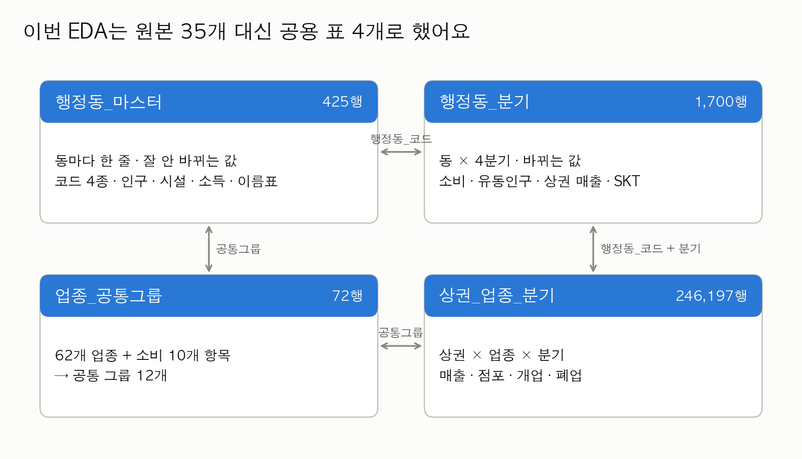
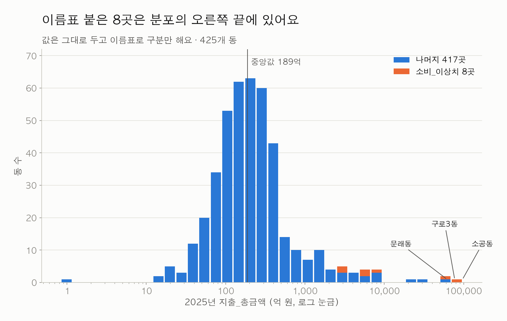
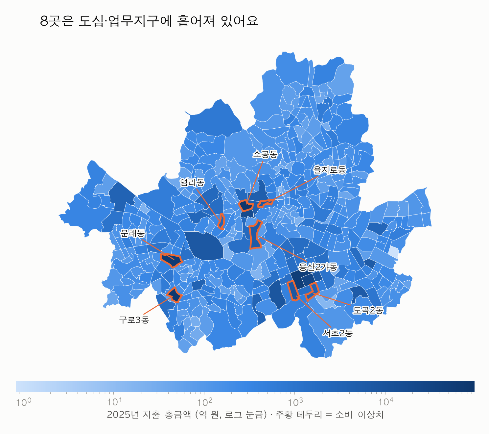
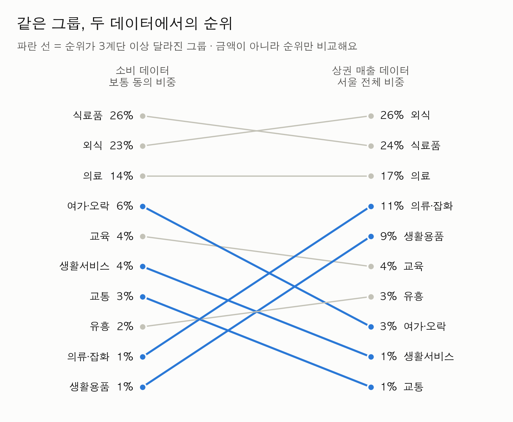
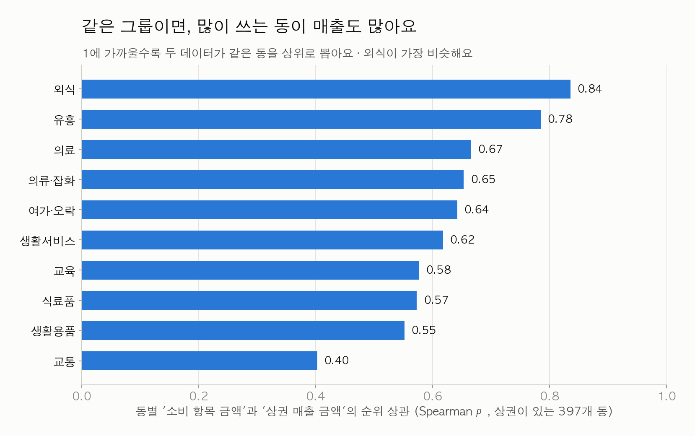
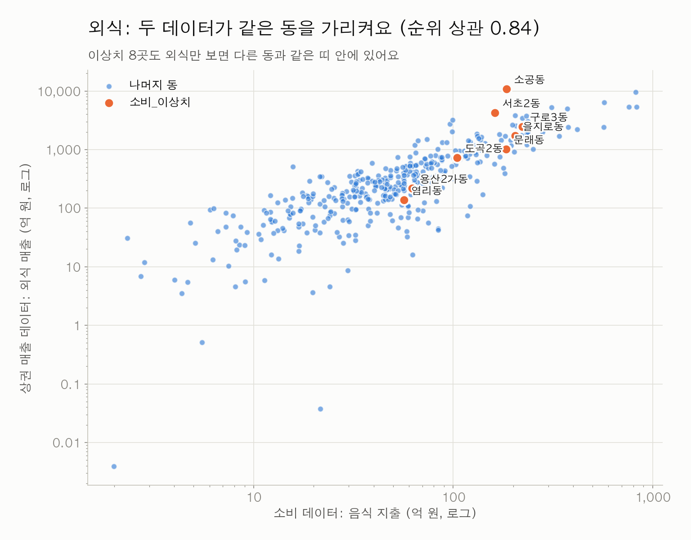
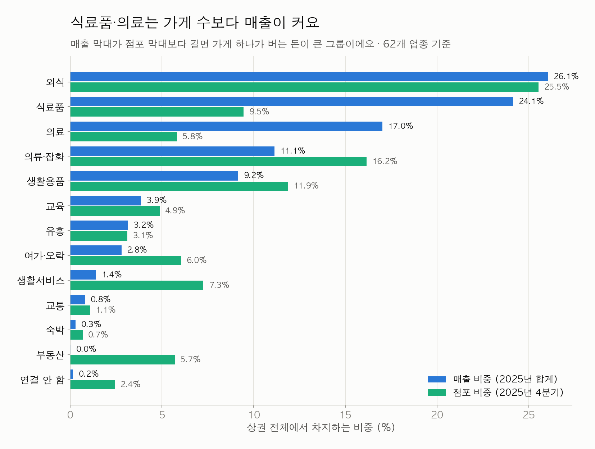
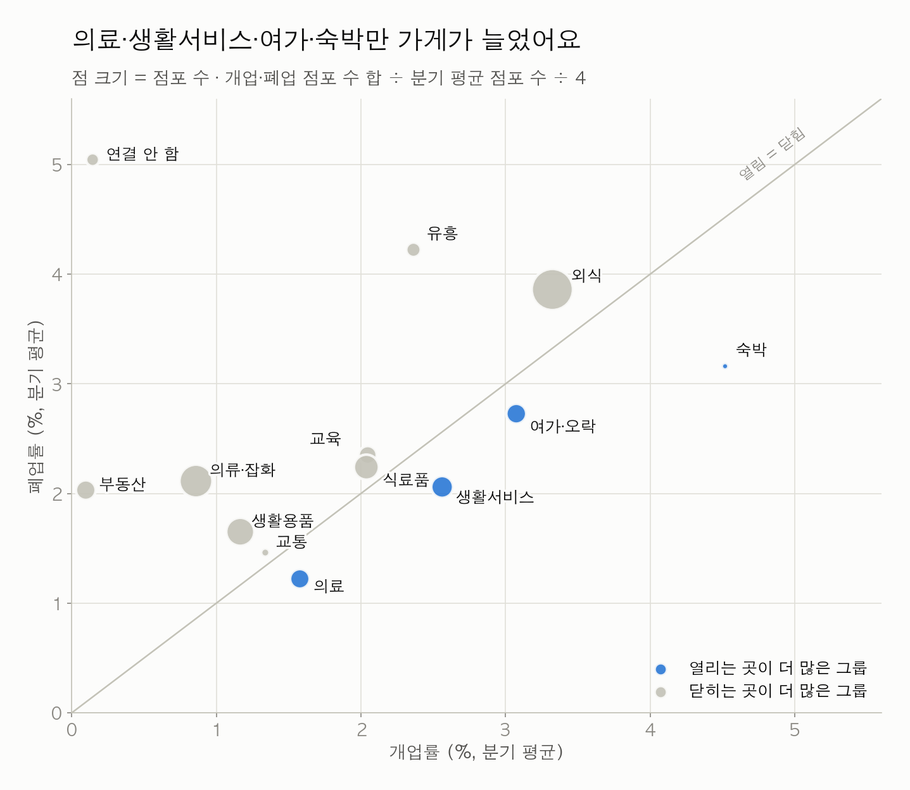
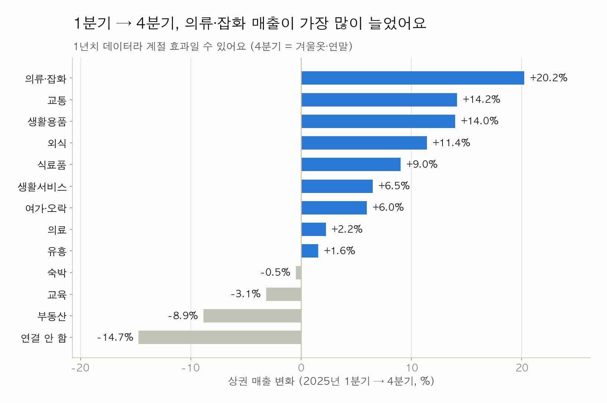
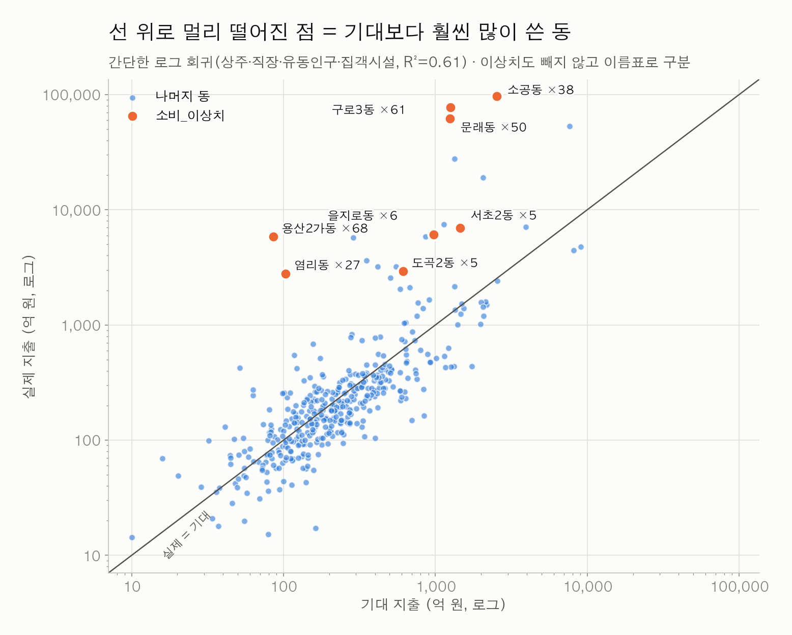

# 2025 공용 전처리 표 EDA: 그림으로 보는 `data/processed`

> [data/PREPROCESSING.md](../data/PREPROCESSING.md)의 규칙으로 만든 **공용 표 4개**를 가지고 EDA를 다시 했어요.
> 원본으로 한 첫 EDA는 [EDA_raw_2025.md](EDA_raw_2025.md)에 그대로 있어요.
> 그림은 [eda_processed_2025.py](eda_processed_2025.py)로 다시 만들 수 있어요.
> 순서: `python scripts/build_processed_2025.py` → `python 김지영/eda_processed_2025.py`

## 먼저 세 줄 요약

1. **이름표 붙은 8곳이 서울 지출의 49%예요.** 값은 지우지 않고 주황색 이름표로 구분만 했어요. 이 8곳은 분포의 오른쪽 끝, 소비 갭 순위의 1~5위에 있어요.
2. **공통 그룹으로 맞추니 두 데이터가 같은 동을 가리켜요.** 소비 데이터와 상권 매출 데이터에서 같은 그룹끼리 동 순위를 비교하면 상관이 0.40~0.84예요. 외식이 0.84로 가장 비슷해요.
3. **상권은 대부분의 그룹에서 문 닫는 가게가 더 많아요.** 가게가 늘어난 그룹은 의료, 생활서비스, 여가·오락, 숙박 4개뿐이에요.

### 첫 EDA와 달라진 점

| | 첫 EDA ([EDA_raw_2025.md](EDA_raw_2025.md)) | 이번 EDA |
|:---|:---|:---|
| 재료 | 원본 35개 | 공용 표 4개 (같은 동 코드, 같은 분기) |
| 소비 이상치 | 따로 표시하지 않음. 생활 소비로 다시 재는 방법을 제안함 | **값은 그대로 두고 `소비_이상치` 이름표로 구분** (팀 결정) |
| 업종 | 상권 62개 업종을 그대로 | **12개 공통 그룹**으로 묶어서 소비 데이터와 맞대 봄 |
| 그림의 주황색 | 여러 뜻으로 씀 | **이상치 이름표에만** 씀 |

---

## 1. 이번 재료: 공용 표 4개



- 마스터와 분기 표는 `행정동_코드`로, 상권 표는 `행정동_코드 + 분기`로 이어져요.
- 업종 이름은 `공통그룹` 컬럼 하나로 소비 데이터와 연결돼요.
- 원본에 없는 값은 0으로 채우지 않고 빈칸으로 뒀어요 (7장).

---

## 2. 이름표 붙은 8곳

### 분포에서



- 보통 동의 1년 지출은 **189억**(중앙값)이에요.
- 이름표 붙은 8곳은 약 2,800억~9.7조로, 오른쪽 끝에 있어요. 맨 끝 세 곳이 문래동, 구로3동, 소공동이에요.
- 이 8곳이 서울 지출의 **49%** 를 차지해요. 그래서 서울 합계나 평균을 쓸 때는 이름표를 꼭 같이 봐야 해요.

### 지도에서



- 도심(소공동·을지로동), 서남권(문래동·구로3동), 용산(용산2가동), 마포(염리동), 강남(서초2동·도곡2동)에 흩어져 있어요.
- 8곳 모두 지출의 90% 넘게가 한 항목이에요. 6곳은 여가·문화, 용산2가동은 식료품, 서초2동은 기타예요.

```python
master[master["소비_이상치"]][["행정동_명", "소비_최대항목", "소비_최대항목_비중"]]
```

---

## 3. 공통 그룹으로 두 데이터 맞대 보기

두 데이터는 재는 대상이 달라요(소비 지출 53조, 상권 매출 93조). 그래서 **금액이 아니라 순위만** 비교했어요.

### 그룹 순위



- 위쪽 세 그룹(식료품·외식·의료)은 두 데이터에서 모두 1~3위예요.
- **의류·잡화, 생활용품**은 상권 매출에서 훨씬 높아요(9위 → 4위, 10위 → 5위). 소비 데이터의 '의류·신발', '생활용품' 항목이 상권 쪽보다 작게 잡히는 것으로 보여요.
- **여가·오락, 생활서비스, 교통**은 반대로 상권 매출에서 낮아요.

### 같은 그룹이면 같은 동이 위에 오나



- 동마다 '소비 데이터의 그 항목 금액'과 '상권 매출의 그 그룹 금액'을 놓고 순위 상관을 구했어요. 대상은 상권이 있는 397개 동이에요.
- **외식(0.84), 유흥(0.78)** 은 두 데이터가 거의 같은 동을 상위로 뽑아요.
- **교통(0.40)** 이 가장 약해요. 상권의 교통 그룹은 자동차수리·자동차미용·자전거뿐이라, 소비의 '교통'과 담는 범위가 달라서 그런 것으로 보여요.
- 10개 그룹 모두 상관이 0.4 이상이라, 공통 그룹 매핑(소비 '기타' → 생활서비스 포함)이 크게 어긋나지 않는다는 근거가 돼요.

### 외식을 점으로



- 점 하나가 동 하나예요. 오른쪽 위로 갈수록 두 데이터 모두 외식이 많은 동이에요.
- 이름표 붙은 8곳도 **외식만 보면 다른 동들과 같은 띠 안**에 있어요. 이 동들은 여가·문화 같은 한 항목만 튀는 거예요.

---

## 4. 상권: 공통 그룹으로

### 매출과 가게 수



- **식료품**(매출 24% / 점포 10%)과 **의료**(17% / 6%)는 가게 수보다 매출이 커요. 가게 하나가 버는 돈이 큰 그룹이에요.
- **생활서비스**(1% / 7%)와 **부동산**(0% / 6%)은 반대예요. 부동산중개업은 추정매출이 거의 잡히지 않아요.
- 외식은 매출과 가게 수 모두 26% 안팎으로 1위예요.

### 열리는 가게와 닫히는 가게



- 대각선 아래(파랑)는 열린 가게가 더 많은 그룹이에요. **의료, 생활서비스, 여가·오락, 숙박** 4개뿐이에요.
- 외식은 분기마다 3.3%가 열리고 3.9%가 닫혀요. 가게가 많고 경쟁도 치열해요.
- **부동산**(개업 0.1% / 폐업 2.0%)과 **연결 안 함**(전자상거래업, 0.1% / 5.0%)은 빠르게 줄고 있어요.

### 1분기 → 4분기 매출 변화



- **의류·잡화 +20%**, 교통 +14%, 생활용품 +14%, 외식 +11% 순으로 늘었어요.
- 부동산 −9%, 교육 −3%는 줄었어요.
- 1년치뿐이라 계절 효과(4분기 겨울옷·연말)인지 추세인지는 아직 알 수 없어요.

---

## 5. 소비 갭 맛보기, 이름표와 함께



- 상주·직장·유동인구와 집객시설로 '기대 지출'을 만들고(로그 회귀, R² = 0.61), 실제 지출과 비교했어요. 직장인구가 없는 11개 동은 빠졌어요.
- 이상치도 **빼지 않고** 그대로 넣었어요. 주황 점이 이름표 붙은 동이에요.

| 순위 | 동 | 실제 ÷ 기대 | 이름표 | 가장 큰 항목 |
|---:|:---|---:|:---:|:---|
| 1 | 용산2가동 | ×68 | ✅ | 식료품 99% |
| 2 | 구로3동 | ×61 | ✅ | 여가·문화 99% |
| 3 | 문래동 | ×50 | ✅ | 여가·문화 99% |
| 4 | 소공동 | ×38 | ✅ | 여가·문화 98% |
| 5 | 염리동 | ×27 | ✅ | 여가·문화 96% |
| 6 | 역삼2동 | ×21 | | 기타 75% |
| 7 | 수서동 | ×20 | | 여가·문화 83% |
| 8 | 신대방2동 | ×10 | | 교통 87% |
| 9 | 회현동 | ×9 | | 교통 83% |
| 10 | 회기동 | ×8 | | 의료비 63% |

- 1~5위가 모두 이름표 붙은 동이에요. 순위표를 볼 때는 **이름표 열을 같이 보는 게** 꼭 필요해요.
- 6~9위는 이름표가 없지만 한 항목에 75~87%가 몰려 있어요. 이름표 기준(90%) 바로 아래의 동이라, 해석할 때 `소비_최대항목_비중`도 같이 봐요.

---

## 6. 빈칸 현황

| 표 | 컬럼 | 비어 있는 곳 | 이유 |
|:---|:---|:---|:---|
| 마스터 | `총_직장_인구_수` | 11개 동 | 원본에 없음 |
| 마스터 | `아파트_*` | 둔촌1동 | 재건축 |
| 마스터 | `SKT_코드` | 항동 | SKT 데이터에 없음 |
| 분기 | `상권_*` | 26개 동 × 4분기 | 상권이 없는 동 |
| 분기 | `SKT_*` | 항동 × 4분기 | SKT 데이터에 없음 |
| 상권_업종_분기 | `당월_매출_*` | 160,465행 | 점포는 있지만 추정매출 원본에 행이 없음 |

---

## 7. 다음에 하면 좋을 것

1. **소비 갭 모델 다듬기**: 변수 추가(아파트 시가, 자치구 소득, SKT 1인가구 비율 등). 결과표에는 항상 `소비_이상치` 열을 붙여요.
2. **공통 그룹별 소비 갭**: 외식처럼 두 데이터가 잘 맞는 그룹부터 그룹별 갭을 구해요.
3. **창업 위험도**: 그룹별 개업·폐업률(4장)을 상권 단위로 내려서 변수로 만들어요.
4. **의류·잡화·생활용품 차이 확인**: 소비 데이터에서 왜 작게 잡히는지 원본 항목 정의를 확인해요.
