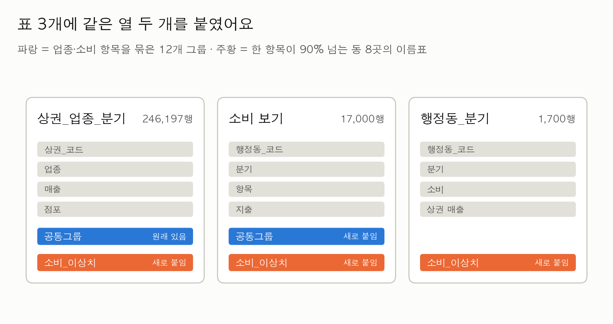
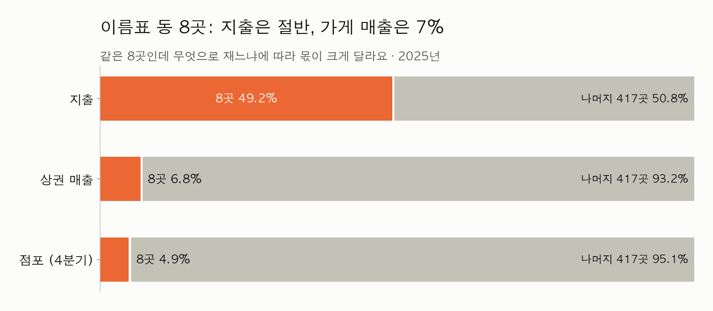
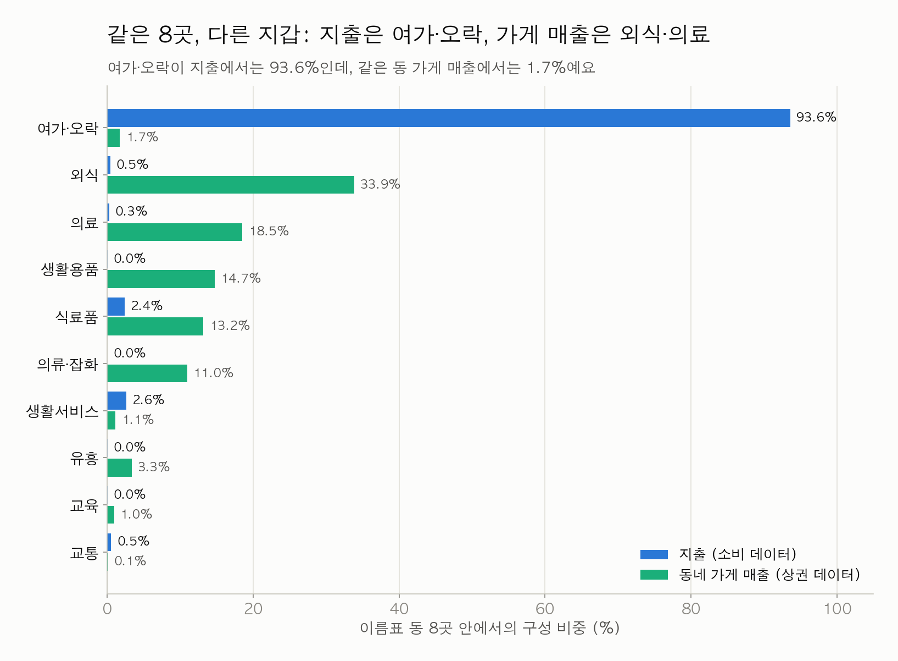
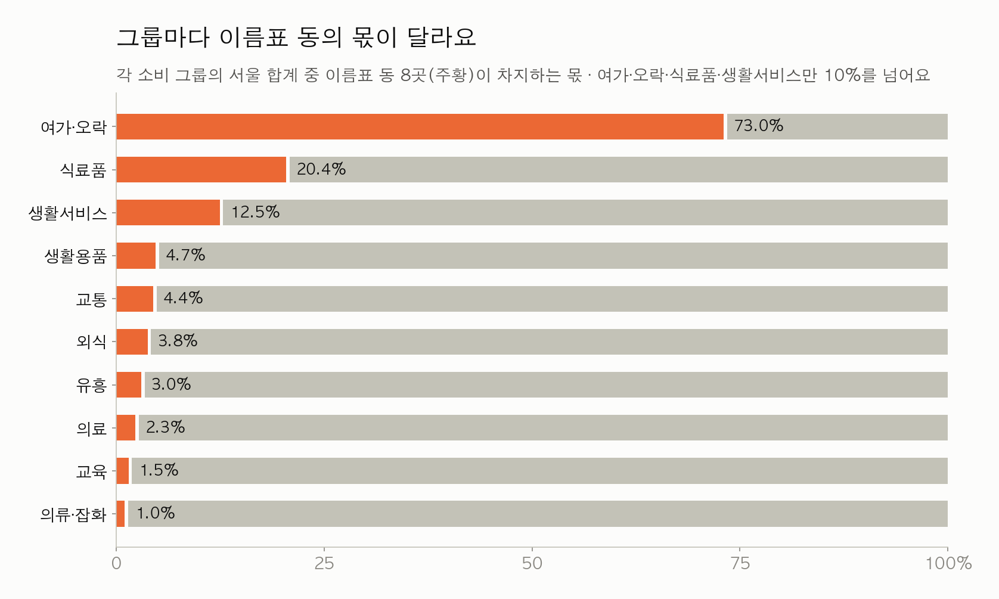
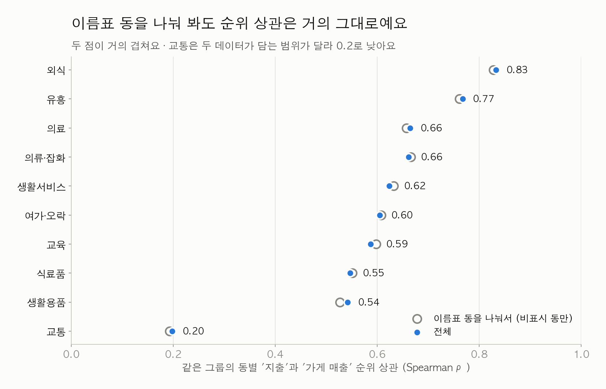
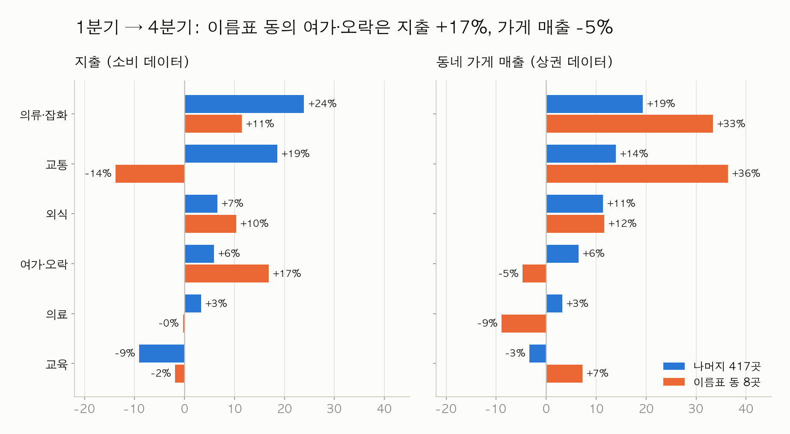
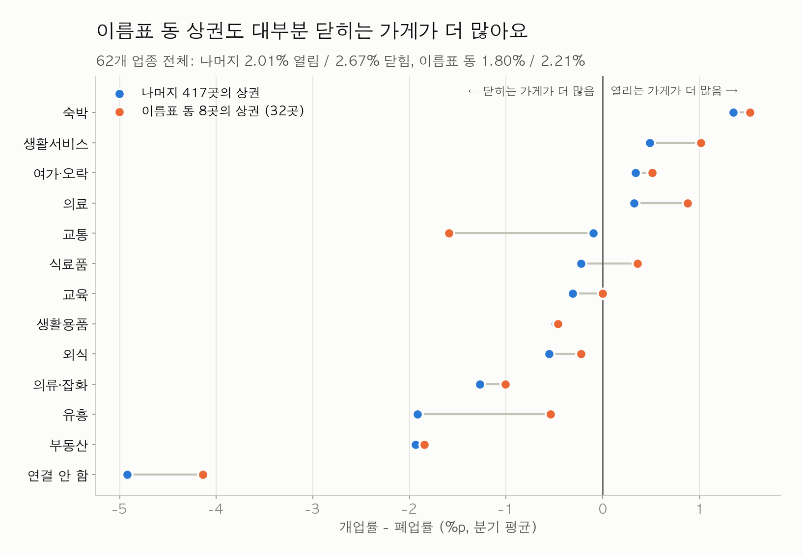
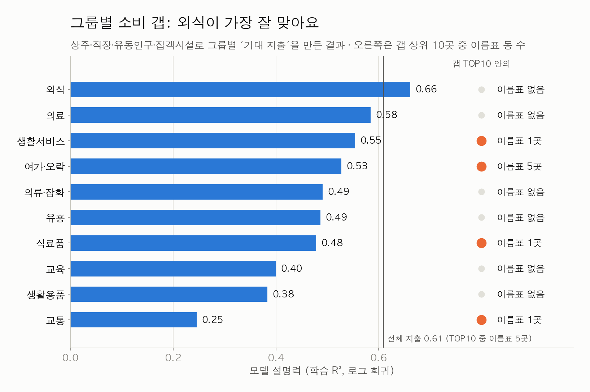
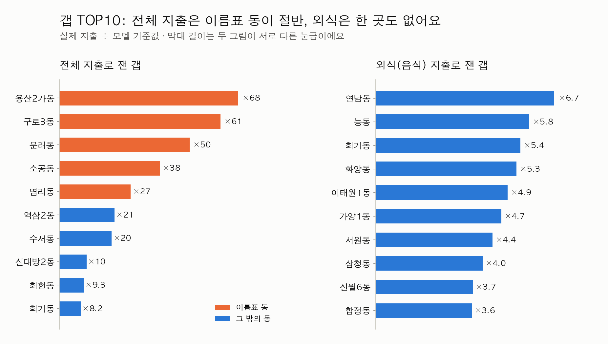

# 2025 EDA: `공통그룹` · `소비_이상치` 열을 붙여서 다시 보기

> 공용 전처리 표에 **`공통그룹`과 `소비_이상치` 두 열을 붙여서**, 소비·상권 매출·점포·개폐업을 같은 두 기준으로 나눠 봤어요.
> 그림과 표는 [eda_1019.py](eda_1019.py)로 다시 만들 수 있어요 (저장소 루트에서 `python3 김지영/eda_1019.py`).
> 이전 EDA: [EDA_raw_2025.md](EDA_raw_2025.md) (원본) · [EDA_processed_2025.md](EDA_processed_2025.md) (공용 표) · [eda_1017.md](eda_1017.md) (재검증)

## 먼저 세 줄 요약

1. **이름표 동 8곳은 지출의 49%인데, 가게 매출로는 7%, 점포로는 5%뿐이에요.** 무엇으로 재느냐에 따라 같은 8곳의 크기가 7배 넘게 달라져요.
2. **이 8곳의 지출은 94%가 여가·오락인데, 그 동네 가게 매출에서 여가·오락은 2%예요.** 가게 매출은 외식·의료 중심이라 다른 동과 비슷해요. 이 지출 대부분은 동네 가게에서 생긴 돈이 아니라는 뜻이에요.
3. **공통그룹으로 쪼개면 외식이 가장 잘 맞고, 외식 갭 상위 10곳에는 이름표 동이 없어요.** 소비 갭은 외식 그룹부터 시작하는 게 안전해요.

### 이전 EDA와 달라진 점

| | 이전 | 이번 |
|:---|:---|:---|
| 나누는 기준 | 업종 또는 이상치 중 하나씩 | **`공통그룹` × `소비_이상치`** 두 열로 함께 나눔 |
| 매출이 비어 있는 칸 | 공용 표에서 0원으로 합쳐진 값 사용 | **결측으로 되살려서** 계산 (`sum(min_count=1)`) |
| 그룹별 순위 상관 | 0.40~0.84 ([EDA_processed_2025.md](EDA_processed_2025.md)) | **0.20~0.83** (관측된 동만, 5장) |

---

## 1. 열 두 개를 붙였어요



- **`공통그룹`** 은 상권 62개 업종과 소비 10개 항목을 12개 그룹으로 묶은 이름이에요. 상권 표에는 원래 있고, 소비 항목에는 이번에 붙였어요.
- **`소비_이상치`** 는 한 항목이 지출의 90%를 넘는 동 8곳의 이름표예요. 마스터 표에서 `행정동_코드`로 가져와 세 표에 모두 붙였어요.
- 이름표 동은 **빼지 않았어요.** 모든 비율은 "이름표 동 8곳 / 나머지 417곳"으로 나눠서 낸 값이에요.

```python
flags = master[["행정동_코드", "소비_이상치"]]
trade_v = trade.merge(flags, on="행정동_코드")               # 공통그룹은 이미 있음
cons_v = (panel.melt(id_vars=["행정동_코드", "기준_년분기_코드"], value_vars=소비_항목_10개,
                     var_name="원본코드", value_name="지출")
               .merge(mapping[["원본코드", "공통그룹"]], on="원본코드")
               .merge(flags, on="행정동_코드"))
```

전체 코드는 [eda_1019.py](eda_1019.py)의 `build_views()`에 있어요.

---

## 2. 이름표 동 8곳은 얼마나 큰가요?



- **지출로 재면 49.2%**, 서울의 절반이에요.
- **동네 가게 매출로 재면 6.8%**, 점포 수로 재면 4.9%예요. 이 8곳에는 상권이 32곳(서울 1,650곳 중) 있어요.
- 같은 동인데 숫자가 이렇게 다르면, 지출 데이터가 "동네 가게에서 쓴 돈"을 재는 게 아니라는 신호예요.

---

## 3. 같은 8곳, 다른 지갑



- 이름표 동의 **지출은 여가·오락이 93.6%** 예요.
- 그런데 같은 동의 **가게 매출에서 여가·오락은 1.7%** 예요. 나머지 417곳(2.9%)보다도 낮아요.
- 가게 매출은 **외식 33.9%, 의료 18.5%, 생활용품 14.7%, 식료품 13.2%** 로, 보통 상권과 비슷한 모양이에요.
- 대형 가맹점이나 플랫폼의 결제 주소가 그 동으로 잡혔다는 추정과 맞는 결과예요. 다만 이것만으로 증명되지는 않아요.

---

## 4. 그룹마다 이름표 영향이 달라요



- 여가·오락 지출의 **73%**, 식료품의 **20%**, 생활서비스의 **12%** 가 이름표 동에서 나와요.
- 나머지 7개 그룹(외식·의료·교육 등)에서는 **5% 아래**예요. 이 그룹들은 이름표 동이 결과를 크게 흔들지 않아요.
- 식료품의 20%는 대부분 **용산2가동**(지출의 98.7%가 식료품) 한 곳에서, 생활서비스의 12%는 대부분 **서초2동**(기타 90.5%)에서 나와요.

---

## 5. 순위로 비교하면 흔들리지 않아요



- 같은 그룹에서 "지출이 많은 동이 가게 매출도 많은가"를 순위 상관으로 쟀어요.
- 이름표 동을 나눠 봐도 값이 **0.015 안에서만** 움직여요. 순위 비교는 이름표 동에 강하고, 금액 합계나 비중만 크게 흔들려요.
- **외식(0.83)** 이 가장 비슷하고, **교통(0.20)** 은 거의 관련이 없어요. 상권 쪽 교통 그룹은 자동차수리·자동차미용·자전거뿐이라, 소비의 '교통'과 담는 범위가 달라요.

> ⚠️ [EDA_processed_2025.md](EDA_processed_2025.md)의 순위 상관(0.40~0.84)은 매출이 비어 있는 칸을 0으로 센 값이에요. 관측된 동만 쓰면 교통은 0.40이 아니라 **0.20**이에요.

---

## 6. 2025년 1년 동안의 흐름



- 서울 지출 증가분의 74%가 이름표 동에서 나왔어요 (eda_1017). 그 증가는 이름표 동의 **여가·오락 지출 +17%** 에서 와요.
- 그런데 같은 동의 **가게 여가·오락 매출은 −5%** 예요. 지출과 가게 매출이 반대로 움직여요.
- 나머지 417곳에서는 **의류·잡화가 지출 +24%, 가게 매출 +19%** 로 같은 방향으로 크게 늘었어요.
- 1년치 데이터라 계절 효과(4분기는 겨울옷·연말)인지 추세인지는 아직 알 수 없어요.

---

## 7. 열리는 가게 vs 닫히는 가게



- 점이 0보다 **왼쪽**이면 1년 동안 닫힌 가게가 더 많았던 그룹이에요. **대부분 왼쪽**에 있어요.
- 이름표 동의 상권(주황)도 나머지와 비슷한 모양이에요. 전체로 보면 분기마다 1.8%가 열리고 2.2%가 닫혀서, 나머지(2.0% / 2.7%)보다 조금 조용해요.
- 오른쪽(가게가 늘어난 그룹)은 **숙박, 생활서비스, 여가·오락, 의료**예요. 이름표 동에서는 식료품도 조금 늘었어요.
- 이름표 동 상권은 32곳뿐이라, 그룹별 차이는 작은 숫자의 영향을 크게 받아요.

---

## 8. 공통그룹별 소비 갭

### 어느 그룹이 잘 맞나



- 상주·직장·유동인구와 집객시설로 그룹마다 '기대 지출'을 만들고, 실제 지출과 비교했어요 (로그 회귀, 414개 동).
- **외식이 R² 0.66으로 가장 잘 맞아요.** 전체 지출(0.61)보다도 높아요.
- 갭 상위 10곳에 이름표 동이 끼는 그룹은 **여가·오락(5곳)** 과 생활서비스·식료품·교통(1곳씩)뿐이에요.

### 갭 상위 10곳: 전체 지출 vs 외식



- **전체 지출**로 재면 1~5위가 모두 이름표 동이에요(용산2가동 ×68, 구로3동 ×61 …).
- **외식**으로 재면 이름표 동이 한 곳도 없어요. 연남동, 능동, 회기동, 화양동, 이태원1동처럼 외식 상권으로 알려진 동이 위에 와요.
- 그래서 **소비 갭은 외식 그룹부터** 만드는 게 안전해요. 여가·오락 그룹의 갭은 이름표 열 없이 읽으면 안 돼요.
- 갭은 "더 살펴볼 동" 신호예요. 그 자체로 창업 기회나 수익성을 뜻하지는 않아요.

---

## 9. 쓸 때 조심할 것

| 무엇이 | 어떻게 다른가 | 어떻게 하면 되나 |
|:---|:---|:---|
| **매출 빈칸이 0원으로** | 공용 `행정동_분기`에서 장위3동·개포1동 × 4분기(8행)가 0원이에요. 동·분기·그룹 조합으로는 5,171개가 실제로는 빈칸인데 0으로 합쳐져 있어요. | 합칠 때 `sum(min_count=1)`을 써요. 공용 생성 코드는 아직 고치지 않았어요. |
| **음수 지출 2건** | 방이2동 2025Q3 생활용품 −537,000원, 종로5·6가동 2025Q4 기타(생활서비스) −355,000원이에요. 두 동 모두 이름표는 없어요. | 값은 그대로 두고, 로그를 씌울 때만 따로 처리해요. |
| **그룹별 0 이하 지출** | 1년 지출이 0 이하인 동이 유흥 6곳, 교통 4곳, 생활용품 2곳이에요. | 로그 갭 모델에서만 그 그룹의 해당 동을 빼요. |
| **교통 그룹** | 소비의 '교통'과 상권의 교통 업종(자동차수리 등)이 담는 범위가 달라요. 순위 상관이 0.20이에요. | 공통그룹 비교에서 따로 표시하거나 빼요. |
| **90% 바로 아래의 쏠린 동** | 역삼2동(기타 75%), 회현동·신대방2동(교통 83~87%)은 이름표가 없지만, 생활서비스·교통 갭에서 수백 배로 튀어요. | 해석할 때 `소비_최대항목_비중`을 같이 봐요. |
| **아주 작은 기준값** | 이름표 동의 부동산 매출 +257%처럼, 기준 금액이 거의 0인 칸은 변화율이 크게 튀어요. | 변화율을 읽기 전에 금액 크기부터 확인해요. |

---

## 10. 다음에 하면 좋을 것

1. **분석 결과표에는 `공통그룹`과 `소비_이상치`를 항상 같이 적기**: 순위표·지도·그래프 모두요.
2. **공용 생성 코드 고치기**: 매출 합계를 `sum(min_count=1)`로, 공통그룹 피벗의 `fill_value=0`을 빼기.
3. **외식 갭부터 다듬기**: 변수 추가(아파트 시가, 자치구 소득, SKT 1인가구 비율), 자치구 교차검증 (eda_1017 9장 방식).
4. **교육 갭 원인 확인**: 보라매동(×66)·명동(×55)·반포본동(×46)이 교육 갭 상위인 이유를 아직 몰라요.

---

<details>
<summary><b>부록: 숫자 표 전체</b> (펼치기)</summary>

### A. 소비: 공통그룹 × 소비_이상치 (2025년 합계, 조 원)

'구성'은 그 그룹(표시/비표시) 안에서 합계로 낸 비중이고, '동 중앙값'은 동마다 비중을 구한 뒤의 중앙값이에요.

| 공통그룹 (소비 항목) | 서울 합계 | 표시 동 몫 | 비표시 구성 | 표시 구성 | 비표시 동 중앙값 | 표시 동 중앙값 |
|---|---:|---:|---:|---:|---:|---:|
| 여가·오락 (여가·문화) | 33.369 | 73.03% | 33.44% | 93.59% | 5.66% | 94.66% |
| 생활서비스 (기타) | 5.531 | 12.45% | 17.99% | 2.65% | 3.67% | 0.16% |
| 교통 (교통) | 3.215 | 4.43% | 11.42% | 0.55% | 2.63% | 0.20% |
| 외식 (음식) | 3.144 | 3.76% | 11.24% | 0.45% | 23.01% | 1.55% |
| 식료품 (식료품) | 3.026 | 20.41% | 8.95% | 2.37% | 25.75% | 0.64% |
| 의료 (의료비) | 2.874 | 2.29% | 10.43% | 0.25% | 14.28% | 0.24% |
| 교육 (교육) | 0.769 | 1.48% | 2.82% | 0.04% | 3.96% | 0.03% |
| 의류·잡화 (의류·신발) | 0.465 | 1.01% | 1.71% | 0.02% | 1.51% | 0.04% |
| 유흥 (유흥) | 0.314 | 3.01% | 1.13% | 0.04% | 1.77% | 0.04% |
| 생활용품 (생활용품) | 0.246 | 4.74% | 0.87% | 0.05% | 1.02% | 0.07% |

### B. 상권 매출·점포: 공통그룹 × 소비_이상치

매출은 관측된 값만 더했어요(조 원). 점포 구성은 2025년 4분기 기준이에요. 관측률은 상권·업종·분기 행 중 매출값이 있는 행의 비율이고, 실제 시장 포괄률이 아니에요.

| 공통그룹 | 관측 매출 | 표시 동 몫 | 비표시 구성 | 표시 구성 | 점포 비표시 | 점포 표시 | 관측률 비표시 / 표시 |
|---|---:|---:|---:|---:|---:|---:|---:|
| 외식 | 24.147 | 8.86% | 25.49% | 33.85% | 25.50% | 26.27% | 52.1% / 63.7% |
| 식료품 | 22.376 | 3.72% | 24.95% | 13.17% | 9.57% | 7.28% | 36.3% / 38.2% |
| 의료 | 15.767 | 7.43% | 16.91% | 18.54% | 5.76% | 6.80% | 41.1% / 52.5% |
| 의류·잡화 | 10.325 | 6.71% | 11.16% | 10.97% | 15.75% | 24.25% | 30.1% / 35.9% |
| 생활용품 | 8.486 | 10.95% | 8.75% | 14.71% | 11.70% | 14.96% | 19.4% / 32.0% |
| 교육 | 3.569 | 1.70% | 4.06% | 0.96% | 5.00% | 2.51% | 40.3% / 23.5% |
| 유흥 | 2.930 | 7.20% | 3.15% | 3.34% | 3.13% | 2.67% | 67.4% / 68.0% |
| 여가·오락 | 2.588 | 4.26% | 2.87% | 1.75% | 6.14% | 3.96% | 30.2% / 34.6% |
| 생활서비스 | 1.302 | 5.41% | 1.43% | 1.11% | 7.45% | 3.60% | 40.8% / 34.5% |
| 교통 | 0.737 | 1.10% | 0.84% | 0.13% | 1.11% | 0.34% | 23.7% / 20.6% |
| 숙박 | 0.269 | 34.22% | 0.21% | 1.46% | 0.68% | 0.61% | 31.0% / 37.7% |
| 연결 안 함 | 0.141 | 0.49% | 0.16% | 0.01% | 2.49% | 1.58% | 8.9% / 19.2% |
| 부동산 | 0.020 | 2.21% | 0.02% | 0.01% | 5.73% | 5.16% | 1.7% / 4.5% |

### C. 같은 그룹끼리 동 순위 상관 (Spearman)

| 공통그룹 | 동 수 | 전체 | 비표시 동만 (동 수) |
|---|---:|---:|---:|
| 외식 | 395 | 0.833 | 0.828 (387) |
| 유흥 | 357 | 0.767 | 0.761 (349) |
| 의료 | 338 | 0.664 | 0.657 (331) |
| 의류·잡화 | 352 | 0.661 | 0.666 (344) |
| 생활서비스 | 387 | 0.623 | 0.632 (379) |
| 여가·오락 | 356 | 0.605 | 0.608 (349) |
| 교육 | 352 | 0.587 | 0.597 (346) |
| 식료품 | 379 | 0.547 | 0.551 (371) |
| 생활용품 | 350 | 0.542 | 0.527 (342) |
| 교통 | 230 | 0.198 | 0.193 (226) |
| (참고) 전체 지출 vs 전체 매출 | 397 | 0.733 | — |

### D. 1분기 → 4분기 변화 (%)

| 공통그룹 | 소비 비표시 | 소비 표시 | 매출 비표시 | 매출 표시 |
|---|---:|---:|---:|---:|
| 의류·잡화 | +23.9 | +11.4 | +19.3 | +33.4 |
| 교통 | +18.5 | −13.8 | +13.9 | +36.4 |
| 외식 | +6.6 | +10.3 | +11.4 | +11.6 |
| 여가·오락 | +5.9 | +16.9 | +6.5 | −4.7 |
| 의료 | +3.4 | −0.3 | +3.2 | −8.9 |
| 생활서비스 | +0.0 | −4.2 | +6.1 | +14.4 |
| 식료품 | −1.1 | +2.7 | +9.3 | +2.5 |
| 유흥 | −1.7 | +2.0 | +1.4 | +3.7 |
| 생활용품 | −4.0 | −2.5 | +13.2 | +21.0 |
| 교육 | −9.1 | −1.9 | −3.3 | +7.3 |
| 숙박 | — | — | −0.3 | −0.7 |
| 부동산 | — | — | −11.6 | (+256.9) |
| 연결 안 함 | — | — | −14.9 | (+36.5) |

괄호 값은 기준 금액이 아주 작아서 해석하지 않아요.

### E. 개업·폐업률 (%)

비율 = 4개 분기 개업(폐업) 점포 수 합 ÷ 4개 분기 전체 점포 수 합 × 100

| 공통그룹 | 개업 비표시 | 개업 표시 | 폐업 비표시 | 폐업 표시 |
|---|---:|---:|---:|---:|
| 외식 | 3.34 | 3.05 | 3.89 | 3.27 |
| 숙박 | 4.53 | 4.19 | 3.18 | 2.67 |
| 여가·오락 | 3.07 | 3.17 | 2.73 | 2.66 |
| 생활서비스 | 2.54 | 3.46 | 2.05 | 2.44 |
| 유흥 | 2.33 | 3.25 | 4.24 | 3.79 |
| 식료품 | 2.02 | 2.46 | 2.25 | 2.10 |
| 교육 | 2.05 | 1.75 | 2.37 | 1.75 |
| 의료 | 1.56 | 1.86 | 1.24 | 0.98 |
| 교통 | 1.36 | 0.32 | 1.45 | 1.91 |
| 생활용품 | 1.19 | 0.75 | 1.68 | 1.21 |
| 의류·잡화 | 0.87 | 0.72 | 2.14 | 1.73 |
| 연결 안 함 | 0.14 | 0.28 | 5.06 | 4.41 |
| 부동산 | 0.10 | 0.09 | 2.04 | 1.93 |
| **전체 62업종** | **2.01** | **1.80** | **2.67** | **2.21** |

### F. 공통그룹별 소비 갭 모델 (학습 R², 414개 동)

| 대상 | 동 수 | 학습 R² | TOP10 중 표시 동 | 갭 TOP5 (실제 ÷ 모델 기준값) |
|---|---:|---:|---:|---|
| 외식 | 414 | 0.662 | 0 | 연남동 ×6.7, 능동 ×5.8, 회기동 ×5.4, 화양동 ×5.3, 이태원1동 ×4.9 |
| 의료 | 414 | 0.584 | 0 | 회기동 ×36.1, 무악동 ×31.3, 연희동 ×17.5, 능동 ×9.0, 반포4동 ×8.3 |
| 생활서비스 | 414 | 0.554 | 1 | 역삼2동 ×375.2, 대치4동 ×159.2, 서초2동 ×103.0(표시), 용답동 ×82.1, 남영동 ×48.0 |
| 여가·오락 | 414 | 0.527 | 5 | 염리동 ×551.7(표시), 구로3동 ×540.2(표시), 문래동 ×462.3(표시), 소공동 ×210.2(표시), 수서동 ×179.6 |
| 의류·잡화 | 414 | 0.491 | 0 | 방화2동 ×60.0, 진관동 ×27.4, 문정2동 ×20.7, 대치2동 ×18.1, 가산동 ×17.8 |
| 유흥 | 408 | 0.487 | 0 | 이태원1동 ×26.8, 서원동 ×10.7, 능동 ×10.5, 화양동 ×9.9, 가양1동 ×9.6 |
| 식료품 | 414 | 0.478 | 1 | 용산2가동 ×235.0(표시), 회현동 ×8.6, 월계3동 ×6.0, 가락1동 ×5.4, 노량진2동 ×5.1 |
| 교육 | 414 | 0.399 | 0 | 보라매동 ×65.8, 명동 ×54.8, 반포본동 ×45.7, 대치4동 ×19.2, 이화동 ×17.9 |
| 생활용품 | 412 | 0.383 | 0 | 능동 ×27.6, 한강로동 ×21.1, 서초3동 ×17.0, 문정2동 ×15.9, 신대방2동 ×13.7 |
| 교통 | 410 | 0.246 | 1 | 회현동 ×675.0, 신대방2동 ×424.2, 수서동 ×163.0, 면목5동 ×76.5, 가양1동 ×70.2 |
| (참고) 전체 지출 | 414 | 0.609 | 5 | 용산2가동 ×68.0, 구로3동 ×61.2, 문래동 ×49.6, 소공동 ×38.2, 염리동 ×27.0 (모두 표시) |

직장인구가 없는 11개 동은 모든 모델에서 빠졌고, 그룹별로 0 이하인 동을 더 뺐어요. 이번에는 학습 R²만 구했고 자치구 교차검증은 하지 않았어요.

</details>
