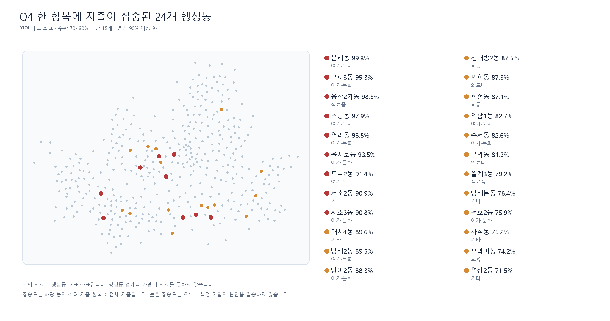
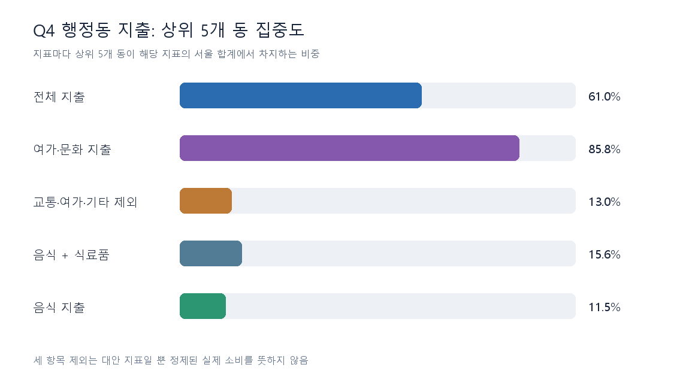
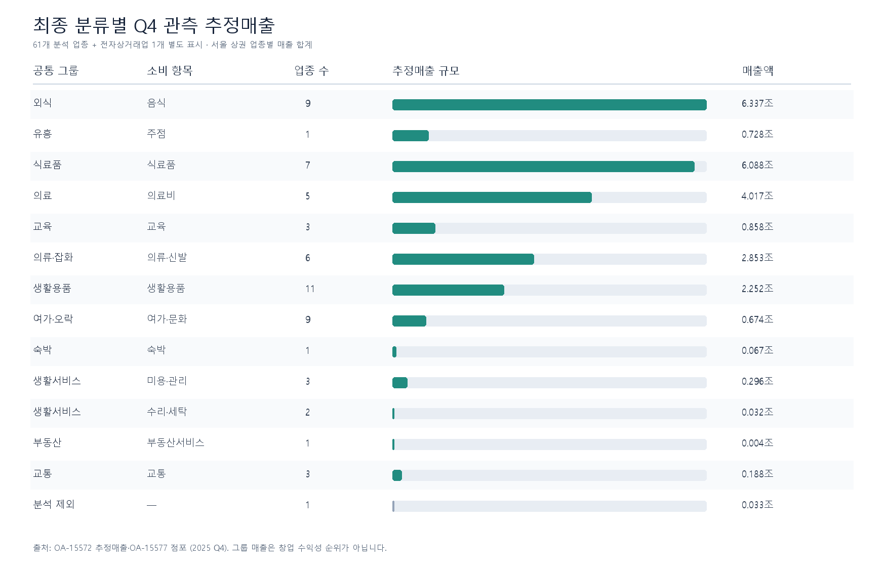
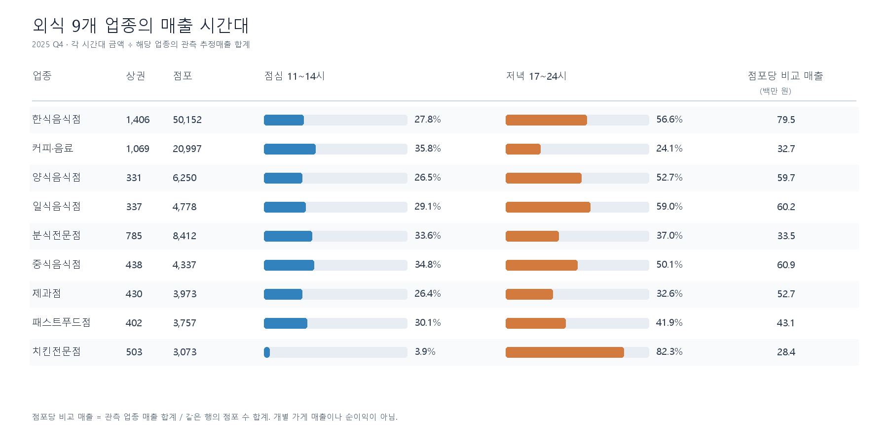
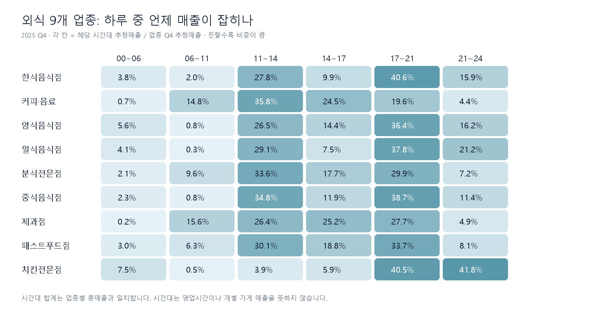
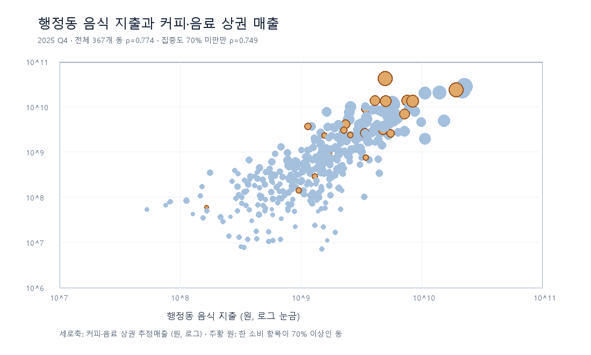

# 박성은 EDA: 서울 동네의 특징과 창업 상권 살펴보기

> **분석 자료:** 저장소 `data/raw/`의 2025년 자료. 동네 특징과 지출 비교는 2025년 4분기(Q4)를 기준으로 하고, 첨부된 16개 동 보고서와의 대조에는 2025년 연간 합계를 별도로 사용했다. 원천 CSV는 바꾸지 않았다.

**이 파일이 박성은 EDA의 통합 보고서다.** 행정동 생활권, 소비 이상치, 팀 최종 업종 분류, 상권·업종 매출과 외식 9개 업종 세부 분석, 연령 분석을 이 순서로 정리했다. 본문의 그림과 CSV 링크에서 근거 수치를 확인할 수 있고, 원천 소비 10개 항목을 조건별로 살펴보려면 [소비 이상치 대시보드](SpotFit_소비이상치_EDA_대시보드.html)를 내려받아 열면 된다. 대시보드는 상권 추정매출 62개 업종을 분류하는 파일이 아니라 행정동 소비 원천을 탐색하는 보조 자료다.

## 먼저 읽는 결론

- **한 항목에 지출이 몰린 행정동은 24개**다. 2025년 연간 기준으로 8개 동은 한 항목 비중이 90% 이상, 첨부 보고서의 16개 동은 70% 이상 90% 미만이다. Q4에는 각각 **9개·15개**이며 24개 동의 집합은 같다. 이들은 Q4 전체 지출의 **76.7%**를 차지하지만 음식 지출에서는 **12.8%**를 차지한다. 집중도는 **추가 확인 신호**이지 데이터 오류나 특정 기업의 거래 원인을 입증하지 않는다.
- 서울의 **행정동 425개** 중 414개 동은 ‘일하는 사람이 상대적으로 많은가’와 ‘오가는 사람 중 20·30대가 상대적으로 많은가’라는 두 질문으로 **4가지 생활권 프로필**을 만들 수 있었다. 직장인구 자료가 없는 **11개 동은 분류하지 않았다**. 이 유형은 지출액을 사용하지 않아 집중도 표시와 별개다.
- Q4 추정매출 자료의 **62개 업종**을 팀 최종 분류표에 따라 빠짐없이 배정했다. **외식 9개와 유흥·주점 1개**를 분리하고, 전자상거래업 1개는 분석 제외로 따로 표시한다. 나머지 61개 업종은 공통 그룹과 소비 항목으로 비교한다.
- 외식 9개 안에서도 차이가 크다. **한식은 외식 추정매출의 62.9%**, 커피·음료는 10.8%다. 커피·제과는 낮 시간, 치킨은 저녁 17~24시에 매출이 몰린다. 업종별 거래 금액과 행정동 분포도 달라 외식 총액만으로 한 업종의 후보지를 고르지 않는다.
- 20대와 30대를 따로 보면 동네 특징이 달라진다. Q4 유동인구 중 20대 비중이 가장 높은 동은 **신촌동 48.1%**, 30대 비중이 가장 높은 동은 **역삼1동 27.6%**다.
- 상권의 **매출 총액만으로 창업 장소를 고르면 위험**하다. 2025 Q4 매출이 관측된 상권 1,565개 중 상위 16개가 전체 관측 매출의 **26.9%**를 차지했다. 가게가 많은 곳은 매출 총액도 커지기 쉽다.
- 음식점·카페를 살펴볼 때 행정동의 **전체 지출액만 보면 다른 항목의 큰 거래에 끌릴 수 있다.** Q4 전체 지출의 상위 5개 동 비중은 **61.0%**지만, 음식 지출의 상위 5개 동 비중은 **11.5%**다. `교통·여가·기타`를 제외해도 식료품 등 다른 항목의 집중은 남는다. 음식 지출이 높은 동은 커피 점포도 많은 경향이 있어 경쟁을 같이 봐야 한다.

**이 문서의 4가지 생활권 프로필은 팀의 금융 MBTI(L/V·E/P·S/G)와 별개**다. 동네의 관측된 특징을 쉽게 설명하려는 첫 분류이며, 창업 성공 여부나 추천 결과를 뜻하지 않는다. 다른 팀원 보고서는 구성 방식을 참고했지만, 아래 계산은 `박성은` 폴더의 스크립트로 원천 CSV에서 다시 했다.

## 이 문서에서 쓰는 말

| 말 | 쉽게 말하면 |
|---|---|
| EDA | 데이터가 어떻게 생겼는지 먼저 살펴보고, 다음에 확인할 질문을 찾는 작업 |
| 행정동 | 소공동·역삼1동처럼 행정 업무를 위해 나눈 ‘동’. 이번 자료에는 425개가 있다. |
| 상권 | 서울시가 가게들이 모인 곳을 구역으로 묶은 것. 한 동에 여러 상권이 있을 수 있다. |
| 유동인구 | 그곳을 오가는 사람의 **추정 규모**. 실제 서로 다른 방문객 수와 같다고 보지 않는다. |
| 추정매출 | 원천 자료가 추정한 매출. 가게의 확정 장부 매출이나 순이익이 아니다. |
| 중앙값 | 수치를 작은 순서로 놓았을 때 한가운데 값. 몇몇 아주 큰 동의 영향을 덜 받는다. |
| 점포당 매출 | 상권·업종 매출 합계를 점포 수 합계로 나눈 **비교용 숫자**. 개별 가게의 예상 매출이 아니다. |
| 업종 | 원천이 구분한 가게 종류. 한식·중식·치킨·커피처럼 나뉘지만 한식 안의 메뉴까지는 나뉘지 않는다. |
| 공통 그룹·소비 항목 | 팀 최종 분류표가 **추정매출 업종에 붙인 분석용 이름**. 행정동 소비 원천의 10개 지출 열을 새로 만든 값이 아니다. |
| 한 항목 집중도 | 한 동의 10개 지출 항목 중 가장 큰 금액 ÷ 그 동의 전체 지출. 70%와 90%는 **검토용 구간**이다. |
| IQR 상단 | 전체 지출액의 3사분위수에 사분위범위의 1.5배를 더한 값. **금액이 큰 동**을 찾는 규칙이며 한 항목 집중도와는 다른 질문이다. |

자료를 연결하는 순서는 **행정동(425개) → 그 동에 배정된 상권(1,650개) → 상권 안의 업종별 매출·점포 수**다. 399개 동에는 상권이 하나 이상 배정되어 있다. Q4에 매출 행이 있는 상권은 1,565개이고, 이들은 397개 동에 배정된다. 나머지 동·상권은 **매출이 0원이라고 확인된 것이 아니라 이 파일에 매출 행이 없는 것**이다.

## 1. 행정동을 4가지 생활권 프로필로 보면

### 두 질문으로 나누었다

1. **일터 쪽인가, 생활 쪽인가?** 동의 `직장인구 ÷ 상주인구`를 계산했다. 서울에서 값이 있는 414개 동의 중앙값은 **0.111**이다. 이보다 높으면 ‘일터’, 낮으면 ‘생활’이라고 **상대적으로** 표시했다. ‘일터’라고 해서 그 동의 직장인이 주민보다 반드시 많다는 뜻은 아니다.
2. **오가는 사람 중 20·30대가 많은 편인가?** `(20대 유동인구 + 30대 유동인구) ÷ 전체 유동인구`를 계산했다. 425개 동의 중앙값은 **29.1%**다. 이보다 높으면 ‘2030’, 낮으면 ‘전연령’으로 표시했다. ‘전연령’은 모든 연령이 고르게 섞였다는 뜻이 아니라 **2030 비중이 서울 동의 중앙값보다 낮다**는 뜻이다.

각 값이 기준값과 정확히 같으면 높은 쪽에 넣었다. 직장인구 자료가 없는 11개 동은 ‘자료 없음’으로 남겼다. 실제 고객이 주민인지 방문객인지, 소비자가 20·30대인지 직접 측정한 유형은 아니다.


| 생활권 프로필 | 동 수 | 직장인구/상주인구 중앙값 | 2030 유동 비중 중앙값 | 음식·식료품 중 음식 비중 중앙값 | Q4 한 항목 70% 이상 동 |
|---|---:|---:|---:|---:|---:|
| 일터·2030 | **139** | 0.35 | 35.9% | 63.2% | 15 |
| 일터·전연령 | **68** | 0.23 | 25.6% | 50.4% | 4 |
| 생활·2030 | **74** | 0.06 | 34.1% | 49.1% | 3 |
| 생활·전연령 | **133** | 0.05 | 25.4% | 37.3% | 2 |
| 직장인구 자료 없음 | **11** | 계산 불가 | 계산 가능 | 계산 가능 | 0 |

마지막 두 열은 유형을 만드는 데 **사용하지 않은 값**이다. 음식 지출과 식료품 지출을 합친 금액 중 음식 지출 비율은 일터·2030형에서 63.2%, 생활·전연령형에서 37.3%였다. 일터·2030형 139개 중 15개는 전체 지출이 한 항목에 70% 이상 몰렸다. 생활권 유형과 지출 집중 여부를 함께 보되, 이것만으로 외식 선호나 카페 수익성을 판단하지 않는다.

### 실제 동을 읽는 예시

| 동 | 유형 | 직장인구/상주인구 | 2030 유동 비중 | 주말 하루 유동/평일 하루 유동 | 자료에서 읽히는 특징 |
|---|---|---:|---:|---:|---|
| 역삼1동 | 일터·2030 | 5.93 | 50.2% | 0.71배 | 직장인구 비율이 높고, 주말 유동은 평일보다 적다. |
| 대치1동 | 일터·전연령 | 0.77 | 13.3% | 1.02배 | 직장인구 비율은 서울 동의 중간보다 높지만, 2030 유동 비중은 낮다. |
| 신림동 | 생활·2030 | 0.058 | 60.3% | 1.11배 | 젊은 유동 비중은 높지만, 직장인구/상주인구는 낮다. |
| 삼양동 | 생활·전연령 | 0.005 | 24.4% | 1.09배 | 두 기준 모두 서울 동의 중간보다 낮다. |

주말/평일 비율은 각각 **하루 평균 유동인구**를 비교한 값이다. 1보다 작으면 주말 하루 평균이 평일 하루 평균보다 적다는 뜻이다. 두 값이 비슷해도 시간대나 방문 목적은 다를 수 있다. 이 표는 창업 적합도를 매긴 순위가 아니다.

### 425개 동을 한눈에 보기

아래 격자는 **25개 자치구의 425개 동을 모두 한 칸씩** 표시한다. 칸의 색은 생활권 유형, 검은 점은 분류 기준값에 가까운 동을 뜻한다. 회색 11칸은 직장인구 자료가 없어 유형을 정하지 않은 동이다. **칸의 위치는 실제 지도상의 위치가 아니며**, 자치구별로 동 이름을 나열한 것이다. [큰 그림으로 보기](eda_figures/Q4_425개_행정동_유형격자.png)


격자에서 보이는 차이를 숫자로 확인하면, **강남구 22개 동 중 19개**는 두 ‘일터’ 유형에 속하고 2개는 직장인구 자료가 없다. **관악구 21개 동 중 17개**는 두 ‘2030’ 유형에 속한다. **도봉구 14개 동 중 12개**는 ‘생활·전연령’이다. 같은 구 안에서도 동마다 유형이 다르므로 구 전체에 하나의 유형을 붙이지 않았다.

점 그래프에는 **직장인구 자료가 있는 414개 동**을 하나씩 찍었다. 가로축은 직장인구/상주인구, 세로축은 2030 유동 비중이다. 굵은 선이 서울 동의 중앙값이어서 네 영역이 만들어진다. 가로축은 값의 차이가 커 **로그 눈금**을 사용했다. 직장인구가 없는 11개 동은 이 그래프에 찍을 수 없지만 위 격자와 결과표에는 포함된다.


**[425개 행정동별 결과표](eda_tables/Q4_행정동_생활권_프로필.csv)**에서 자기 동의 유형, 두 기준의 실제 수치, 주말 유동, 음식·식료품 지출과 별도 열의 Q4·연간 집중도 구간을 확인할 수 있다. 원천에 `?`로 나온 일부 동 이름은 화면 표시용 `·`로 바꿨다. 동을 연결할 때는 이름이 아닌 코드를 썼다.

### 유형을 얼마나 조심해서 읽어야 하나

- 두 기준 가운데 하나라도 중앙값에 가까운 동은 **76개**다(기준값 앞뒤 순위 5%p). 결과표에 `중앙값 근처`라고 표시했다. 이 동들의 유형은 기준을 조금 바꾸면 달라질 수 있다.
- 2030 유동 비중을 2025 Q1로 바꿔 같은 Q4 기준에 대입하면, 직장인구 자료가 있는 414개 동 중 **12개 동의 2030/전연령 표시가 달라진다**. 시기에 따라 달라질 수 있는 스냅샷이다.
- ‘일터·2030’과 ‘생활·전연령’이 어떤 창업 아이템에 유리하다는 **검증 결과는 아직 없다**. 유형은 추천 모델의 정답이 아니라 동네를 읽는 출발점이다.

## 2. 동네에서 실제로 무엇이 많이 쓰였나

### 16개 동 보고서의 숫자를 원천과 맞춰 보면

첨부 보고서의 **16개 동**은 `OA-22166_소비_행정동.csv`의 **2025년 네 분기를 동 코드별로 합산**했을 때, 10개 지출 항목 중 가장 큰 항목이 전체의 **70% 이상 90% 미만**인 집단과 정확히 일치한다. 같은 연간 기준으로 **90% 이상 8개 동**도 있다. Q4만 따로 보면 70% 이상 90% 미만이 **15개**, 90% 이상이 **9개**다. 서초3동이 연간 89.0%에서 Q4 90.8%로 옮겨 갔다. **70% 이상 24개 동의 집합은 연간과 Q4가 같다.** 원천 1,700행 모두에서 10개 항목 합계가 전체 지출과 일치했다.

이 24개 동은 **2025년 매 분기 70% 이상**이었고, 네 분기 모두 가장 큰 항목의 종류도 같았다. 일시적인 한 분기 현상으로 보기는 어렵다. 다만 지출 항목이 한쪽으로 몰렸다는 사실은 데이터 오류, 온라인 결제, 본사 주소 효과 또는 개별 기업의 거래 원인을 구분해 주지 않는다. 첨부 보고서의 기업·시설 연결 설명은 **조사 가설**로 두고, 가맹점 또는 거래 단위의 근거가 확보되기 전까지 EDA의 확정 원인으로 쓰지 않는다.

| 첨부 보고서의 연간 70~90% 미만 동 | 최대 항목 | 연간 비중 | Q4 비중 | Q4 전체 지출 |
|---|---|---:|---:|---:|
| 대치4동 | 기타 | 89.7% | 89.6% | 1,915억 원 |
| 방배2동 | 여가·문화 | 89.6% | 89.5% | 876억 원 |
| 방이2동 | 여가·문화 | 89.3% | 88.3% | 1,397억 원 |
| 서초3동 | 여가·문화 | 89.0% | **90.8%** | 2,162억 원 |
| 연희동 | 의료비 | 87.6% | 87.3% | 524억 원 |
| 신대방2동 | 교통 | 87.3% | 87.5% | 956억 원 |
| 천호2동 | 여가·문화 | 85.0% | 75.9% | 399억 원 |
| 수서동 | 여가·문화 | 83.2% | 82.6% | 1,340억 원 |
| 회현동 | 교통 | 83.0% | 87.1% | 4,695억 원 |
| 역삼1동 | 여가·문화 | 82.0% | 82.7% | 14,341억 원 |
| 월계3동 | 식료품 | 80.4% | 79.2% | 64억 원 |
| 무악동 | 의료비 | 80.2% | 81.3% | 34억 원 |
| 방배본동 | 기타 | 76.2% | 76.4% | 197억 원 |
| 보라매동 | 교육 | 75.6% | 74.2% | 135억 원 |
| 역삼2동 | 기타 | 74.9% | 71.5% | 7,058억 원 |
| 사직동 | 기타 | 73.5% | 75.2% | 595억 원 |



위 위치도는 **425개 동의 원천 대표 좌표**를 찍은 것이다. 행정동 경계나 보고서에 적힌 사업장 주소를 공간 검증한 지도가 아니다. 24개 동의 이름·코드, 10개 항목의 Q4 금액, 연간·Q4 집중도, 분기 지속 여부는 **[425개 동 지출 점검표](eda_tables/Q4_행정동_지출_민감도.csv)**에 있다.

### 총액만 보면 왜 해석이 달라지나

Q4 한 항목 비중 70% 이상인 24개 동은 서울 **전체 지출의 76.7%**를 차지한다. 그중 90% 이상 9개 동만 해도 전체의 **51.7%**다. 하지만 같은 24개 동이 서울 **음식 지출에서 차지하는 비중은 12.8%**다. 전체 지출을 음식점·카페 수요의 대표값으로 쓰면 항목 구성이 다른 동을 높은 수요로 오해하기 쉽다.



| 2025 Q4 지표 | 425개 동 합계 | 한 동의 중앙값 | 상위 5개 동 비중 | 상위 3개 동 |
|---|---:|---:|---:|---|
| 전체 지출 | 13.798조 원 | 48.18억 원 | **61.0%** | 소공동·구로3동·문래동 |
| 교통·여가·기타 제외 지출 | 2.729조 원 | 39.92억 원 | **13.0%** | 용산2가동·역삼1동·연희동 |
| 음식 + 식료품 지출 | 1.548조 원 | 24.28억 원 | **15.6%** | 용산2가동·서교동·종로1·2·3·4가동 |
| 음식 지출 | 0.809조 원 | 11.92억 원 | **11.5%** | 종로1·2·3·4가동·서교동·역삼1동 |

전체 지출의 **64.0%는 여가·문화**다. 이 항목만 보면 상위 5개 동 비중은 **85.8%**다. 세 항목을 뺀 값은 특정 왜곡 가능성을 비교하는 **대안 지표**이지 실제 ‘순수 생활소비’가 아니다. 예를 들어 그 지표와 음식+식료품 지표 모두에서 상위인 **용산2가동**은 Q4 전체 지출의 **98.5%가 식료품**이다. 세 항목을 빼도 다른 항목의 집중은 남는다. 반대로 의료·교육·교통 등 진짜 동네 활동을 통째로 제외하면 유효한 지출도 잃는다.

금액의 IQR 상단 **176.58억 원**을 넘는 동은 **52개**이고, 한 항목 70% 이상인 24개와 겹치는 동은 **21개**다. **보라매동·월계3동·무악동**은 금액이 IQR 상단보다 작아도 한 항목에 70% 이상 몰린다. 금액이 큰 동을 찾는 규칙만으로 항목 집중을 걸러낼 수 없다. 반대로 24개 동을 지우거나 모든 큰 금액에 상한을 씌우면 실제 동네 소비까지 버릴 수 있으므로, 원본·항목별·대안 지표를 **나란히 비교**한다.

행정동 **음식 지출**과 상권 **업종별 추정매출**은 조사 대상과 집계 방식이 다른 숫자다. 두 금액을 빼서 ‘아직 쓰지 않은 돈’이나 ‘소비 갭’을 만들지 않았다.

## 3. 업종을 더 자세히 보면

행정동의 특징은 동네 전체의 **배경**이고, 창업 후보를 볼 때는 **어느 상권의 어느 업종인지**까지 내려가야 한다. Q4 업종별 매출 21,333행을 점포 자료와 연결하면, 매출이 관측된 상권 1,565개를 행정동별·업종별로 다시 묶을 수 있다. 그 결과 관측된 `행정동 × 업종` 조합은 **11,594개**다. 동네 유동인구는 업종 행마다 여러 번 더하지 않고 동별로 한 번만 붙였다.

### 팀 최종 분류표로 62개 업종을 다시 묶기

Q4 추정매출 파일에는 **62개 업종**이 있고, 점포 파일에는 **100개 업종**이 있다. 점포에만 나타나는 38개 업종의 매출을 0원으로 채우지 않았다. 첨부된 최종 분류표의 14개 행에 매출이 관측된 62개 업종을 **중복·누락 없이 한 번씩** 배정했다. 전자상거래업 1개는 표대로 **분석 제외**하고 별도 표시한다. 원천의 `CS1/CS2/CS3` 업종 구분은 [62개 업종 결과표](eda_tables/Q4_62개_업종_현황.csv)에 참고 열로 남겼지만, 아래 해석에는 팀의 `공통 그룹 → 소비 항목 → 추정매출 업종` 분류를 쓴다.

| 공통 그룹 | 소비 항목 | 업종 수 | 매출 관측 상권 수 | Q4 추정매출(억 원) |
|---|---|---:|---:|---:|
| 외식 | 음식 | 9 | 1,462 | 63,374.1 |
| 유흥 | 주점 | 1 | 882 | 7,276.6 |
| 식료품 | 식료품 | 7 | 1,151 | 60,883.4 |
| 의료 | 의료비 | 5 | 707 | 40,171.2 |
| 교육 | 교육 | 3 | 758 | 8,582.3 |
| 의류·잡화 | 의류·신발 | 6 | 885 | 28,534.4 |
| 생활용품 | 생활용품 | 11 | 819 | 22,523.4 |
| 여가·오락 | 여가·문화 | 9 | 832 | 6,741.2 |
| 숙박 | 숙박 | 1 | 205 | 667.9 |
| 생활서비스 | 미용·관리 | 3 | 1,135 | 2,960.2 |
| 생활서비스 | 수리·세탁 | 2 | 455 | 322.7 |
| 부동산 | 부동산서비스 | 1 | 23 | 44.9 |
| 교통 | 교통 | 3 | 389 | 1,883.8 |
| **분석 제외** | — | **1** | **127** | **332.0** |



**분석 대상 61개 업종의 Q4 추정매출 합계는 24.3966조 원**, 제외 표시한 전자상거래업은 0.0332조 원이다. 62개 전체 합계 **24.4298조 원**은 원천 매출 행의 합계와 맞는다. 매출 관측 상권 수는 **그 분류 안의 중복 없는 상권 수**라 행끼리 더할 수 없다. 업종 수와 관측 범위도 다르므로 매출 규모만으로 창업 유망 순위를 정하지 않는다. 업종별 코드와 배정 결과는 [최종 분류표](eda_tables/Q4_최종_업종_소비항목_분류표.csv), 수치는 [그룹별 결과표](eda_tables/Q4_최종분류_그룹별_현황.csv)에서 확인할 수 있다.

행정동까지 내려가면 **외식 매출은 393개 동에서 관측되고 상위 5개 동의 비중이 15.8%**다. 식료품 매출은 **377개 동에서 관측되지만 상위 5개 동 비중이 48.0%**다. 같은 규모의 그룹 매출이라도 어디에 몰리는지는 다르다. [행정동 × 최종 분류 결과표](eda_tables/Q4_행정동_최종분류_추정매출.csv)에는 매출이 관측된 **397개 동의 3,966개 조합**과 점포·폐업 점포 수를 실었다. 없는 조합을 0원으로 간주하지 않았고, 전자상거래업은 `분석_포함=False`로 따로 표시했다.

**주의:** 이 분류표의 `소비 항목`은 상권 **추정매출 업종에 붙인 분석용 이름**이다. 행정동 소비 CSV에는 원래 **10개 지출 항목**만 있으며 `주점·숙박·미용·관리·수리·세탁·부동산서비스`라는 독립 열은 없다. 이름이 비슷한 `음식`도 두 원천의 조사 대상·집계 방식이 다르다. 따라서 새 그룹 매출과 행정동 지출을 같은 금액처럼 더하거나 빼지 않는다. 위 24개 이상치 동과 원천 소비의 10개 항목 집중도는 새 업종 분류로 다시 정의하지 않았다.

### 외식 9개를 나누어 비교

| 업종 | 매출 관측 상권 | 같은 행의 점포 수 | 추정매출(억 원) | 점심 11~14시 | 저녁 17~24시 |
|---|---:|---:|---:|---:|---:|
| 한식음식점 | 1,406 | 50,152 | 39,859.0 | 27.8% | 56.6% |
| 커피·음료 | 1,069 | 20,997 | 6,864.3 | 35.8% | 24.1% |
| 양식음식점 | 331 | 6,250 | 3,731.3 | 26.5% | 52.7% |
| 일식음식점 | 337 | 4,778 | 2,876.4 | 29.1% | 59.0% |
| 분식전문점 | 785 | 8,412 | 2,814.0 | 33.6% | 37.0% |
| 중식음식점 | 438 | 4,337 | 2,641.6 | 34.8% | 50.1% |
| 제과점 | 430 | 3,973 | 2,094.6 | 26.4% | 32.6% |
| 패스트푸드점 | 402 | 3,757 | 1,619.4 | 30.1% | 41.9% |
| 치킨전문점 | 503 | 3,073 | 873.6 | 3.9% | 82.3% |



호프·간이주점은 **유흥 → 주점**으로 분리했다. 이 업종의 Q4 추정매출은 **7,276.6억 원**, 점심 비중은 **6.0%**, 저녁 비중은 **64.0%**다. 외식 9개 업종의 시간대 비중은 **각 업종의 관측 매출 중 해당 시간대의 비율**이다. 점심과 저녁 외 시간대도 있으므로 두 열의 합이 100%일 필요는 없다. Q4 매출 행에서는 시간대별 금액 합계가 전체 매출과 모두 일치했다. 치킨의 저녁 비중은 82.3%로 높지만, 이것만으로 특정 동의 치킨 창업 수익을 예측할 수는 없다. 원천의 ‘한식음식점’을 국밥·고깃집 등 메뉴별 매출로 더 나눌 근거는 없다.

#### 외식 안에서도 거래 단위와 영업 시간대가 다르다

아래는 **외식 9개 업종만** Q4 원천 매출 5,701행에서 다시 계산한 값이다. 9개 합계는 위 분류표의 **63,374.1억 원**과 같다. `건당 매출`은 원천의 추정매출액을 매출건수로 나눈 값이며, 메뉴 가격이나 실제 영수증 평균을 뜻하지 않는다. `상권별 점포당 비교 매출 중앙값`은 **각 상권·업종의 추정매출 ÷ 같은 행의 점포 수**를 구한 뒤 업종별 중앙값을 낸 것으로, 한 점포의 실제 실적이나 이익이 아니다.

| 업종 | 외식 9개 매출 중 | 건당 매출 | 주말 매출 비중 | 상권별 점포당 비교 매출 중앙값 | 매출 관측 동 | 상위 5개 동 매출 비중 |
|---|---:|---:|---:|---:|---:|---:|
| 한식음식점 | 62.9% | 40,945원 | 25.6% | 5,050만 원 | 391 | 15.8% |
| 커피·음료 | 10.8% | 8,225원 | 25.0% | 1,334만 원 | 367 | 20.3% |
| 양식음식점 | 5.9% | 49,217원 | 32.0% | 2,921만 원 | 176 | 27.8% |
| 일식음식점 | 4.5% | 45,534원 | 23.0% | 3,946만 원 | 200 | 23.6% |
| 분식전문점 | 4.4% | 11,194원 | 25.1% | 1,908만 원 | 349 | 13.7% |
| 중식음식점 | 4.2% | 37,168원 | 25.7% | 3,680만 원 | 255 | 21.6% |
| 제과점 | 3.3% | 11,543원 | 26.3% | 3,992만 원 | 265 | 16.1% |
| 패스트푸드점 | 2.6% | 12,655원 | 29.6% | 2,076만 원 | 246 | 21.0% |
| 치킨전문점 | 1.4% | 36,947원 | 26.3% | 1,608만 원 | 299 | 16.4% |

**매출 총액은 한식에 크게 끌린다.** 한식 39,859.0억 원은 외식 9개 합계의 62.9%다. 커피·음료는 6,864.3억 원으로 10.8%다. 따라서 ‘외식 매출이 큰 동’을 곧바로 카페나 치킨 수요가 큰 동으로 읽으면 업종 차이가 사라진다. 건당 매출도 커피·음료 8,225원과 양식 49,217원처럼 차이가 나므로, 총매출과 건수를 함께 봐야 한다. 이 수치에는 원천 추정의 오차와 업종 안의 다양한 가게 형태가 섞여 있다.



**매출이 잡히는 시간도 다르다.** 커피·음료의 06~17시 세 구간은 합계 **75.1%**, 제과점은 **67.2%**다. 치킨은 17~21시 **40.5%**와 21~24시 **41.8%**를 합쳐 저녁 17~24시가 **82.3%**다. 양식의 주말 매출 비중은 **32.0%**, 일식은 **23.0%**지만, 주말은 한 주의 이틀이므로 이 두 비율만으로 하루 평균 주말 매출을 비교하지 않는다. 시간대 그림은 합계 100%가 되는 여섯 구간을 모두 보여 주며 영업시간·방문 목적은 알려 주지 않는다.

#### 행정동으로 내려가면 업종별 분포도 다르다

외식 9개 업종은 **393개 행정동**에서 매출이 관측됐고, 관측된 `행정동 × 업종` 조합은 **2,548개**다. 한식은 **391개 동**, 분식은 **349개 동**에서 관측되지만 양식은 **176개 동**에서 관측된다. 각 업종 매출 상위 5개 동의 비중은 양식 **27.8%**, 커피·음료 **20.3%**, 분식 **13.7%**다. 이는 업종마다 매출이 관측되는 공간 범위와 집중도가 다르다는 뜻이다. 관측 행이 없는 동을 매출 0원으로 채운 결과가 아니다.

예를 들어 **중구 소공동**에 배정된 상권 7개의 커피·음료 추정매출 합계는 **424.7억 원**, **용산구 이태원1동**에 배정된 상권 4개의 양식 합계는 **376.5억 원**이다. 두 숫자는 업종도 상권 수도 달라 바로 우열을 매기는 비교가 아니다. [행정동 × 외식 9개 업종 결과표](eda_tables/Q4_행정동_외식_9업종.csv)에서 동별 업종 매출·점포 수·관측 상권 수와 동 안의 외식 업종 비중을 확인하고, [외식 9개 세부지표](eda_tables/Q4_외식_9업종_세부지표.csv)에서 위 표의 원 단위 수치와 여섯 시간대 비중을 확인할 수 있다.

외식 업종의 **연령별 매출은 이번 표에서 제외했다.** Q4 외식 매출 5,701행 중 **5,201행(91.2%)**에서 여섯 연령대 금액 합계가 해당 행 총매출과 다르다. 행정동 유동인구의 연령 구성은 동네의 배경을 설명할 수 있지만, 이를 외식 업종별 실제 고객 연령으로 바꾸어 읽을 수 없다.

### 같은 업종이라도 수요와 경쟁을 함께 보기

**커피·음료**를 예로 보면, 음식 지출이 높은 동에 커피 매출이 관측되는 경향이 있다. 하지만 **커피 점포 수도 함께 많다.** 음식 지출 상위 25%의 동 107개 중 105개에서 커피 매출이 관측됐고, 그 105개 동에 배정된 상권의 커피 점포 수 중앙값은 **104개**다. 음식 지출 하위 25%에서는 107개 동 중 68개에서 커피 매출이 관측됐고, 이 68개의 점포 수 중앙값은 **10.5개**다. 매출 행이 없는 곳의 점포를 0개라고 간주한 비교가 아니다.



동네 단위에서 음식 지출과 커피 매출은 **함께 커지는 경향**이 있다. 커피 매출이 관측된 **367개 동**의 순위 상관계수는 **0.774**, 이 중 한 항목 집중도 70% 미만인 **344개 동**만 따로 계산하면 **0.749**다. 그림의 주황 원은 한 항목 집중도 70% 이상인 동이다. 관계가 소수의 집중 동에만 의존하지는 않지만, 두 금액은 서로 다른 원천이므로 같은 거래를 뜻하지 않는다.

같은 업종을 **상권끼리** 비교하면, 커피 매출은 상권 유동인구보다 **커피 점포 수**와 더 강하게 함께 커진다(순위 상관계수 각각 **0.246**, **0.738**). ‘순위 상관계수’는 두 숫자의 큰 순서가 얼마나 비슷한지를 보는 값으로, 1에 가까울수록 순서가 비슷하다. 가게가 여럿이면 **총매출**도 커질 수 있으므로, 이 결과가 점포 하나의 수익이 높다는 뜻은 아니다.

### 상권 매출의 크기와 분기 변화


Q4 매출이 관측된 상권 1,565개의 **상권별 매출 중앙값은 34.3억 원**이고, 상위 10%가 시작되는 값은 **349.1억 원**이다. 상위 16개 상권의 매출이 전체 관측 매출의 **26.9%**를 차지한다. 여기서 상권 16개는 앞 절의 **연간 한 항목 집중 행정동 16개와 다른 집합**이다. 큰 상권의 총매출만 보고 작은 골목 상권보다 창업에 낫다고 말할 수 없는 이유다.

2025년 네 분기 모두 매출이 있는 상권 1,560개를 같은 상권끼리 비교하면, Q1 대비 Q4 매출 변화율의 중앙값은 **+7.3%**, 매출이 늘어난 상권은 **1,124개**다. 이는 **2025년 안의 분기 비교**다. 2024년 같은 분기와 비교한 성장률은 이 저장소의 2025년 원천 자료만으로 계산할 수 없다.

상권의 ‘일터 성격’을 매출만으로 단정하기도 어렵다. **직장인구 밀도**(상권 면적 1ha당 직장인구)와 **평일 매출 비중**의 순위 상관계수는 **0.212**로 약했다. 평일 매출이 높아도 직장인구가 적은 상권, 그 반대인 상권이 함께 있다.


## 4. 20대와 30대를 나누어 동네를 보면

이전 4유형의 ‘2030’은 첫 설명용 합계다. 더 구체적인 분석에는 원천의 **연령대 10·20·30·40·50·60세 이상, 6개 열**을 사용한다. 행정동별로 유동인구·상주인구·직장인구를 **각각 다른 분모**로 나눠 비중을 계산했다. 아래 서울 값은 동별 비율의 평균이 아니라 인구 수를 먼저 합친 비율이다.


| Q4 유동인구 기준 | 20대 비중 | 30대 비중 | 읽을 수 있는 점 |
|---|---:|---:|---|
| 서울 425개 동 합산 | 16.0% | 16.7% | 비교 기준 |
| 신촌동 | 48.1% | 15.7% | 20대 비중이 특히 높다. |
| 역삼1동 | 22.6% | 27.6% | 30대 비중이 20대보다 높다. |
| 신림동 | 34.5% | 25.7% | 두 연령대가 모두 서울 합산 비중보다 높다. |

이 비율은 **그 동을 오가는 사람의 연령 구성**이다. 그 연령대가 어느 업종에서 얼마를 썼는지는 뜻하지 않는다. 동별 실제 인구 수와 6개 연령 비중은 **[425개 행정동 연령 결과표](eda_tables/Q4_행정동_연령_6구간.csv)**에 있다. 직장인구 자료가 없는 11개 동은 직장 연령 비중도 비워 두었다.

### 행정동별 숫자를 위치에서 보기

아래는 원천 영역 파일의 행정동 **대표 좌표 425개**에 각 동의 20대·30대 유동 비중을 색으로 표시한 위치도다. 같은 연령대 안에서 색이 진할수록 비중이 높다. 왼쪽과 오른쪽의 색 눈금 최대값이 각각 **50%와 30%**라서 색의 진하기를 두 지도 사이에서 직접 비교하지 않는다. 지도 아래에는 각 연령대의 비중 상위 3개 동과 수치를 적었다.


**[점별 수치 확인용 SVG 지도](eda_figures/Q4_행정동_연령_점별값.svg)**를 파일로 열어 점에 마우스를 올리면 해당 동의 코드, 전체 유동인구, 연령 6개 구간 비중을 볼 수 있다. GitHub에서 마우스 설명이 나타나지 않으면 SVG를 내려받아 브라우저에서 열면 된다.

이 그림은 **행정동 경계를 색칠한 지도가 아니라 대표 좌표를 찍은 지도**다. 보유한 2025년 말 경계 파일은 서울 427개 경계이고, 이번 분석의 425개 동과 코드가 바로 맞는 것은 422개다. **용신동·일원2동·상일동**은 경계 파일의 동 구분과 달라 그대로 색칠하면 잘못된 값이 된다. 경계 버전과 코드 대응을 검증하기 전까지는 위 위치도를 사용한다. 각 점의 정확한 숫자는 SVG 또는 연령 결과표에서 코드나 동 이름으로 찾을 수 있다.

## 5. SpotFit에서는 어떻게 쓸까

1. **동네 특징과 지출 집중을 함께 보여 준다.** ‘일터·2030’ 같은 생활권 프로필, 두 기준의 실제 숫자, `중앙값 근처`와 **Q4 한 항목 집중도**를 나란히 보여 준다. 지출 집중은 유형을 바꾸거나 동네를 자동 탈락시키는 규칙이 아니다.
2. **전체 지출 순위 대신 목적에 맞는 항목을 고른다.** 행정동 음식 지출은 별도 원천의 배경 정보로 보고, 상권 매출에서는 팀 최종 분류의 **외식/음식 9개 업종**과 **유흥/주점 1개 업종**을 구분한다. 교통·여가·기타 제외 지출과 음식+식료품 지출은 민감도 비교에만 쓴다. **한 항목 70% 이상인 동은 원본과 항목별 수치를 같이 표시**한다.
3. **공통 그룹에서 실제 업종까지 내려가 상권을 비교한다.** 61개 분석 대상 업종 중 창업자가 고른 업종의 매출·점포 수·폐업점포 수를 비교하고, 유동인구의 연령·요일·시간대도 확인한다. 전자상거래업은 팀 표대로 분석에서 제외 표시하지만 원천과 62개 전체 합계에는 남긴다. 본사 소재지나 시설 한 곳을 Q4 집계의 원인으로 단정하지 않는다.
4. **창업자 금융 MBTI는 따로 연결한다.** 팀의 L/V·E/P·S/G는 창업자와 상권에 대한 별도 설계다. 이 문서의 생활권 프로필은 그 옆에 붙는 **지역 설명**이다. 실제 임대료, 창업 비용, 손익, 현장 상황은 이 데이터에 없으므로 ‘수익이 보장되는 곳’으로 표현하지 않는다.

## 6. 숫자를 읽을 때의 제한

- **자료 시점:** 이 저장소의 원천은 2025년 Q1~Q4다. 2026년 현재의 점포 현황이나 2024년 대비 성장률을 말하지 않는다.
- **인구 변화:** 직장인구와 상주인구 원천은 각 상권의 2025년 네 분기 값이 동일하다. 이 값으로 분기별 인구 증가를 설명하지 않는다.
- **빠진 자료:** Q4 행정동 직장인구는 11개 동에서 없고, 상권 유동인구는 매출이 있는 상권 중 2개에서 없다. 빠진 값을 0으로 채우지 않았다.
- **연령의 의미:** 프로필의 2030은 **유동인구의 연령 비중**이다. 매출 파일의 연령별 금액은 Q4 업종 행 21,333개 중 12,637개(59.2%)에서 전체 매출과 합이 맞지 않아 고객의 완전한 연령 분포로 쓰지 않았다. 유동인구의 연령별 합계는 425개 동 중 293개에서 총계와 다르지만 최대 차이가 4명이다. 상주·직장인구의 연령별 합계는 각각 총계와 일치한다.
- **지도 단위:** 상권 파일에 적힌 행정동 코드로 상권을 동에 배정했다. 상권이 동 경계를 가로지르더라도 매출을 경계에 따라 나눈 값은 아니다. 상권이 없는 26개 동, Q4 상권 매출 행이 없는 28개 동은 ‘시장 없음’으로 해석하지 않는다.
- **업종 범위:** 점포 자료에는 있으나 매출 행이 없는 38개 업종은 매출을 0으로 채우지 않았다. 점포당 비교 매출은 업종·상권의 관측 총량을 나눈 값이지 실제 개별 점포의 실적이나 순이익이 아니다.
- **팀 최종 분류의 적용 범위:** Q4 매출이 관측된 62개 업종에만 적용해 61개를 분석 대상으로 두고 전자상거래업 1개는 별도 표시했다. `소비 항목`은 업종 연결용 이름이며, 행정동 소비 원천에 없는 항목의 지출액을 만들지 않았다. 업종 그룹의 관측 상권 수는 그룹마다 중복될 수 있다.
- **이상치의 의미:** 한 항목 비중 70%·90%와 전체 금액의 IQR 상단은 검토를 위한 규칙이다. 항목 집중도만으로 거래 위치, 가맹점, 법인 또는 집계 오류를 증명할 수 없다. 첨부된 사업자등록·SGIS 매핑 보고서의 주소와 기업 추정은 원천 소비 CSV만으로 재검증되지 않으며 원인 판정에 사용하지 않았다.
- **기간과 비교 지표:** 첨부 보고서의 16개는 2025년 연간 기준이고 이 EDA의 시각화·주요 순위는 Q4 기준이다. 세 항목 제외 지표나 음식+식료품 지표도 특정 항목의 집중을 모두 제거하지 않는다. 원본 24개 동을 일괄 삭제하거나 상한 보정을 확정 규칙으로 사용하지 않았다.
- **상관과 분류:** 같이 커진다는 관계는 원인·결과나 창업 성공을 증명하지 않는다. 행정동 소비와 상권 매출도 서로 다른 원천 지표여서 차감하지 않았다. 프로필 경계에 가까운 76개 동은 특히 조심해서 읽는다.

## 자료와 재현 방법

| 살펴본 내용 | 주로 사용한 원천 CSV (`data/raw/` 아래) |
|---|---|
| 행정동 프로필 | `OA-22178_길단위인구_행정동.csv`, `OA-22184_직장인구_행정동.csv`, `OA-22183_상주인구_행정동.csv`, `OA-22166_소비_행정동.csv` |
| 한 항목 집중도와 지출 민감도 | `OA-22166_소비_행정동.csv`의 2025Q1~Q4 10개 항목과 전체 지출. 연간은 네 분기 금액 합계의 비율, Q4는 Q4 행의 비율 |
| 상권·업종 매출과 점포 | `상권/OA-15572_추정매출_상권.csv`, `상권/OA-15577_점포_상권.csv` |
| 팀 최종 업종 분류 | 첨부된 최종 소비 항목 분류표를 `박성은/eda_final_industry_groups.py`에 옮김. 62개 코드·이름을 원천과 대조하고 [매핑 CSV](eda_tables/Q4_최종_업종_소비항목_분류표.csv)로 출력 |
| 상권을 동에 연결 | `상권/OA-15560_영역_상권.csv`, `OA-22160_영역_행정동.csv` |
| 유동인구와 자치구 이름 | `상권/OA-15568_길단위인구_상권.csv`, `OA-22167_소비_자치구.csv` |
| 업종 62개와 시간대 | `상권/OA-15572_추정매출_상권.csv`, `상권/OA-15577_점포_상권.csv` |
| 외식 9개 세부 거래·시간대·행정동 | `상권/OA-15572_추정매출_상권.csv`, `상권/OA-15577_점포_상권.csv`, `상권/OA-15560_영역_상권.csv` |
| 연령 6개 구간과 위치도 | `OA-22178_길단위인구_행정동.csv`, `OA-22183_상주인구_행정동.csv`, `OA-22184_직장인구_행정동.csv`, `OA-22160_영역_행정동.csv` |
| 경계 코드 대조 | `geo/HangJeongDong_ver20251231.geojson` |

저장소 루트에서 아래 네 명령을 실행하면 `pandas`와 `Pillow`로 분석 숫자를 다시 출력하고 이 문서의 PNG 그림 13개, 점별 수치 확인용 SVG 지도와 위에서 연결한 425개 동 지출·생활권 결과표, 62개 업종·최종 분류 매핑·그룹별·동별 결과표, 외식 9개 세부지표·행정동 결과표, 연령 결과표를 다시 만든다. 원천 파일은 읽기만 한다.

```bash
python 박성은/eda_raw_상권_2025.py
python 박성은/eda_raw_행정동_2025.py
python 박성은/eda_detail_2025.py
python 박성은/eda_dining_detail_2025.py
```
