# SpotFit 기본 EDA 보고서: 창업 성향 MBTI 대시보드를 위한 데이터 점검 (2025년)

> **이 보고서의 목적**: 우리 팀의 목표는 **"예비 창업자의 성향을 검사해 MBTI처럼 3글자 유형을 만들고, 그 유형에 맞는 상권·업종·정보를 한 화면에서 주는 대시보드"** 입니다. 이 보고서는 `data/raw/`의 2025년 원천 데이터로 **그 대시보드를 실제로 만들 수 있는지** 미리 확인합니다.
>
> **EDA(탐색적 데이터 분석)란?** 본격적으로 만들기 전에 데이터를 표와 그래프로 살펴보며 "쓸 수 있는 재료인지, 이상한 점은 없는지" 확인하는 단계입니다. 요리 전에 냉장고를 열어 재료를 확인하는 것과 같습니다.

- **작성**: 이승희 개인 분석 · 2026-10-12
- **기준 문서**: 팀의 유형 정의서 [김지영/금융_MBTI.md](../김지영/금융_MBTI.md) (L/V · E/P · S/G 세 기준, 8유형, 검사 15문항)
- **다시 만들기**: 저장소 루트에서 아래 명령을 실행하면 그래프(`eda_figures/`)와 요약표(`eda_tables/`)가 다시 만들어집니다.

```bash
uv run --no-project --with pandas,matplotlib,openpyxl,scikit-learn python 이승희/eda_raw_2025.py     # 0~9장
uv run --no-project --with pandas,matplotlib,openpyxl,scikit-learn python 이승희/eda_dong_2025.py    # 10장
uv run --no-project --with pandas,matplotlib,openpyxl,scikit-learn python 이승희/eda_check_2025.py   # 12장 신뢰도 점검
```

---

## 대시보드는 이렇게 움직입니다

```text
[1] 창업자 검사 15문항  ──►  [2] 3글자 유형 (예: VPG 트렌드 성장형)
                                         │
[3] 상권 1,650곳에도 데이터로 같은 3글자를 붙여 둠 ◄─┘ 같은 유형끼리 연결
                                         │
[4] 추천 화면: 같은 유형 상권 + 소비 잠재력 순위 + 업종 정보 카드 + 예산 필터
```

| 세 기준 | 창업자 쪽 (검사) | 상권 쪽 (데이터) |
| :--- | :--- | :--- |
| **L 생활형 / V 방문형** | 단골 손님이 좋은가, 새 손님이 좋은가 | 사는 사람에 비해 일하는 사람·지나가는 사람이 많은가 |
| **E 실속형 / P 프리미엄형** | 많이 싸게 팔까, 적게 비싸게 팔까 | 같은 업종끼리 비교했을 때 객단가가 높은가 |
| **S 안정형 / G 성장형** | 안전한 게 좋은가, 모험이 좋은가 | 매출이 늘고 새 가게가 많이 생기는가 |

## 이번 EDA가 답한 질문 8가지

| # | 질문 | 답 | 근거 |
| :--- | :--- | :--- | :--- |
| 1 | 상권에 L/V를 붙일 수 있나? | **가능** | 상권 종류별 순서가 상식과 맞음 (골목 < 전통시장 < 발달 < 관광특구) |
| 2 | 상권에 E/P를 붙일 수 있나? | **가능, 단 업종별로 비교해야 함** | 업종마다 객단가가 100배 넘게 달라 그냥 비교하면 업종 구성만 보게 됨 |
| 3 | 상권에 S/G를 붙일 수 있나? | **가능, 단 1년치라 조심** | 서울시 상권변화지표와 방향이 같음. 하지만 계절 효과가 섞임 |
| 4 | 세 기준이 서로 겹치지 않나? | **거의 안 겹침** | 세 점수끼리 상관계수 -0.03 ~ 0.15 |
| 5 | 8유형이 고르게 나뉘나? | **고르게 나뉨** | 유형마다 159~227곳 (10~15%) |
| 6 | 유형별 추천 업종이 데이터와 맞나? | **V(방문형)는 잘 맞고, L·P의 '카페' 추천은 안 맞음** | 유형별 업종 특화 지수 |
| 7 | 소비 잠재력을 계산할 수 있나? | **가능, 단 튀는 동 처리 필요** | 단순한 식으로도 생활소비의 65%를 설명 |
| 8 | 동네 특징에 따라 상권이 다를까? | **크게 다름** | 동네 5유형마다 상권 MBTI, 잘 팔리는 업종, 바쁜 시간, 손님 나이가 뚜렷하게 다름 (10장) |

> **빠진 재료**: 예산 필터에 필요한 **임대료·보증금 데이터가 없습니다.** 검사 문항이 실제 창업 성과와 맞는지 확인할 데이터도 없습니다. (11장)
>
> **얼마나 믿어도 될까?**: 숫자는 다시 계산해 확인했고, **전체 경향과 비교**(유형이 고르게 나뉘는지, 동네 유형마다 무엇이 다른지)는 믿을 만합니다. 하지만 **상권 하나하나에 붙인 유형은 지표 정의를 조금만 바꿔도 18~26%가 바뀌고**, 몇몇 해석은 데이터로 확인하지 않은 추정입니다. 자세한 점검 결과는 **12장**에 있습니다.

---

## 0. 재료 점검: 상권 데이터가 충분한가?

상권 유형은 서울시가 정한 **상권 1,650곳** 단위로 붙입니다. 상권은 "가게가 모여 있는 구역"이고, 골목상권·발달상권·전통시장·관광특구 네 종류가 있습니다.

| 항목 | 개수 | 메모 |
| :--- | ---: | :--- |
| 상권 수 | 1,650 | 골목상권 1,090 · 전통시장 305 · 발달상권 249 · 관광특구 6 |
| 상주인구(사는 사람)가 있는 상권 | 1,633 | |
| 직장인구(일하는 사람)가 있는 상권 | 1,641 | |
| 2025년 1분기 매출이 있는 상권 | 1,572 | |
| 2025년 4분기 매출이 있는 상권 | 1,565 | 85곳은 매출 자료 없음 |
| **세 점수가 모두 나와 유형을 붙인 상권** | **1,544** | 106곳(6%)은 유형 없음 |
| 상권이 하나라도 있는 행정동 | 399 / 425 | 26개 동은 상권이 없음 |

- **주의 1**: 상권의 상주인구·직장인구는 **4개 분기 값이 모두 같습니다**(분기마다 새로 계산된 값이 아닌 것으로 보입니다). 그래서 "인구가 늘었나?"는 이 데이터로 볼 수 없고, 변화(S/G)는 **매출과 개업** 데이터로만 봐야 합니다.
- **주의 2**: 상권이 없는 26개 동, 매출이 없는 85개 상권은 대시보드에서 "자료 부족"으로 따로 표시해야 합니다.

---

## 1. L 생활형 / V 방문형

### 1-1. 지표 만들기

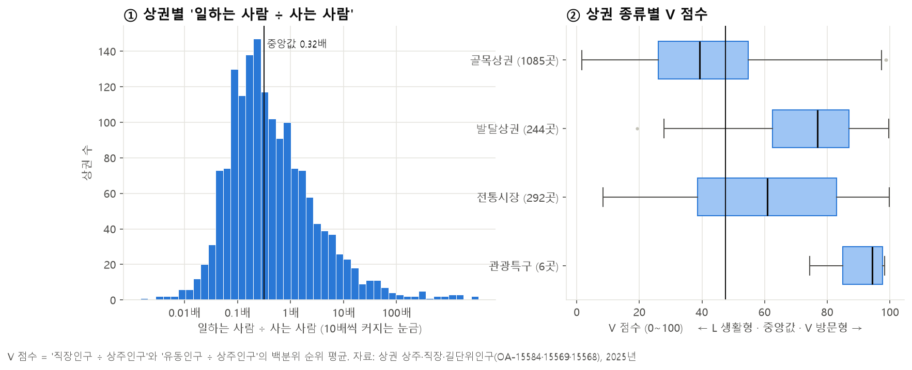

- **① 일하는 사람 ÷ 사는 사람**: 상권마다 0.01배부터 100배 넘게까지 차이가 매우 큽니다. 중앙값은 **0.32배**로, 보통 상권은 사는 사람이 일하는 사람보다 3배 많습니다.
- 값의 차이가 너무 커서 그대로 쓰지 않고 **순위(백분위)** 로 바꿨습니다. "서울 상권 100곳 중 몇 등인가?"로 생각하면 됩니다.
- **V 점수** = ('일하는 사람 ÷ 사는 사람' 순위 + '지나가는 사람 ÷ 사는 사람' 순위) ÷ 2. 0~100점이고 클수록 방문객 중심입니다.

### 1-2. 맞게 만들었을까? (검증)

위 그림 ②의 상권 종류별 V 점수 중앙값은 다음과 같습니다.

| 골목상권 | 전통시장 | 발달상권 | 관광특구 |
| ---: | ---: | ---: | ---: |
| 39 | 61 | 77 | 94 |

- 주택가 골목(생활형)이 가장 낮고, 번화가·관광특구(방문형)가 가장 높습니다. **상식과 순서가 같아서 V 점수는 믿을 만합니다.**

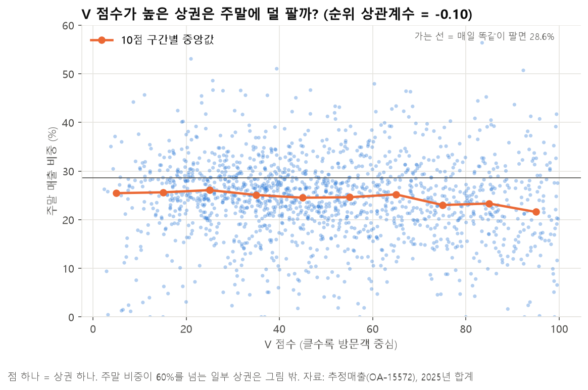

- "방문형 상권은 회사원이 많으니 주말에 덜 팔 것"이라고 생각해 확인해 봤습니다. V 점수가 높을수록 주말 매출 비중이 **아주 조금** 낮아지지만(순위 상관계수 -0.10), 점들이 넓게 퍼져 있어 관계가 약합니다.
- **쉽게 말하면**: 방문형에는 "평일에 오는 회사원 상권"과 "주말에 놀러 오는 상권"이 섞여 있습니다. 주말 비중은 L/V를 나누는 기준으로는 약하고, 나중에 **방문형 안에서 "평일형 / 주말형"을 나누는 보조 정보**로 쓰면 좋습니다.

---

## 2. E 실속형 / P 프리미엄형

### 2-1. 왜 업종끼리 비교해야 할까?

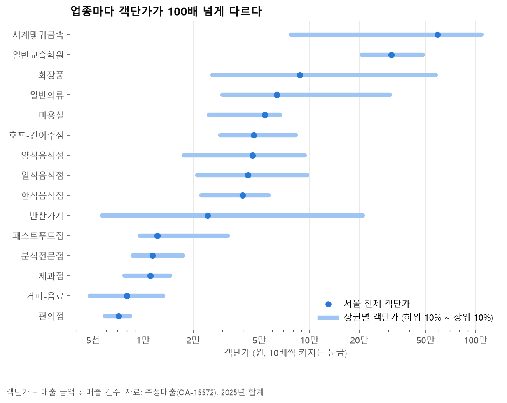

- **객단가**는 손님 한 명이 한 번에 쓰는 돈입니다 (매출 금액 ÷ 결제 건수).
- 편의점 0.7만 원, 커피 0.8만 원, 한식 4.0만 원, 화장품 8.8만 원, 귀금속 58.9만 원으로 **업종마다 100배 가까이** 다릅니다.
- 상권 객단가를 그냥 비교하면, 귀금속 가게가 많은 상권이 무조건 "프리미엄"이 되어 버립니다. 그래서 **같은 업종끼리 순위를 매긴 뒤** 상권 단위로 모았습니다.
  - 예: A 상권의 커피 객단가가 서울 커피 중 상위 20%, 한식이 상위 30%라면 → 매출 비중으로 평균
- 막대(하위 10%~상위 10%)를 보면 **같은 업종 안에서도 상권마다 2~5배 차이**가 납니다. 이 차이가 바로 "실속 vs 프리미엄"입니다.

### 2-2. P 점수 결과

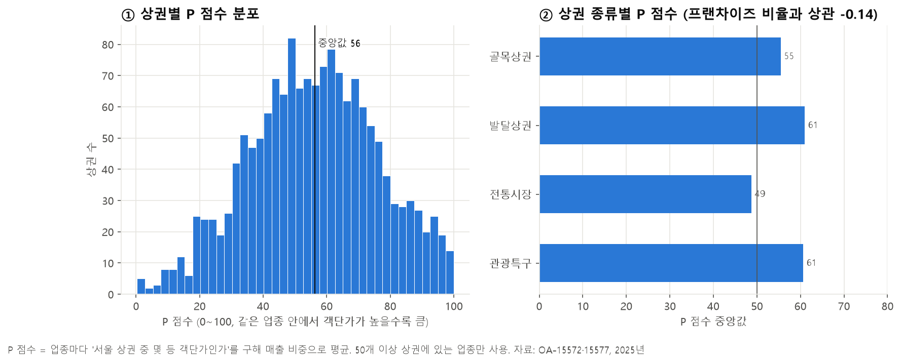

- **① P 점수 분포**: 0~100점에 고르게 퍼져 있습니다(중앙값 56). 한쪽에 몰리지 않아 E/P를 나누기 좋습니다.
- **② 상권 종류별 P 점수 중앙값**: 발달상권·관광특구 61 > 골목상권 55 > 전통시장 49. **전통시장이 가장 실속형**이라는 결과는 상식과 맞습니다.
- 정의서에서 참고 지표로 든 **프랜차이즈 비율**과는 상관계수가 -0.14로 약했습니다. 프랜차이즈가 많은 상권이 아주 조금 더 실속형이지만, P 점수를 대신할 정도는 아닙니다.

---

## 3. S 안정형 / G 성장형

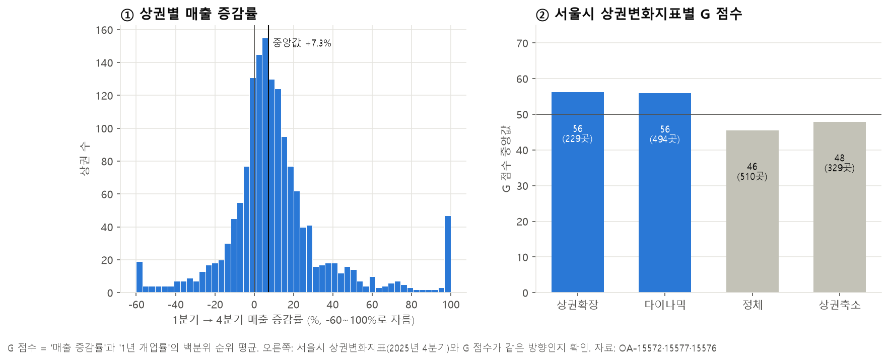

- **G 점수** = ('1분기 → 4분기 매출 증감률' 순위 + '1년 개업률' 순위) ÷ 2
- **① 매출 증감률**: 상권 절반이 **+7.3% 넘게** 늘었습니다. 하지만 이 증가에는 **연말 소비가 많아지는 계절 효과**가 섞여 있습니다. 순위로 바꾸면 모든 상권이 함께 오른 몫은 사라지고 "다른 상권보다 더 많이 늘었나?"만 남습니다.
- **② 검증**: 서울시가 따로 만든 **상권변화지표**와 비교했습니다. '상권확장'·'다이나믹' 상권은 G 점수 중앙값이 56, '정체'·'상권축소'는 46~48로 **같은 방향**입니다.
- **눈여겨볼 점**: 매출 증감률과 개업률은 **서로 거의 관계가 없습니다**(상관계수 0.02). "매출이 늘어나는 상권"과 "새 가게가 많이 생기는 상권"은 서로 다른 곳입니다.
  - 지금은 둘을 반씩 섞었습니다. 팀에서 **"성장 = 손님이 늘어남(매출)"인지, "성장 = 가게가 몰려듦(개업)"인지** 정하면 더 선명해집니다.

---

## 4. 세 기준이 서로 겹치지 않을까?

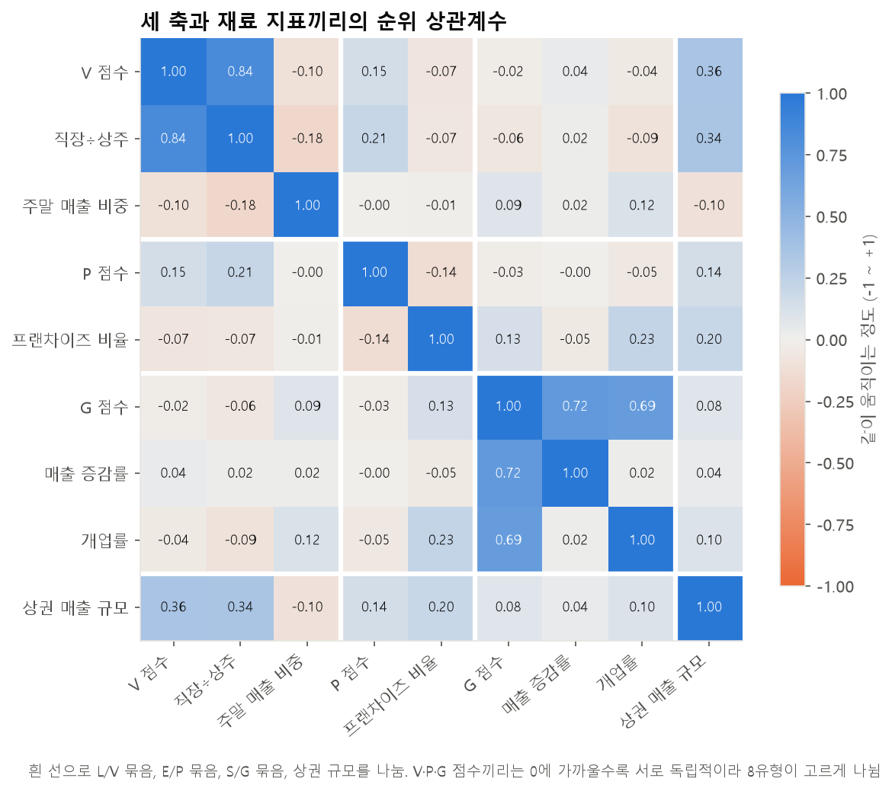

> **상관계수**는 두 값이 "같이 움직이는 정도"입니다. +1이면 늘 같이 커지고, 0이면 관계없고, -1이면 반대로 움직입니다.

| | V 점수 | P 점수 | G 점수 |
| :--- | ---: | ---: | ---: |
| V 점수 | 1 | 0.15 | -0.02 |
| P 점수 | 0.15 | 1 | -0.03 |
| G 점수 | -0.02 | -0.03 | 1 |

- 세 점수끼리 상관계수가 **0에 가깝습니다.** 세 기준이 서로 다른 성격을 재고 있다는 뜻이라, MBTI처럼 "3개의 독립된 질문"으로 쓰기에 알맞습니다.
- 만약 V와 P가 강하게 같이 움직였다면 VP와 LE 유형만 잔뜩 생기고 VE·LP 유형은 거의 없었을 것입니다.
- 참고로 **상권 매출 규모는 V 점수와 0.36**으로 가장 관련이 큽니다. 방문형 상권이 대체로 큰 상권입니다.

---

## 5. 8유형 시뮬레이션: 상권에 3글자를 붙여 보면?

각 점수가 서울 상권 **중앙값보다 크면 V·P·G, 작으면 L·E·S** 를 붙였습니다.

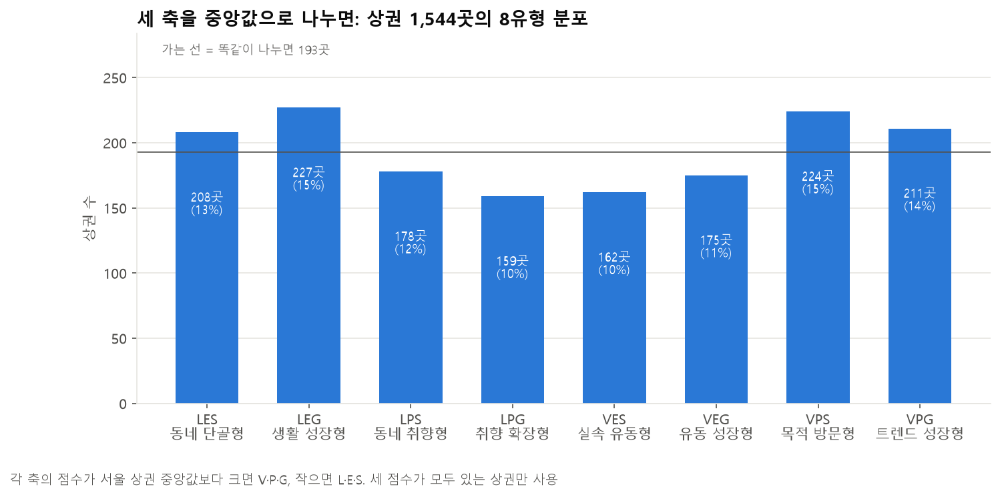

| 유형 | 이름 | 상권 수 | 골목 | 발달 | 전통시장 | 관광특구 | 매출이 큰 예시 상권 |
| :--- | :--- | ---: | ---: | ---: | ---: | ---: | :--- |
| LES | 🏡 동네 단골형 | 208 | 180 | 6 | 22 | 0 | 목동신시가지, 동원전통종합시장 |
| LEG | 🌱 생활 성장형 | 227 | 178 | 8 | 41 | 0 | 독산동, 상봉역 |
| LPS | ☕ 동네 취향형 | 178 | 160 | 2 | 16 | 0 | 독산동 우시장, 선유도역 1번 |
| LPG | ✨ 취향 확장형 | 159 | 144 | 5 | 10 | 0 | 장안동사거리, 인왕시장 |
| VES | 🍱 실속 유동형 | 162 | 76 | 33 | 51 | 2 | 가산디지털단지, 잠실역 |
| VEG | 🚶 유동 성장형 | 175 | 88 | 36 | 51 | 0 | 홍대입구역, 구로디지털단지, 건대입구역 |
| VPS | 🛍️ 목적 방문형 | 224 | 91 | 85 | 45 | 3 | 강남역, 명동 관광특구, 용산전자상가 |
| VPG | 🔥 트렌드 성장형 | 211 | 109 | 69 | 32 | 1 | 압구정로데오역, 잠실새내역 |

- **고르게 나뉩니다**: 가장 적은 LPG(159곳, 10%)와 가장 많은 LEG(227곳, 15%)의 차이가 1.4배 정도입니다. 어떤 유형을 받더라도 **추천할 상권이 150곳 넘게** 있습니다.
  - 단, 각 축을 중앙값으로 잘랐기 때문에 **축마다 반반으로 나뉘는 것은 당연한 결과**입니다. 8유형이 고르게 나온 것은 세 축이 서로 독립적이기 때문입니다(4장).
  - **상권 하나하나의 유형은 아직 확정값이 아닙니다.** 상권의 45%는 세 축 중 하나 이상이 중앙값 근처(±5점)에 있어서, 지표를 조금만 바꿔도 글자가 바뀔 수 있습니다(12장).
- **L 유형은 대부분 골목상권**이고, **VPS·VPG에 발달상권이 몰려** 있습니다. 상식과 맞습니다.
- 예시 상권도 이름과 잘 어울립니다. 강남역·명동은 '목적 방문형', 압구정로데오는 '트렌드 성장형', 홍대입구는 '유동 성장형'입니다.

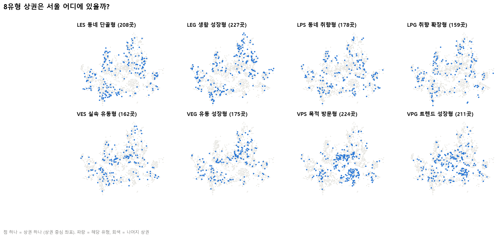

- **LES·LEG**(생활형)는 서울 **가장자리 주거지**(관악·은평·중랑·강북 등)에 퍼져 있습니다.
- **VPS**(목적 방문형)는 **강남·서초와 도심(중구·종로)** 에 뭉쳐 있습니다. 자치구 1~3위가 강남구 37곳, 서초구 27곳, 중구 23곳입니다.
- **쉽게 말하면**: 지도로 봐도 유형이 "아무렇게나" 흩어져 있지 않고 동네 성격대로 모여 있습니다. 대시보드에서 **유형별 지도**를 보여 주면 사용자가 바로 이해할 수 있습니다.

---

## 6. 솔루션 재료 ①: 유형별로 잘 팔리는 업종

정의서의 "추천 창업 아이템"을 상권분석서비스 업종 이름에 대응시켜(예: 베이커리 → 제과점, 가성비 식당 → 한식음식점), **그 유형 상권에서 실제로 매출이 몰리는지** 확인했습니다.

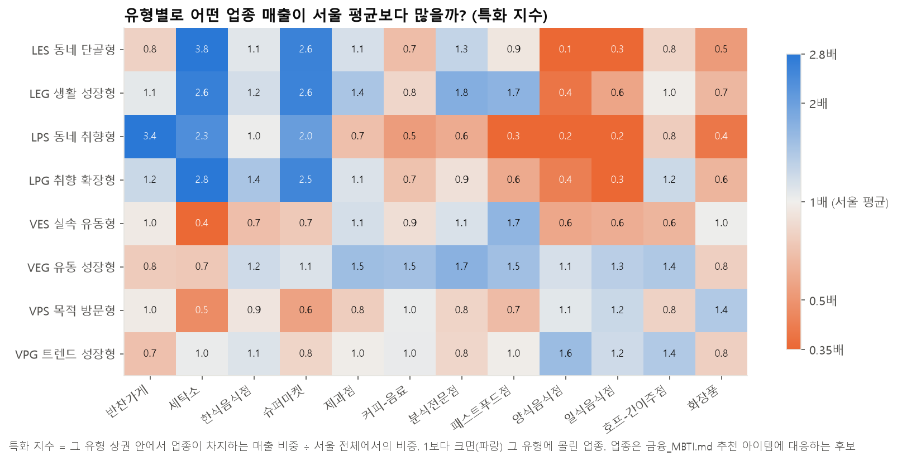

> **특화 지수** = (그 유형 상권 안에서 업종이 차지하는 매출 비중) ÷ (서울 전체에서의 비중). **1보다 크면(파랑)** 그 유형 상권에 몰려 있는 업종이고, 1보다 작으면(주황) 덜 팔리는 업종입니다.

| 유형 | 정의서 추천 아이템 | 데이터 확인 결과 | 판정 |
| :--- | :--- | :--- | :--- |
| LES 동네 단골형 | 반찬가게, 세탁소, 가성비 식당 | 세탁소 **3.8**, 슈퍼마켓 2.6, 한식 1.1, 반찬가게 0.8 | 대체로 맞음 |
| LEG 생활 성장형 | 베이커리, 생활용품점, 테이크아웃 카페 | 제과점 **1.4**, 분식 1.8, 커피 0.8 | 카페는 안 맞음 |
| LPS 동네 취향형 | 스페셜티 카페, 프리미엄 식료품점 | 반찬가게 **3.4**, 세탁소 2.3, 커피 0.5 | 식료품은 맞고 카페는 안 맞음 |
| LPG 취향 확장형 | 브런치 카페, 디저트, 편집숍 | 한식 1.4, 제과점 1.1, 커피 0.7 | 카페는 안 맞음 |
| VES 실속 유동형 | 분식, 도시락, 저가 커피 | 패스트푸드 **1.7**, 분식 1.1, 커피 0.9 | 대체로 맞음 |
| VEG 유동 성장형 | 간편식, 테이크아웃 음료, 소형 음식점 | 분식 **1.7**, 제과점 1.5, 커피 1.5 | 잘 맞음 |
| VPS 목적 방문형 | 전문 음식점, 와인바, 전문 소매점 | 화장품 **1.4**, 일식 1.2 | 맞음 |
| VPG 트렌드 성장형 | 콘셉트 카페, 팝업, 체험형 매장 | 양식 **1.6**, 호프 1.4, 일식 1.2, 커피 1.0 | 외식은 맞고 카페는 보통 |

- **V(방문형) 4유형은 정의서 추천과 데이터가 잘 맞습니다.**
- **L·P 유형에 추천한 '카페'는 데이터와 반대입니다.** 동네 상권에서 커피 매출 비중은 서울 평균의 0.5~0.8배입니다. 해석은 두 가지가 가능합니다.
  - 동네에는 카페 수요가 적다 → 추천 아이템을 바꾼다
  - 아직 카페가 적어서 빈자리가 있다 → "기회"로 보여 준다
  - 이 판단은 9장의 경쟁(점포 수) 정보와 함께 팀에서 정하는 것이 좋습니다.
- 데이터가 직접 고른 특화 업종도 참고할 만합니다 (`eda_tables/09_유형별_업종_특화지수.csv`). 예를 들어 VPG는 수산물판매 3.7, LPS는 육류판매 6.4가 높게 나옵니다. 다만 자동차수리·의료기기처럼 창업 아이템과 거리가 먼 업종도 섞여 있어 걸러야 합니다.

---

## 7. 솔루션 재료 ②: 업종 정보 카드

추천 화면에 업종마다 "얼마짜리 장사인지, 얼마나 버티는지"를 보여 줄 수 있는지 확인했습니다.

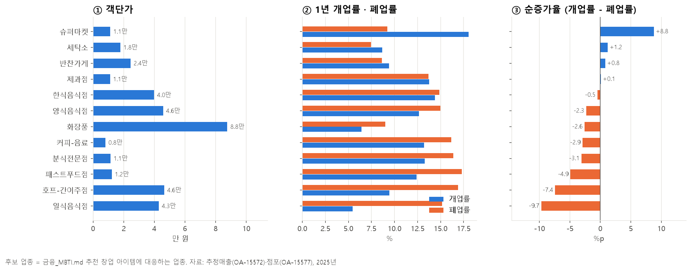

| 업종 | 점포 수 | 객단가 | 1년 개업률 | 1년 폐업률 | 순증가율 | 프랜차이즈 비율 |
| :--- | ---: | ---: | ---: | ---: | ---: | ---: |
| 슈퍼마켓 | 9,342 | 1.1만 원 | 18.0% | 9.2% | **+8.8** | 27% |
| 세탁소 | 3,873 | 1.8만 원 | 8.7% | 7.4% | +1.2 | 15% |
| 반찬가게 | 7,608 | 2.4만 원 | 9.4% | 8.6% | +0.8 | 4% |
| 제과점 | 5,616 | 1.1만 원 | 13.8% | 13.7% | +0.1 | 24% |
| 한식음식점 | 50,559 | 4.0만 원 | 14.4% | 14.9% | -0.5 | 12% |
| 양식음식점 | 7,932 | 4.6만 원 | 12.6% | 15.0% | -2.3 | 10% |
| 화장품 | 12,122 | 8.8만 원 | 6.4% | 9.0% | -2.6 | 6% |
| 커피-음료 | 22,356 | 0.8만 원 | 13.2% | 16.2% | -2.9 | 25% |
| 분식전문점 | 9,533 | 1.1만 원 | 13.3% | 16.4% | -3.1 | 22% |
| 패스트푸드점 | 5,064 | 1.2만 원 | 12.4% | 17.3% | -4.9 | **53%** |
| 호프-간이주점 | 14,200 | 4.6만 원 | 9.5% | 16.9% | -7.4 | 11% |
| 일식음식점 | 6,024 | 4.3만 원 | 5.4% | 15.2% | **-9.7** | 15% |

- **순증가율** = 개업률 - 폐업률입니다. 플러스면 가게가 늘고, 마이너스면 줄어드는 업종입니다.
- **생활형 업종(슈퍼마켓·세탁소·반찬가게)은 가게가 늘거나 유지**되고, **외식·주점(일식·호프·패스트푸드·커피)은 문 닫는 곳이 더 많습니다.**
- 커피·분식·패스트푸드는 개업률과 폐업률이 **둘 다 13~17%로 높습니다.** 100곳 중 15곳 정도가 매년 바뀌는 "회전이 빠른" 업종입니다.
- **S/G 성향과 연결하면**: 안정형(S) 사용자에게는 폐업률이 낮은 업종을, 성장형(G) 사용자에게는 회전이 빠르더라도 시장이 큰 업종을 함께 보여 주는 식으로 쓸 수 있습니다.

---

## 8. 창업자(사용자) 쪽 데이터

검사를 받을 사람, 즉 **예비 창업자**에 대해 데이터가 알려 주는 것을 확인했습니다.

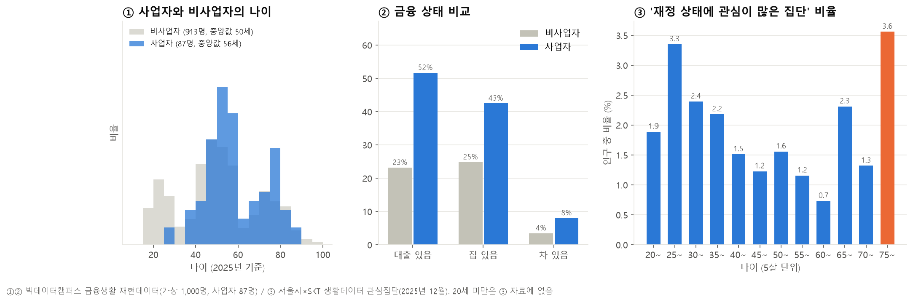

**①② 사업자 vs 비사업자** (빅데이터캠퍼스 금융생활 재현데이터)

| | 사람 수 | 나이 중앙값 | 대출 있음 | 집 있음 | 차 있음 |
| :--- | ---: | ---: | ---: | ---: | ---: |
| 사업자 | 87 | 56세 | **52%** | 43% | 8% |
| 비사업자 | 913 | 50세 | 23% | 25% | 4% |

- 사업자는 **대출이 있는 비율이 비사업자의 2배가 넘습니다.** 창업에는 대출이 흔하게 따라온다는 뜻입니다. 검사 15번 문항("자금이 모자라면 대출을 받아서라도 연다")처럼 **대출 태도를 S/G 기준에 넣은 것은 데이터와 어울립니다.**
- **주의**: 이 자료는 실제 사람이 아니라 통계적 특징만 흉내 낸 **가상의 1,000명**이고, 사업자는 87명뿐입니다. 경향을 보는 정도로만 쓰세요. 사업자의 소득 순위가 더 낮게 나오는 등(중앙값 20 vs 47) 실제와 다를 수 있는 값도 있습니다.

**③ '재정 상태에 관심이 많은 집단' 비율** (서울시×SKT 생활데이터, 2025년 12월)

- 20대 후반(3.3%)과 75세 이상(3.6%)에서 높고, 60대 초반(0.7%)에서 가장 낮습니다.
- 20대 후반은 사회 초년생이 돈 관리를 시작하는 시기라 **"금융 MBTI" 같은 검사형 서비스의 주요 사용자층**이 될 가능성이 있습니다.

**한계**: 검사 문항에 답한 사람이 실제로 그 유형 상권에서 창업해 성공했는지를 보여 주는 데이터는 없습니다. **문항이 잘 맞는지는 팀원·주변 사람 대상 시범 검사로 따로 확인**해야 합니다.

---

## 9. 소비 잠재력 미리보기 (행정동 단위)

정의서의 소비 잠재력은 **"인구·시설로 보면 이만큼 써야 하는데, 실제로는 얼마나 쓰나?"** 입니다.

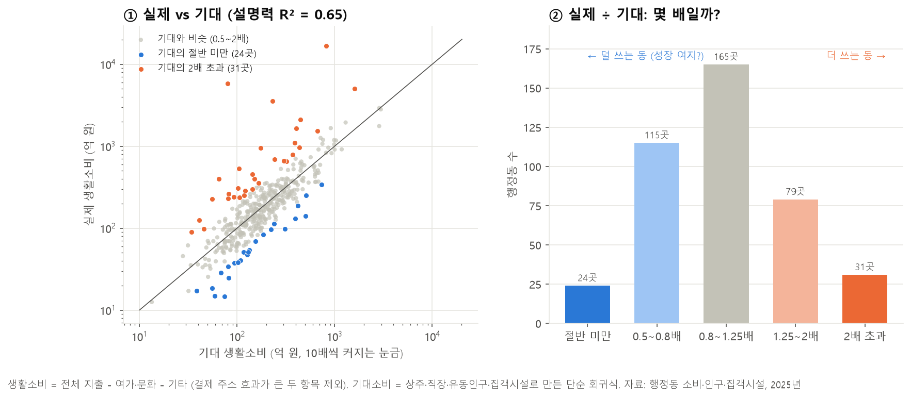

- **생활소비** = 전체 지출 - 여가·문화 - 기타. 두 항목은 결제 주소 때문에 몇몇 동에서 수조 원씩 튀어서 뺐습니다. 덕분에 예전에 문제였던 4개 동(소공동·구로3동·문래동·역삼1동)이 **기대의 0.7~1.8배로 정상 범위**에 들어왔습니다.
- **기대 소비**는 상주인구·직장인구·유동인구·집객시설 수로 만든 단순한 식입니다. 이 식만으로 동마다 다른 생활소비의 **65%(R² = 0.65)** 를 설명합니다. 가장 영향이 큰 재료는 **집객시설 수**(병원·학교·마트 등)였습니다. 재료마다 단위를 맞춘 표준화 계수로 비교해도 집객시설 0.51 > 직장인구 0.33 > 유동인구 0.18 순서입니다. 상주인구는 다른 재료와 정보가 겹쳐 계수가 오히려 음수(-0.10)로 나오므로, 식의 계수 하나하나를 "효과"로 해석하면 안 됩니다.
- **② 실제 ÷ 기대**:

| 구간 | 행정동 수 | 의미 |
| :--- | ---: | :--- |
| 절반 미만 | 24 | 기대보다 훨씬 덜 씀 → 성장 여지 후보 (예: 반포본동 0.20배, 개포1동 0.25배) |
| 0.5~0.8배 | 115 | 조금 덜 씀 |
| 0.8~1.25배 | 165 | 기대와 비슷 |
| 1.25~2배 | 79 | 조금 더 씀 |
| 2배 초과 | 31 | 기대보다 훨씬 더 씀 (예: 용산2가동 73배, 회현동 20배) |

- **주의**:
  - 용산2가동(73배)처럼 극단적인 값은 실제 소비가 아니라 **결제 주소 효과가 남아 있는 것**으로 보입니다. 순위에 쓰기 전에 걸러야 합니다.
  - "덜 쓰는 동"이 꼭 기회는 아닙니다. 주민이 다른 동네에서 소비하거나 상가가 들어설 자리가 없는 아파트 단지일 수도 있습니다. 대시보드에서는 **"성장 여지가 있을 수 있음"** 정도로 표현하는 것이 안전합니다.
  - 소비 데이터는 **행정동** 단위이고 MBTI는 **상권** 단위입니다. 상권 영역 파일에 상권이 속한 행정동 코드가 있어 연결할 수 있습니다. 다만 상권이 없는 26개 동은 추천 목록에 나오지 않습니다.

---

## 10. 동네 특징으로 본 상권

상권은 혼자 존재하지 않고 **어떤 동네 안에** 있습니다. 같은 '목적 방문형(VPS)' 상권이라도 회사가 모인 도심에 있는지, 비싼 아파트 단지 옆에 있는지에 따라 손님이 다릅니다. 그래서 서울 행정동 425곳을 **동네 특징**으로 먼저 나누고, 동네 유형마다 상권이 어떻게 다른지 살펴봤습니다.

- **다시 만들기**: [eda_dong_2025.py](eda_dong_2025.py)

### 10-1. 동네를 5가지로 나누기

행정동마다 아래 9가지 특징을 계산했습니다.

| 특징 | 뜻 | 자료 |
| :--- | :--- | :--- |
| 인구 밀도 | 1km²에 사는 사람 수 | 상주인구, 행정동 면적 |
| 일하는 사람 ÷ 사는 사람 | 낮에 일하러 오는 사람이 얼마나 많은가 | 직장·상주인구 |
| 20·30대 비중, 60대 이상 비중 | 사는 사람의 나이 구성 | 상주인구 |
| 1인가구 비율 | 혼자 사는 사람 비율 | SKT 관심집단 |
| 아파트 시세 | 동네 집값 수준 | 아파트 |
| 집객시설 밀도 | 1km²당 병원·학교·마트 등 사람을 모으는 시설 수 | 집객시설 |
| 밤 유동인구 | 밤(21~06시)에 지나가는 사람 ÷ 낮(11~17시) | 길단위인구 |
| 주말 유동인구 | 주말 하루 ÷ 평일 하루 | 길단위인구 |

그다음 **K-평균 군집**으로 비슷한 동네끼리 묶었습니다. 컴퓨터가 특징이 비슷한 동네를 자동으로 같은 반에 넣는 방법입니다.

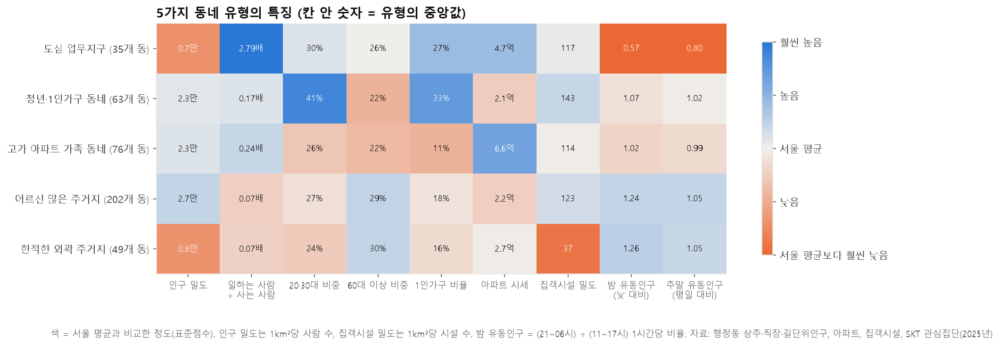

| 동네 유형 | 동 수 | 한 줄 설명 | 많은 자치구 |
| :--- | ---: | :--- | :--- |
| 🏢 **도심 업무지구** | 35 | 일하는 사람이 사는 사람의 2.8배. 밤·주말엔 텅 빔 | 중구, 강남구, 서초구 |
| 🎒 **청년·1인가구 동네** | 63 | 20·30대가 41%, 1인가구가 33%로 가장 많음 | 관악구, 광진구, 영등포구 |
| 🏙️ **고가 아파트 가족 동네** | 76 | 아파트 시세가 가장 높고(중앙값 6.6억, 순위로만 볼 값) 1인가구는 11%로 가장 적음 | 송파구, 서초구, 강남구 |
| 🏘️ **어르신 많은 주거지** | 202 | 서울에서 가장 흔한 주거지. 60대 이상이 조금 많고 밤·주말에 사람이 많음 | 중랑구, 성북구, 은평구 |
| 🌳 **한적한 외곽 주거지** | 49 | 인구 밀도와 집객시설이 가장 적음. 산·공원·신도시 끝자락 | 노원구, 강동구, 용산구 |

- 색은 서울 평균과 비교한 정도입니다. 파랑은 평균보다 높고, 주황은 낮습니다.
  - 예: 도심 업무지구의 '밤 유동인구' 칸은 진한 주황입니다. 밤에 사람이 가장 적다는 뜻입니다.
- **주의**: 동네 유형 사이의 경계가 아주 뚜렷하지는 않습니다(실루엣 점수 0.24). 0~1 사이에서 클수록 뚜렷하다는 뜻인데, 동네 특징은 칼로 자르듯 나뉘기보다 조금씩 이어지기 때문입니다. "가장 가까운 성격"으로 이해하면 됩니다.
  - 그래도 묶음 자체는 꽤 안정적입니다. 컴퓨터의 시작점(시드)을 바꿔도 묶음이 87% 수준으로 같고, 동네 80%만 뽑아 다시 나눠도 대부분 81% 수준으로 같습니다(12장).
- **빈 값을 채운 동이 있습니다.** 직장인구가 없는 11개 동(위례동 등), 1인가구 비율이 없는 8개 동(강일동 등)은 서울 중앙값으로 채웠습니다. 이 동들의 유형은 실제와 다를 수 있습니다.
- **아파트 비율은 넣지 않았습니다.** 상주인구 파일의 '아파트 가구 수'가 모든 행에서 0이고, 아파트 파일의 세대 수도 실제보다 크게 적었기 때문입니다. 예를 들어 중계2·3동은 가구가 약 1만 5천인데 아파트 세대는 약 1천으로 잡혀 있습니다. (11장 체크리스트)

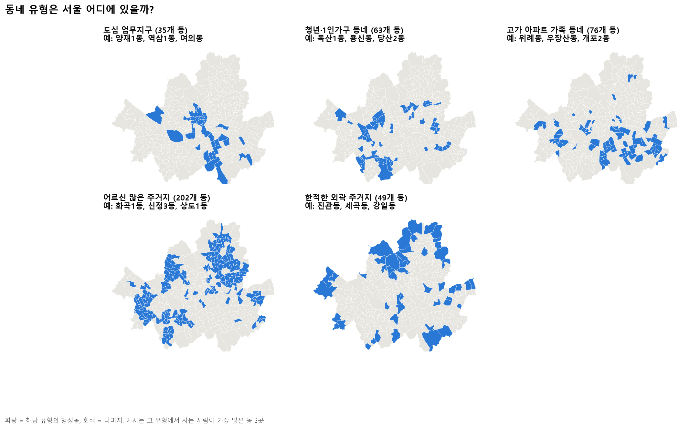

- **도심 업무지구**는 종로·중구에서 강남·서초로 이어지는 **업무 축**을 따라 있고, 여의도(여의동) 같은 업무 중심지도 들어 있습니다.
- **고가 아파트 가족 동네**는 **강남 3구(강남·서초·송파)** 에 가장 많고, 위례동·우장산동처럼 다른 구의 아파트 단지 동네도 섞여 있습니다.
- **어르신 많은 주거지**는 강서·양천·은평·성북·중랑 같은 **서울 서쪽과 북동쪽 주거지**를 넓게 덮고 있습니다.
- **한적한 외곽 주거지**는 진관동(북한산 자락)·세곡동·강일동처럼 **서울 가장자리**에 있습니다.

### 10-2. 동네마다 상권의 모습이 다를까?

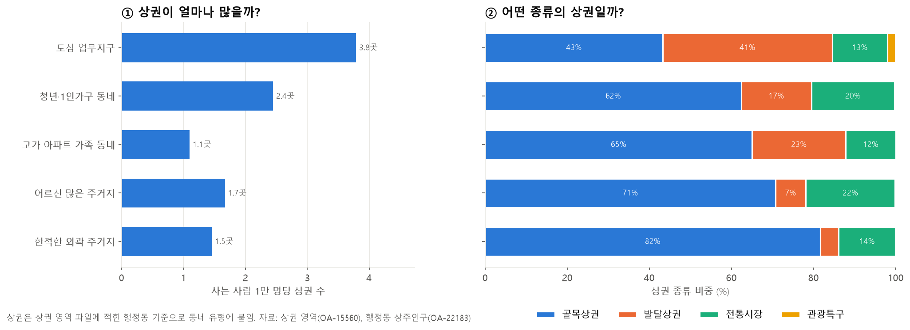

| 동네 유형 | 사는 사람 1만 명당 상권 | 골목상권 | 발달상권 | 전통시장 | 상권이 없는 동 |
| :--- | ---: | ---: | ---: | ---: | ---: |
| 도심 업무지구 | **3.8곳** | 43% | **41%** | 13% | 0 |
| 청년·1인가구 동네 | 2.4곳 | 62% | 17% | 20% | 0 |
| 고가 아파트 가족 동네 | **1.1곳** | 65% | 23% | 12% | **14** |
| 어르신 많은 주거지 | 1.7곳 | 71% | 7% | **22%** | 8 |
| 한적한 외곽 주거지 | 1.5곳 | **82%** | 4% | 14% | 4 |

- **도심 업무지구**는 사는 사람에 비해 상권이 가장 많고, 상권의 절반 가까이가 번화가(발달상권)입니다.
- **고가 아파트 가족 동네**는 사는 사람에 비해 상권이 가장 **적습니다**. 76개 동 중 **14개 동은 상권이 하나도 없습니다**. 아파트 단지 안 상가는 서울시 상권 구역에 잡히지 않는 경우가 많기 때문으로 보입니다. 대시보드에서 이런 동네는 **"상권 정보 부족"으로 표시**해야 합니다.
- **어르신 많은 주거지**는 전통시장 비중(22%)이 가장 큽니다.

### 10-3. 동네 유형과 상권 MBTI

5장에서 상권에 붙인 3글자 유형이 동네마다 얼마나 섞여 있는지 봤습니다.

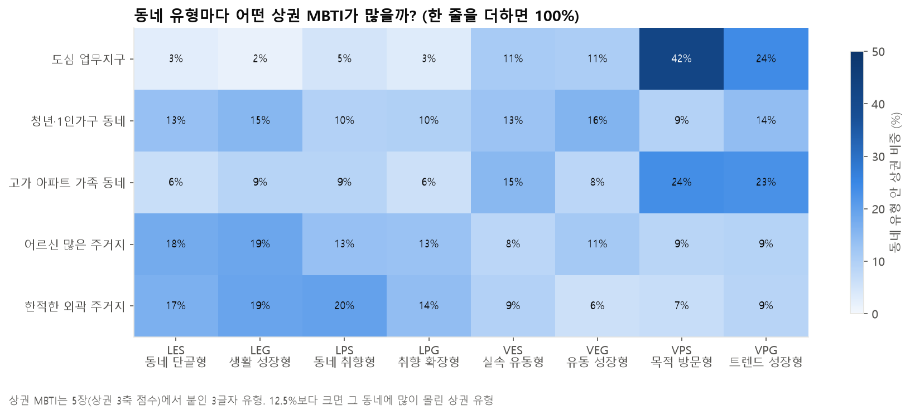

- **도심 업무지구**: VPS(목적 방문형) **42%** + VPG(트렌드 성장형) 24%. 상권 3곳 중 2곳이 방문·프리미엄형입니다.
- **고가 아파트 가족 동네**: VPS 24%, VPG 23%, VES 15%. **사는 동네인데도 방문·프리미엄형이 많습니다.** 이 동네들은 일하는 사람 ÷ 사는 사람(0.24배)이 다른 주거지(0.07~0.17배)보다 높아 회사가 가까운 곳이 많고, 상권 객단가(P 62)도 높습니다. 그래서 V와 P가 함께 높게 나온 것으로 보입니다.
- **어르신 많은 주거지**·**한적한 외곽 주거지**: LES·LEG·LPS 같은 **생활형(L)** 상권이 많습니다.
- **청년·1인가구 동네**: 8유형이 **고르게 섞여** 있습니다(9~16%). 생활과 방문이 섞인 동네라 어떤 유형의 창업자에게도 후보가 나올 수 있습니다.
- **쉽게 말하면**: 상권 MBTI와 동네 유형은 서로 잘 맞지만 똑같지는 않습니다. 둘을 함께 보여 주면 "같은 VPS라도 **도심형 VPS**인지 **아파트형 VPS**인지"까지 알려 줄 수 있습니다.

### 10-4. 동네마다 잘 팔리는 업종

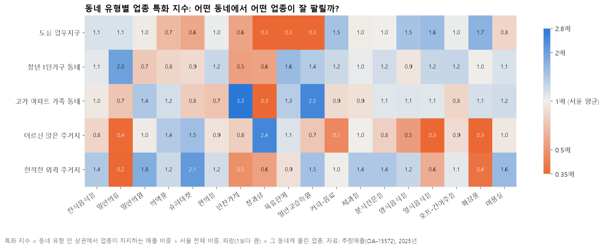

특화 지수가 1보다 크면(파랑) 그 동네에서 서울 평균보다 더 많이 팔리는 업종입니다.

| 동네 유형 | 잘 팔리는 업종 (특화 지수) | 덜 팔리는 업종 |
| :--- | :--- | :--- |
| 도심 업무지구 | 화장품 1.7, 일식 1.6, 커피 1.5, 양식 1.5 | 청과상·육류·학원 0.3 |
| 청년·1인가구 동네 | 일반의류 2.0, 육류판매 1.6, 학원 1.4, 호프 1.2 | 반찬가게 0.5 |
| 고가 아파트 가족 동네 | **반찬가게 3.3**, **교습학원 2.5**, 일반의원 1.4 | 청과상 0.3 |
| 어르신 많은 주거지 | **수산물 2.9**, **청과상 2.4**, 슈퍼마켓 1.5, 약국 1.4 | 일식·화장품 0.3, 커피 0.5 |
| 한적한 외곽 주거지 | 치과 2.2, 슈퍼마켓 2.1, 일반의원 1.8, 미용실 1.6 | 일반의류 0.2 |

- **고가 아파트 가족 동네**에서는 **반찬가게(3.3배)와 학원(2.5배)** 이 두드러집니다. 맞벌이 가족의 "저녁 반찬"과 "아이 교육" 수요로 볼 수 있습니다.
- **어르신 많은 주거지**는 **수산물·청과상(전통시장 장보기)** 이 강하고, 커피·일식·화장품은 서울 평균의 절반도 안 됩니다.
- 6장에서 "생활형(L) 상권에 '카페' 추천이 안 맞는다"고 했는데, 동네로 봐도 같습니다. **커피는 도심(1.5)과 청년 동네(1.2)에서만 강합니다.**

### 10-5. 동네마다 언제, 누가 살까?

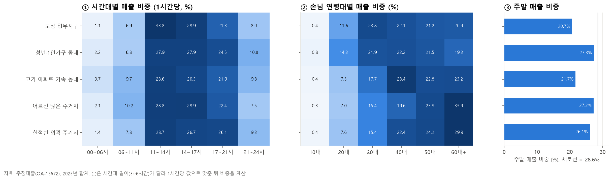

- **① 시간대**: 도심 업무지구는 **점심(11~14시)에 33.8%** 가 몰리고, 청년·1인가구 동네는 **밤(21~24시)이 10.8%** 로 가장 높습니다. 한적한 외곽 주거지는 **퇴근 후 저녁(17~21시)** 비중이 26.1%로 가장 큽니다.
- **② 손님 나이**: 청년 동네는 20대 손님이 14.3%로 가장 많고, 고가 아파트 동네는 **40대(28.4%)**, 어르신 많은 주거지는 **60대 이상(33.9%)** 이 가장 큰 손님입니다.
- **③ 주말 매출**: 도심 업무지구는 주말 비중이 20.7%로 가장 낮습니다. 주말에 장사가 잘 안되는 동네입니다. 청년 동네와 어르신 많은 주거지는 27.3%로 주말에도 꾸준합니다.
- **쉽게 말하면**: 같은 커피숍이라도 도심이면 **평일 점심 장사**, 청년 동네면 **밤·주말 장사**, 아파트 동네면 **40대 가족 손님 장사**가 됩니다. 대시보드의 상권 카드에 "바쁜 시간 · 주요 손님 나이"를 넣으면 창업자에게 바로 쓸모 있는 정보가 됩니다.

### 10-6. 동네마다 창업 환경이 다를까?

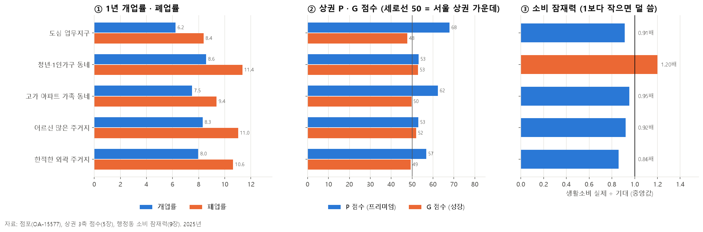

| 동네 유형 | 1년 개업률 | 1년 폐업률 | P 점수 | G 점수 | 소비 실제÷기대 |
| :--- | ---: | ---: | ---: | ---: | ---: |
| 도심 업무지구 | 6.2% | 8.4% | **68** | 48 | 0.91 |
| 청년·1인가구 동네 | **8.6%** | **11.4%** | 53 | **53** | **1.20** |
| 고가 아파트 가족 동네 | 7.5% | 9.4% | 62 | 50 | 0.95 |
| 어르신 많은 주거지 | 8.3% | 11.0% | 53 | 52 | 0.92 |
| 한적한 외곽 주거지 | 8.0% | 10.6% | 57 | 49 | **0.86** |

- **도심 업무지구**는 가게가 잘 바뀌지 않고(개업·폐업 모두 가장 낮음) 객단가가 가장 높습니다(P 68). **안정형(S)·프리미엄형(P) 창업자**와 잘 맞는 환경입니다.
- **청년·1인가구 동네**는 가게가 가장 자주 바뀌고(개업 8.6%, 폐업 11.4%), 인구·시설로 예상한 것보다 **20% 더 씁니다**. 활발하지만 경쟁이 센 **성장형(G) 동네**입니다.
- **한적한 외곽 주거지**는 예상보다 **14% 덜 씁니다**(0.86배). 주민이 다른 동네로 나가서 소비하는 곳일 수 있어, 소비 잠재력 측면에서 **빈자리 후보**가 될 수 있습니다.
- 모든 동네에서 폐업률이 개업률보다 높습니다. 2025년 서울 상권 전체가 조금씩 줄어드는 흐름입니다.

### 10-7. 동네 특징 하나로 업종 매출을 맞힐 수 있을까?

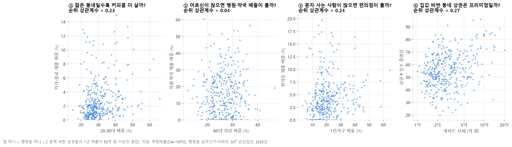

행정동 379곳(상권 매출 1년 50억 원 이상)에서 동네 특징 하나와 업종 매출 비중의 관계를 봤습니다.

| 질문 | 순위 상관계수 | 결과 |
| :--- | ---: | :--- |
| ① 젊은 동네일수록 커피를 더 살까? | 0.23 | 약하게 그렇다 |
| ② 어르신이 많으면 병원·약국 매출이 클까? | 0.04 | **거의 관계없음** |
| ③ 혼자 사는 사람이 많으면 편의점이 클까? | 0.24 | 약하게 그렇다 |
| ④ 집값 비싼 동네 상권은 프리미엄일까? | 0.27 | 약하게 그렇다 |

- 상식대로의 방향은 맞지만 **관계가 모두 약합니다.** 점들이 넓게 퍼져 있습니다.
- 특히 ②처럼 "어르신이 많은 동네 = 병원 매출이 큰 동네"는 성립하지 않았습니다. 병원은 사는 곳이 아니라 **교통이 좋은 중심지**에 모이기 때문으로 볼 수 있습니다.
- **쉽게 말하면**: 동네 특징 **하나**만 보고 업종을 추천하면 틀리기 쉽습니다. 그래서 여러 특징을 함께 묶은 **동네 유형**(10-1)과 **상권 MBTI**(5장)를 같이 쓰는 것이 더 안전합니다.

### 10-8. 대시보드에 주는 힌트

1. **추천 결과에 "동네 유형" 꼬리표를 붙이기**: "VPS 목적 방문형 · 도심 업무지구에 있는 상권"처럼 두 정보를 함께 보여 주면 상권 성격이 훨씬 구체적으로 전달됩니다.
2. **상권 카드에 "바쁜 시간 · 주요 손님 나이 · 주말 비중" 넣기**: 동네 유형에 따라 크게 달라서 창업자에게 실제로 쓸모 있는 정보입니다.
3. **S/G 성향과 동네 연결**: 안정형(S)에게는 개업·폐업이 적은 도심·아파트 동네를, 성장형(G)에게는 회전이 빠르고 예상보다 많이 쓰는 청년 동네를 함께 보여 줄 수 있습니다.
4. **아파트 단지 상가는 빈칸**: 고가 아파트 가족 동네 14곳은 서울시 상권 구역이 없어 추천에서 빠집니다. 필요하면 소상공인 상가정보(점포 주소) 같은 다른 자료로 보완해야 합니다.

---

## 11. 대시보드 만들기 전 체크리스트

| # | 항목 | 상태 | 할 일 |
| :--- | :--- | :--- | :--- |
| 1 | 상권 L/V · E/P · S/G 점수 | ✅ 만들 수 있음 | 기준(중앙값으로 나누기) 팀 확정. 지표: `eda_tables/상권_MBTI_지표_2025.csv` |
| 2 | G 점수의 뜻 | ⚠️ 결정 필요 | "매출 증가"와 "개업 증가"가 서로 다른 신호. 둘 중 무엇을 성장으로 볼지 결정 |
| 3 | 계절 효과 | ⚠️ 1년치뿐 | 2024년 자료를 추가하면 "작년 같은 분기 대비"로 비교할 수 있음 |
| 4 | 추천 아이템 ↔ 업종 코드 대응표 | ⚠️ 일부 없음 | 브런치 카페·와인바·팝업스토어 같은 업종 코드가 없음. 가장 가까운 업종으로 대응표 작성 |
| 5 | L·P 유형의 '카페' 추천 | ⚠️ 데이터와 반대 | 추천을 바꿀지, "빈자리 기회"로 보여 줄지 결정 |
| 6 | 예산 필터 | ❌ 데이터 없음 | 임대료·보증금 자료 추가 필요 (예: 한국부동산원 상업용부동산 임대동향) |
| 7 | 검사 문항 검증 | ❌ 데이터 없음 | 시범 검사로 5:0, 4:1, 3:2 분포를 확인하고 문항 수정 |
| 8 | 소비 잠재력 극단값 | ⚠️ 처리 필요 | 실제÷기대가 너무 큰 동(용산2가동 등)은 제외 기준 마련 |
| 9 | 자료 없는 상권·동 | ⚠️ 표시 필요 | 유형 없는 상권 106곳, 상권 없는 동 26곳은 "자료 부족" 표시 |
| 10 | 동 이름의 `?` | ✅ 처리 방법 있음 | 원본의 `종로1?2?3?4가동` 같은 이름은 코드로 연결하고 이름은 `·`로 바꿔 표시 |
| 11 | 아파트 가구 수 | ❌ 믿기 어려움 | 상주인구 파일의 아파트 가구 수는 모두 0, 아파트 파일 세대 수는 실제보다 크게 적음. 아파트 비율이 필요하면 다른 자료 필요 |
| 12 | 행정동 코드 체계 · 빈 값 | ⚠️ 처리 필요 | SKT 생활데이터(7자리)와 상권분석(8자리)은 코드가 달라 행정동 경계 파일로 연결. 1인가구 비율이 없는 동 8곳(3곳은 코드 불일치), 직장인구가 없는 동 11곳은 중앙값으로 채움 → 실제 값으로 보완 필요 |
| 13 | 상권이 없는 아파트 동네 | ⚠️ 표시 필요 | 고가 아파트 가족 동네 76곳 중 14곳은 상권 구역이 없음. 추천에서 빠지지 않게 다른 자료(소상공인 상가정보)로 보완 검토 |

---

## 12. 이 보고서를 얼마나 믿어도 될까? (신뢰도 점검)

보고서를 그대로 믿어도 되는지 다시 확인했습니다. 점검 코드는 [eda_check_2025.py](eda_check_2025.py)로 누구나 다시 돌려 볼 수 있습니다.

### 12-1. 다시 계산해서 확인한 것 (믿어도 되는 것)

| 확인한 내용 | 결과 |
| :--- | :--- |
| 보고서에 적힌 숫자 | 스크립트를 다시 실행해 나온 값과 일치 |
| "폐업이 개업보다 많아 상권이 조금씩 줄어듦" (10-6) | 서울 상권 점포 수가 1분기 521,137개 → 4분기 513,778개로 **1.4% 줄어**, 설명과 맞음 |
| "4분기 매출 증가에는 계절 효과가 섞임" (3장) | 서울 상권 전체 매출이 1분기 22.4조 → 4분기 24.4조로 **모든 상권이 함께 9% 늘어**, 순위로 바꾼 이유와 맞음 |
| "소비 잠재력에서 집객시설이 가장 중요" (9장) | 단위를 맞춘 표준화 계수로 다시 비교해도 집객시설(0.51)이 가장 큼 |
| "세 축은 서로 독립적" (4장) | 세 점수끼리 상관계수 -0.03 ~ 0.15 |
| 동네 유형 묶음 | 시작점(시드)만 바꾸면 **87% 수준으로 같은 묶음**이 나옴 (ARI 0.87~0.88) |

### 12-2. 조심해서 봐야 하는 것

| 항목 | 점검 결과 | 의미 |
| :--- | :--- | :--- |
| **상권 유형의 민감도** | 지표 정의를 하나만 바꿔도 같은 글자가 나오는 비율이 L/V 82~83%, E/P 78%, S/G 74~76% | 상권 하나하나의 유형은 **정의에 따라 18~26%가 바뀝니다.** 팀이 지표 정의를 확정하기 전에는 개별 라벨을 확정값처럼 쓰면 안 됩니다 |
| **경계에 걸친 상권** | 45%의 상권이 세 축 중 하나 이상에서 중앙값 ±5점 안 | 정의서의 "3:2 경계" 처리처럼, 대시보드에서도 **점수와 '경계' 표시를 함께** 보여 주는 것이 좋습니다 |
| **업종이 적은 상권의 P 점수** | P 점수에 쓰인 업종이 3개 이하인 상권 244곳 | 업종 몇 개의 객단가로 정해져 흔들리기 쉽습니다 |
| **동네 유형 개수** | 5개 대신 4개나 6개로 나누면 같은 묶음 비율이 68~77%로 떨어짐. 동네 80%만 뽑아 다시 나누면 중앙값 81%, 가장 나쁠 때 59% | 큰 그림(도심·청년·고가 아파트·외곽)은 유지되지만, 경계에 있는 동은 다른 유형으로 갈 수 있습니다 |
| **빈 값 채우기** | 직장인구 11개 동, 1인가구 비율 8개 동, 아파트 시세 1개 동을 중앙값으로 채움 | 예시로 든 위례동(직장인구), 강일동(1인가구)도 여기에 포함됩니다 |
| **아파트 시세 수준** | 강남구 동들의 중앙값이 9.0억으로, 뉴스에서 보는 강남 아파트 가격보다 훨씬 낮음 | 이 값의 정확한 정의를 확인하지 못했습니다. **금액 자체는 쓰지 말고 동네끼리의 순위로만** 쓰세요 |
| **기간** | 2025년 1년치뿐이고, 상주·직장인구는 4개 분기 값이 같음 | 성장(G)과 계절 효과를 완전히 나눌 수 없습니다 |
| **재현데이터** | 빅데이터캠퍼스 자료는 가상의 1,000명(사업자 87명) | 8장의 사업자 비교는 경향 참고용입니다 |

### 12-3. 데이터로 확인하지 않은 해석 (추정)

아래 설명은 **결과를 이해하기 쉽게 붙인 해석**이고, 이 데이터만으로는 맞는지 확인할 수 없습니다. 발표나 대시보드 문구에 쓸 때는 "~로 보입니다"처럼 추정임을 밝혀야 합니다.

- 특이 4개 동의 큰 여가·문화 지출은 **결제 주소 효과** 때문이다 (1·9장)
- 4분기 매출 증가는 **연말 소비** 때문이다 (3장)
- 고가 아파트 동네에 상권이 없는 것은 **단지 안 상가가 상권 구역에 안 잡혀서**다 (10-2)
- 반찬가게·학원이 강한 것은 **맞벌이 가족의 반찬·교육 수요** 때문이다 (10-4)
- 어르신 많은 동네에 병원 매출이 크지 않은 것은 **병원이 교통 좋은 중심지에 모여서**다 (10-7)
- 동네 상권에 카페가 적은 것이 **수요 부족인지 빈자리 기회인지** (6장)
- 20대 후반이 **금융 MBTI 검사의 주요 사용자층**이 될 것이다 (8장)
- 한적한 외곽 주거지는 **주민이 다른 동네에서 소비**해서 덜 쓰는 것이다 (10-6)

### 12-4. 결론: 어떻게 쓰면 좋을까?

| 용도 | 믿어도 될까? |
| :--- | :--- |
| 대시보드 **기획과 방향 결정** (3축이 만들어지는지, 8유형이 고른지, 동네마다 무엇이 다른지) | ✅ 믿어도 됩니다 |
| 유형별·동네별 **평균적인 차이** 설명 (업종 특화, 바쁜 시간, 손님 나이, 개업·폐업률) | ✅ 믿어도 됩니다. 단, 추정 해석(12-3)은 구분해서 말하기 |
| **특정 상권 하나의 유형**을 사용자에게 확정적으로 보여 주기 | ⚠️ 아직 이릅니다. 지표 정의를 팀에서 확정하고, 점수와 '경계' 표시를 함께 보여 주세요 |
| 아파트 시세 **금액**, 재현데이터 **수치**를 그대로 인용 | ❌ 쓰지 마세요 |

**더 믿을 수 있게 만드는 방법**

1. **지표 정의 확정**: L/V·E/P·S/G를 어떤 지표로 만들지 팀에서 정하면, 12-2의 민감도 문제가 대부분 사라집니다.
2. **아는 상권으로 직접 확인**: 팀원이 잘 아는 상권 20곳 정도의 유형과 동네 유형을 보고 "맞다/아니다"를 표시해 보세요. 데이터 점검으로는 알 수 없는 현실 감각을 확인할 수 있습니다.
3. **2024년 자료 추가**: 같은 계산을 2024년에도 해서 유형이 얼마나 유지되는지 보면 S/G와 계절 효과를 나눌 수 있습니다.
4. **빈 값과 아파트 자료 보완**: 중앙값으로 채운 동과 아파트 시세의 정의를 원본 자료로 확인합니다.

---

## 부록 A: 지표 정의

| 지표 | 계산 방법 | 자료 |
| :--- | :--- | :--- |
| V 점수 | ('직장인구÷상주인구' 백분위 + '유동인구÷상주인구' 백분위) ÷ 2 | OA-15584, OA-15569, OA-15568 |
| P 점수 | 업종마다 상권 객단가의 백분위를 구한 뒤 상권 안 업종 매출 비중으로 가중평균 (50개 이상 상권에 있는 업종만) | OA-15572 |
| G 점수 | ('1→4분기 매출 증감률' 백분위 + '1년 개업률' 백분위) ÷ 2 | OA-15572, OA-15577 |
| 유형 | 각 점수가 서울 상권 중앙값보다 크면 V·P·G, 아니면 L·E·S | |
| 특화 지수 | 유형 안 업종 매출 비중 ÷ 서울 전체 업종 매출 비중 | OA-15572 |
| 개업률 · 폐업률 | 1년 개업(폐업) 점포 수 ÷ 분기 평균 점포 수 | OA-15577 |
| 생활소비 | 전체 지출 - 여가·문화 - 기타 | OA-22166 |
| 기대 소비 | log(생활소비) = a + b·log(상주) + c·log(직장) + d·log(유동) + e·log(집객시설) | OA-22166, 22183, 22184, 22178, 22169 |
| 동네 유형 | 행정동 9가지 특징(인구 밀도·직장÷상주·아파트 시세·집객시설 밀도는 로그)을 표준화한 뒤 K-평균 군집(5개). 이름은 가장 뚜렷한 특징 순서로 붙임 | OA-22183, 22184, 22178, 22169, 22163, 22160, SKT 관심집단 |
| 동네 유형별 특화 지수 | 동네 유형 안 상권의 업종 매출 비중 ÷ 서울 전체 업종 매출 비중 | OA-15572, OA-15560 |

## 부록 B: 용어 사전

| 용어 | 뜻 |
| :--- | :--- |
| 상권 | 가게가 모여 있는 구역. 서울시가 1,650곳으로 나눔 |
| 객단가 | 손님 한 명이 한 번에 쓰는 돈 (매출 ÷ 결제 건수) |
| 백분위(순위) | 100명 중 몇 등인지로 바꾼 값. 값 차이가 아주 클 때 공평하게 비교하는 방법 |
| 중앙값 | 줄 세웠을 때 한가운데 값 |
| 상관계수 | 두 값이 같이 움직이는 정도 (-1 ~ +1) |
| R² (설명력) | 식이 실제 값의 차이를 얼마나 설명하는지 (0~1, 1이면 완벽) |
| 계절 효과 | 연말·휴가철처럼 해마다 같은 시기에 반복되는 변화 |
| 재현데이터 | 개인정보 보호를 위해 진짜 데이터의 특징만 흉내 낸 가상의 데이터 |
| K-평균 군집 | 특징이 비슷한 것끼리 정해진 개수의 묶음으로 자동으로 나누는 방법 |
| 실루엣 점수 | 묶음이 얼마나 뚜렷하게 나뉘었는지 (0~1, 클수록 뚜렷) |
| 표준점수 | 서울 평균에서 얼마나 떨어져 있는지를 같은 눈금으로 맞춘 값 (0 = 평균) |
| ARI | 두 번 나눈 결과가 얼마나 같은지 (1 = 완전히 같음, 0 = 우연히 맞는 수준) |
| 민감도 | 계산 방법을 조금 바꿨을 때 결과가 얼마나 달라지는지 |

## 부록 C: 파일 위치

- 분석 코드: [eda_raw_2025.py](eda_raw_2025.py) (0~9장), [eda_dong_2025.py](eda_dong_2025.py) (10장), [eda_check_2025.py](eda_check_2025.py) (12장 신뢰도 점검)
- 그래프 20장: [eda_figures/](eda_figures/) (01~12: 상권 MBTI, 13~20: 동네 유형)
- 요약표: [eda_tables/](eda_tables/)
  - `상권_MBTI_지표_2025.csv`: 상권 1,650곳의 V·P·G 점수와 유형. **대시보드의 출발점**으로 쓸 수 있습니다
  - `12_행정동_소비잠재력.csv`: 행정동별 생활소비, 기대 소비, 실제÷기대
  - `09_유형별_업종_특화지수.csv`, `10_후보업종_카드.csv`: 솔루션 화면 재료
  - `행정동_동네유형_2025.csv`: 행정동 425곳의 동네 특징과 동네 유형
  - `13~19_동네유형별_*.csv`: 동네 유형별 특징, 상권 구성, 상권 MBTI, 업종 특화 지수, 창업 지표
