# SpotFit 원천 데이터 기본 EDA 보고서

> **대상 데이터**: `data/raw/` 아래 원천 데이터 전체 (2025년 기준)
> **재현 방법**: 저장소 루트에서 `uv run --no-project --with pandas,matplotlib,openpyxl python 이승희/eda_raw_basic_2025.py`
> **산출물**: 그래프 `eda_basic_figures/` (16개), 요약표 `eda_basic_tables/` (13개)
> **작성**: 이승희 개인 분석 · 2026-10-13

이 보고서는 이전 분석의 가설이나 파생 지표를 쓰지 않고, 원천 데이터만으로 다음 네 가지를 점검합니다.

1. 어떤 데이터가 있는가 (인벤토리)
2. 그대로 써도 되는가 (품질·정합성)
3. 값은 어떻게 분포하는가 (분포)
4. 지표끼리 어떤 관계가 있는가 (관계)

---

## 요약: 꼭 알아야 할 7가지

| # | 발견 | 분석에 주는 영향 |
|---|---|---|
| 1 | **소비(행정동) 데이터에서 4개 동(소공동·구로3동·문래동·역삼1동)이 서울 전체 지출의 54.6%를 차지합니다.** 이 동들의 지출은 97~99%가 '여가·문화' 항목입니다. | 온라인·플랫폼 결제가 가맹점 소재지로 잡힌 것으로 보입니다. 이 4개 동을 빼면 '여가·문화' 비중이 63.0%에서 23.9%로 떨어집니다. **소비 합계·비중을 계산할 때는 반드시 따로 처리해야 합니다.** |
| 2 | 상주인구, 직장인구, 아파트 데이터는 **4개 분기 값이 모든 행정동·상권에서 같습니다.** | 사실상 연 1회 갱신되는 값입니다. 분기별 변화를 분석하는 변수로는 쓸 수 없습니다. |
| 3 | 상권 추정매출에서 **성별·연령이 구분된 매출은 전체의 88.6%** 입니다. | 성별·연령 비중을 계산할 때 분모는 '당월 매출'이 아니라 '성별 합계'로 잡아야 합니다. |
| 4 | **상위 10% 상권이 상권 매출의 66.8%를 차지합니다.** 발달상권은 상권 수로는 15%이지만 매출로는 61%입니다. | 매출은 로그 변환하거나 상권 구분별로 나눠서 분석해야 합니다. |
| 5 | 2025년 Q1→Q4 동안 소비는 +10.0%, 상권 매출은 +9.2% 늘었고, 유동인구와 점포 수는 −1.4% 줄었습니다. | 사람과 점포는 줄었는데 매출은 늘었습니다. 점포당·방문자당 매출이 오른 셈입니다. |
| 6 | 데이터마다 **행정동 코드 체계가 다릅니다.** 상권분석은 행안부 8자리, 생활데이터는 통계청 7자리, GeoJSON은 두 코드를 모두 가지고 있습니다. | 데이터를 합칠 때는 GeoJSON(`adm_cd2`↔`adm_cd`)을 연결표로 씁니다. 매칭률은 98.3%입니다. |
| 7 | 생활데이터의 SNS·유튜브·넷플릭스 지표에 **음수값**이 있고(표준화된 값으로 추정), 배달_식재료 지표는 평균과 사분위수가 모두 같습니다. | 이 지표들은 '사용일수'로 해석할 수 없습니다. 상대 지표로만 쓰거나 분석에서 뺍니다. |

---

## 1. 데이터 인벤토리

### 1.1 파일 목록

| 그룹 | 데이터 | 행 × 열 | 단위(키) | 기간 | 비고 |
|---|---|---|---|---|---|
| 상권분석 · 행정동 | 영역 (OA-22160) | 425 × 5 | 행정동 425 | – | 좌표·면적 마스터 |
| | 아파트 (OA-22163) | 1,696 × 18 | 행정동 424 | 2025 Q1~Q4 | 둔촌1동 없음 |
| | 소비 (OA-22166) | 1,700 × 14 | 행정동 425 | 2025 Q1~Q4 | 10개 지출 항목 |
| | 집객시설 (OA-22169) | 1,700 × 23 | 행정동 425 | 2025 Q1~Q4 | 결측 셀 46% |
| | 길단위인구 (OA-22178) | 1,700 × 25 | 행정동 425 | 2025 Q1~Q4 | 성·연령·시간·요일별 |
| | 상주인구 (OA-22183) | 1,700 × 27 | 행정동 425 | 2025 Q1~Q4 | 분기 값 동일 |
| | 직장인구 (OA-22184) | 1,656 × 24 | 행정동 414 | 2025 Q1~Q4 | 11개 동 없음 |
| 상권분석 · 자치구 | 아파트 / 소비 / 상주인구 (OA-22164·22167·22182) | 각 100행 | 자치구 25 | 2025 Q1~Q4 | 행정동 합계와 100% 일치 |
| 상권분석 · 상권 | 영역 (OA-15560) | 1,650 × 11 | 상권 1,650 | – | 상권→행정동·자치구 매핑 |
| | 길단위인구 (OA-15568) | 6,595 × 27 | 상권 1,650 | 2025 Q1~Q4 | |
| | 직장인구 (OA-15569) | 6,564 × 26 | 상권 1,641 | 2025 Q1~Q4 | |
| | **추정매출 (OA-15572)** | 85,732 × 55 | 상권 1,577 × 업종 62 | 2025 Q1~Q4 | 핵심 타깃 후보 |
| | 상권변화지표 (OA-15576) | 6,600 × 11 | 상권 1,650 | 2025 Q1~Q4 | HH/HL/LH/LL |
| | 점포 (OA-15577) | 304,775 × 14 | 상권 1,650 × 업종 100 | 2025 Q1~Q4 | 개업·폐업 포함 |
| | 집객시설 (OA-15580) | 6,312 × 25 | 상권 1,578 | 2025 Q1~Q4 | 결측 셀 65% |
| | 상주인구 (OA-15584) | 6,532 × 29 | 상권 1,633 | 2025 Q1~Q4 | |
| 생활데이터 (서울시×SKT) | 통신정보 (4개 xlsx) | 40,704 × 144 | 행정동 424 × 성별 2 × 연령 12 | 2025-03/06/09/12 | 29개 지표 × 평균·사분위수 |
| | 관심집단 (4개 xlsx) | 40,704 × 18 | 같음 | 같음 | 10개 관심집단 인구 |
| 소득 | 국민연금 평균소득월액 | 229 × 3 | 전국 시군구 (서울 25) | 2025-12 | |
| 재현데이터 (빅데이터캠퍼스) | 금융생활 sample | 1,000 × 65 | 개인 | – | 자치구명만 있음 |
| | 소비이동패턴 sample | 1,000 × 102 | 개인 | – | 남성 83% (표본 편향) |
| 검색 트렌드 | 네이버 10개 분야 / 자치구 TOP5 / 자치구 특화 | 12 / 1,500 / 12행 | 월 | 2025-01~12 | 상대지수 (최대=100) |
| 공간 | 행정동 경계 GeoJSON | 3,557 features | 전국 (서울 427) | 2025-12-31 | |

- 모든 CSV 파일은 **UTF-8(BOM)** 이므로 `encoding="utf-8-sig"`로 읽습니다. 완전히 중복된 행은 하나도 없습니다.
- `MANIFEST.csv`에는 `소상공인_상가정보_서울.csv`(278MB)가 적혀 있지만, **실제 파일은 없습니다** (100MB 제한 때문에 커밋하지 않은 것으로 보입니다).
- 상세 표: [`01_데이터_인벤토리.csv`](eda_basic_tables/01_데이터_인벤토리.csv)

### 1.2 데이터 간 연결 구조

```text
                    ┌──── 자치구(25) ──── 국민연금 소득, 네이버 TOP5, 재현데이터(자치구명)
                    │        ▲ 행정동_코드 // 1000 = 자치구_코드
행정동(425, 행안부 8자리) ── 소비·인구·집객·아파트
                    │        ▲ 영역_상권.행정동_코드
                    └──── 상권(1,650) ──── 추정매출·점포·변화지표·인구·집객
행정동(424, 통계청 7자리) ── 생활데이터(통신정보·관심집단)
         ▲ GeoJSON: adm_cd2[:8] = 행안부 코드, adm_cd[:7] = 통계청 코드
```

---

## 2. 데이터 품질 점검

### 2.1 결측값

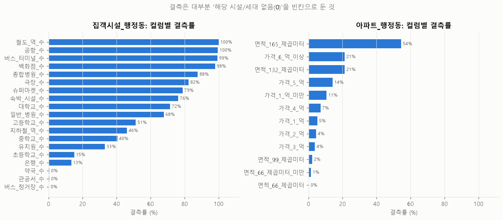

- **집객시설(행정동·상권)**: 결측은 오류가 아니라 **'해당 시설 0개'를 빈칸으로 남긴 것**입니다. `fillna(0)`으로 채우면 됩니다. 철도역 수는 100% 결측입니다.
  - 단, `집객시설_수`는 하위 19종을 더한 값보다 항상 큽니다(차이 3~391개, 중앙값 55). 하위 19종 말고 다른 시설도 포함된 합계이므로, 합계를 다시 계산하지 말고 원래 값을 씁니다.
- **아파트(행정동)**: 면적·가격 구간별 세대 수 컬럼의 결측도 '해당 세대 없음'(0)으로 보입니다. 165㎡ 이상 구간은 54.5%가 결측입니다.
- **재현데이터**: 소비이동패턴의 이동·통신 컬럼 33개는 **같은 53%의 사람에게서 한꺼번에 비어 있습니다.** 해당 정보를 연결하지 못한 사람들로 보입니다. 금융생활의 `생애최초주택구입연월`은 73% 결측인데, 주택을 산 적 없는 사람이라 비어 있는 것입니다.

### 2.2 키 커버리지

| 데이터 | 단위 수 | 기준 대비 누락 | 누락 예시 |
|---|---|---|---|
| 아파트_행정동 | 424 | 1 | 둔촌1동 (재건축) |
| 직장인구_행정동 | 414 | 11 | 하계2동, 신정6동, 가양2동, 구로1동, 항동, 일원본동 등 |
| GeoJSON 서울 | 427 | 3 (반대로 5개는 GeoJSON에만 있음) | 신설동·용두동, 개포3동, 상일제1·2동 — 행정동 개편 시점 차이 |
| 생활데이터 | 424 | 1 | GeoJSON을 거쳐 98.3% 매칭 |
| 추정매출_상권 | 1,577 | 73 | 분기마다 1,565~1,572개 상권만 있음 (매출이 잡히지 않는 상권) |
| 집객시설_상권 | 1,578 | 72 | |
| 상주인구_상권 / 직장인구_상권 | 1,633 / 1,641 | 17 / 9 | |

- 상세 표: [`03_행정동_키_커버리지.csv`](eda_basic_tables/03_행정동_키_커버리지.csv), [`04_상권_키_커버리지.csv`](eda_basic_tables/04_상권_키_커버리지.csv)
- 행정동 패널을 만들 때는 `영역_행정동`(425개)을 기준으로 left join 하고, 직장인구에서 빠진 11개 동은 결측으로 표시합니다.

### 2.3 집계 정합성

| 점검 항목 | 결과 |
|---|---|
| 소비: 행정동 합계 = 자치구 값 | **100% 일치** |
| 상주인구: 행정동 합계 = 자치구 값 | **100% 일치** |
| 소비: 10개 항목 합 = 지출 총금액 | **100% 일치** |
| 추정매출: 주중+주말 = 당월, 요일 합 = 당월, 시간대 합 = 당월 | **100% 일치** |
| 추정매출: 남+여 = 당월 | **41.5%만 일치** → 성별 합계는 당월 매출의 88.6% |
| 추정매출: 연령 합 = 성별 합 | 83.3% 일치 |

→ 추정매출의 성별·연령 컬럼은 '성별·연령을 알 수 있는 결제'만 집계한 값입니다(법인카드 등은 빠진 것으로 추정). 비중을 계산할 때는 분모를 맞춰야 합니다.

### 2.4 그 밖의 이상 사항

- **컬럼명 오류**: 추정매출의 시간대별 *건수* 컬럼 이름이 `시간대_건수~06_매출_건수`처럼 깨져 있습니다. 전처리할 때 `시간대_00~06_매출_건수` 형식으로 이름을 바꿔야 합니다.
- **이름 깨짐**: 가운뎃점(·)이 `?`로 저장되어 있습니다. 행정동 7건(`종로1?2?3?4가동`, `금호2?3가동` 등)과 상권 1건(`종로?청계 관광특구`)입니다. **조인할 때는 이름 말고 코드를 씁니다.**
- **분기 값이 같은 데이터**: 상주인구(행정동·상권), 직장인구, 아파트는 모든 단위에서 Q1~Q4 값이 같습니다.
- **생활데이터**:
  - `SNS 사용횟수`, `유튜브 사용일수`, `넷플릭스 사용일수`에 음수가 있습니다(최솟값 −0.67). 원래 값이 아니라 표준화된 값으로 보입니다.
  - `배달_식재료 서비스 사용일수`는 평균과 25·50·75% 사분위수가 모든 행에서 같습니다.
  - `평균 출근 소요시간`은 70세 이상에서 0으로, 추정되지 않았습니다.
- **재현데이터 단위**: 금액 컬럼에 단위가 적혀 있지 않습니다. 추정연소득의 중앙값이 32,000이므로 **천원 단위**로 추정합니다.

---

## 3. 행정동 단위: 소비·인구·시설

### 3.1 소비 총액 분포

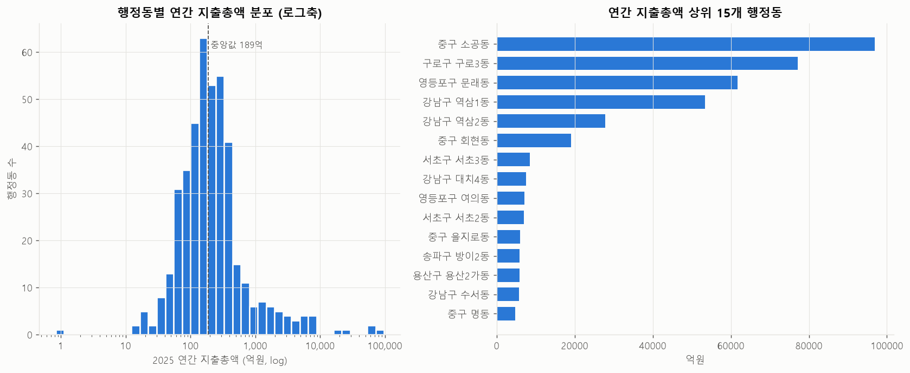

| 통계 | 연간 지출총액 (억원) |
|---|---|
| 중앙값 | 189 |
| 25% ~ 75% | 107 ~ 346 |
| 90% | 954 |
| 최댓값 | 96,909 (중구 소공동) |
| 최솟값 | 0.8 (강동구 둔촌1동, 재건축) |

- 분포가 매우 치우쳐 있습니다. 평균(1,246억)이 중앙값의 6.6배입니다. 로그축으로 보면 중앙값 근처에서 봉우리가 하나인 모양에, 오른쪽에 아주 큰 값 몇 개가 떨어져 있습니다.
- **상위 5개 동이 서울 전체 지출의 59.9%** 를 차지합니다.

### 3.2 소비 항목 구성과 '여가·문화' 이상치

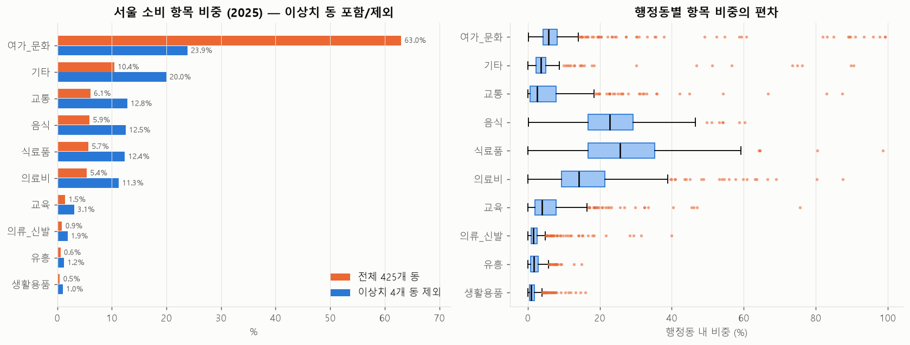

| 항목 | 전체 425개 동 | 이상치 4개 동 제외 | 행정동별 비중 중앙값 |
|---|---|---|---|
| 여가·문화 | **63.0%** | 23.9% | 5.7% |
| 기타 | 10.4% | 20.0% | 3.6% |
| 교통 | 6.1% | 12.8% | 2.5% |
| 음식 | 5.9% | 12.5% | 22.7% |
| 식료품 | 5.7% | 12.4% | 25.6% |
| 의료비 | 5.4% | 11.3% | 14.2% |
| 교육 | 1.5% | 3.1% | 3.9% |
| 의류·신발 / 유흥 / 생활용품 | 0.9 / 0.6 / 0.5% | 1.9 / 1.2 / 1.0% | 1.5 / 1.7 / 1.0% |

- **이상치 4개 동**: 소공동, 구로3동, 문래동, 역삼1동입니다. 각각 연간 지출이 1조 원을 넘고, '여가·문화' 비중이 82~99%입니다.
- 일반적인 동네의 소비는 **식료품(중앙값 26%)·음식(23%)·의료비(14%)** 가 중심입니다. 서울 전체 합계로 계산한 비중과 많이 다릅니다.
- 결론: 행정동 소비를 지표로 쓸 때는 **합계보다 '동 안에서의 항목 비중'이나 '순위'** 를 쓰는 편이 안전합니다.

### 3.3 인구 분포

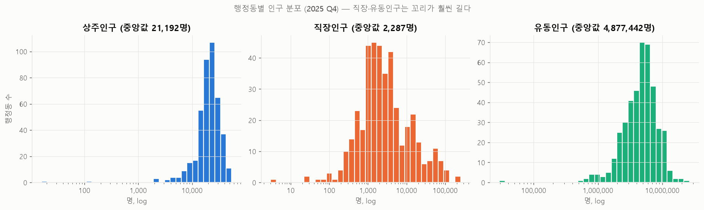

| 지표 (2025 Q4) | 중앙값 | 최소 ~ 최대 |
|---|---|---|
| 상주인구 | 21,192명 | 16 ~ 54,368 |
| 직장인구 | 2,287명 | 3 ~ 250,897 |
| 유동인구 (분기 누적) | 488만 | 2.9만 ~ 2,654만 |
| 집객시설 수 | 111개 | 14 ~ 542 |

- 상주인구는 비교적 고르게 퍼져 있습니다. 반면 **직장인구는 극단적으로 치우쳐** 있어, 최댓값이 중앙값의 100배가 넘습니다. 도심과 업무지구에 몰려 있다는 뜻입니다.

### 3.4 지표 간 관계

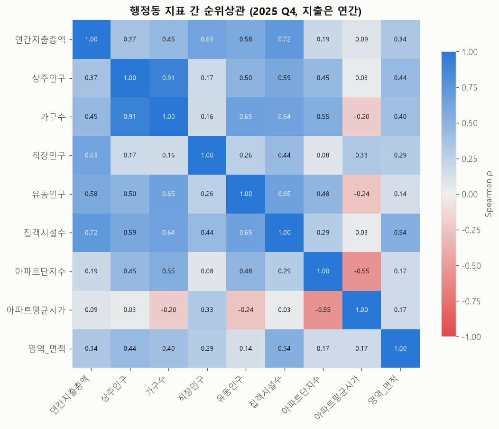

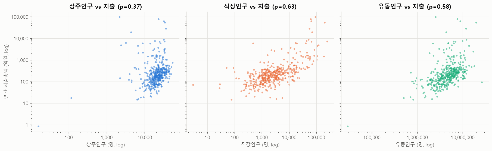

연간 지출총액과의 스피어만 순위상관입니다.

| 집객시설 수 | 직장인구 | 유동인구 | 가구 수 | 상주인구 | 면적 | 아파트 단지 수 | 아파트 평균시가 |
|---|---|---|---|---|---|---|---|
| **0.72** | **0.63** | 0.58 | 0.45 | 0.37 | 0.34 | 0.19 | 0.09 |

- 행정동 소비는 **사는 사람(상주인구, 0.37)보다 일하는 사람·시설(직장인구 0.63, 집객시설 0.72)과 더 강하게** 움직입니다. 소비가 '거주지'가 아니라 '결제가 일어난 곳' 기준으로 집계된다는 점과 맞습니다.
- 상주인구와 직장인구의 상관은 0.17로 거의 없습니다. **'주거형 동'과 '업무형 동'이 뚜렷하게 나뉩니다.**
- 아파트 단지 수와 평균시가는 −0.55입니다. 단지가 많은 동일수록 평균 시가가 낮습니다.

---

## 4. 분기 추이 (2025 Q1 → Q4)

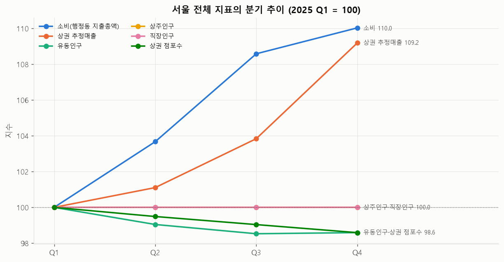

| 지표 | Q1 | Q4 | 변화 |
|---|---|---|---|
| 소비 (행정동 지출 합계) | 12.54조 | 13.80조 | **+10.0%** |
| 상권 추정매출 | 22.37조 | 24.43조 | **+9.2%** |
| 유동인구 | 23.0억 | 22.7억 | −1.4% |
| 상권 점포 수 | 521,137 | 513,778 | −1.4% |
| 상주·직장인구 | – | – | 0% (분기 값 동일) |

- 매출과 소비는 분기마다 계속 늘었고(특히 Q4에 크게 증가), 유동인구와 점포 수는 조금씩 줄었습니다.
- 데이터가 1년치뿐이어서 **계절 효과와 추세를 구분할 수 없습니다.** Q4 증가는 연말 계절성일 가능성이 있습니다.

---

## 5. 자치구 단위: 소비·소득

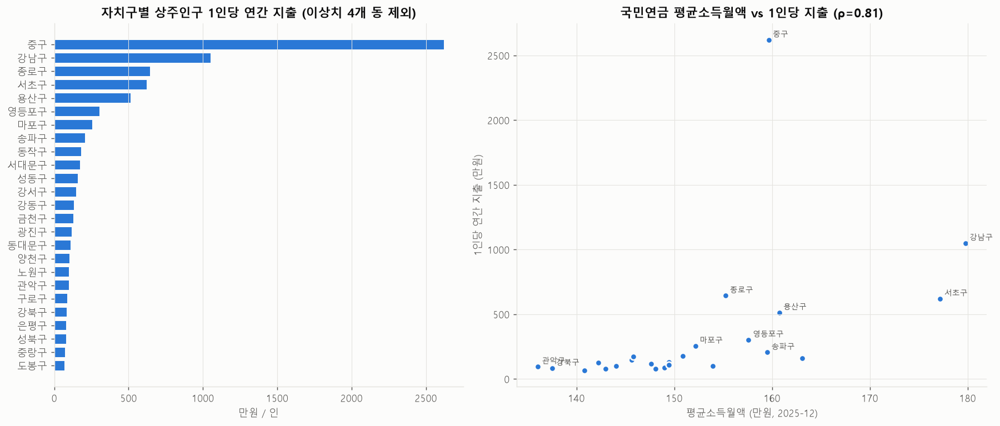

- **국민연금 평균소득월액(2025-12)**: 서울 25개 구의 중앙값은 149만 원으로, 전국 229개 시군구 중앙값(141만 원)보다 높습니다. 가장 높은 곳은 강남구(180만 원), 가장 낮은 곳은 관악구(136만 원)입니다.
- **상주인구 1인당 연간 지출**(이상치 4개 동 제외)과 평균소득월액의 순위상관은 **ρ = 0.81** 로 강합니다. 아파트 평균시가와의 상관은 0.79입니다.
- 다만 중구(2,620만 원/인)와 강남구(1,050만 원/인)처럼 직장인구가 많은 구는 '상주인구 1인당' 값이 과장됩니다. 분모를 상주인구 + 직장인구로 바꾸는 방법을 검토해야 합니다.
- 상세 표: [`09_자치구_소비_소득_2025.csv`](eda_basic_tables/09_자치구_소비_소득_2025.csv)

---

## 6. 상권 단위: 매출·점포·변화

### 6.1 상권 구분과 매출 집중도

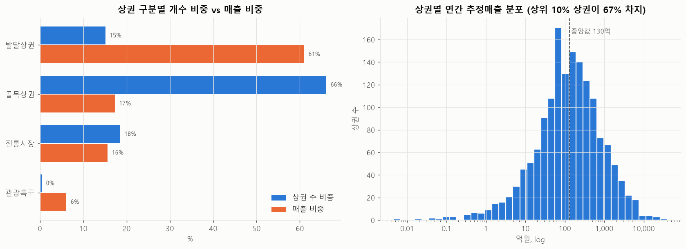

| 상권 구분 | 상권 수 | 상권 수 비중 | 매출 비중 | 상권당 연매출 중앙값 | 면적 중앙값 |
|---|---|---|---|---|---|
| 골목상권 | 1,090 | 66.1% | 17.3% | 76억 | 7.7만㎡ |
| 전통시장 | 305 | 18.5% | 15.6% | 179억 | 2.3만㎡ |
| 발달상권 | 249 | 15.1% | **61.0%** | 1,353억 | 15.0만㎡ |
| 관광특구 | 6 | 0.4% | 6.1% | 7,632억 | 63.0만㎡ |

- 상권별 연매출의 중앙값은 130억 원이고, **상위 10% 상권이 매출의 66.8%** 를 차지합니다. 로그축으로 보면 정규분포에 가깝습니다.
- 매출 상위 상권은 노량진역(3.9조), 가산디지털단지(3.1조), 용산전자상가(2.4조), 명동·남대문 관광특구(1.9조), 가락시장(1.7조) 순입니다. 수산물·전자제품·도매처럼 **객단가가 높은 업종이 모인 곳**이 위에 있습니다.

### 6.2 업종별 매출

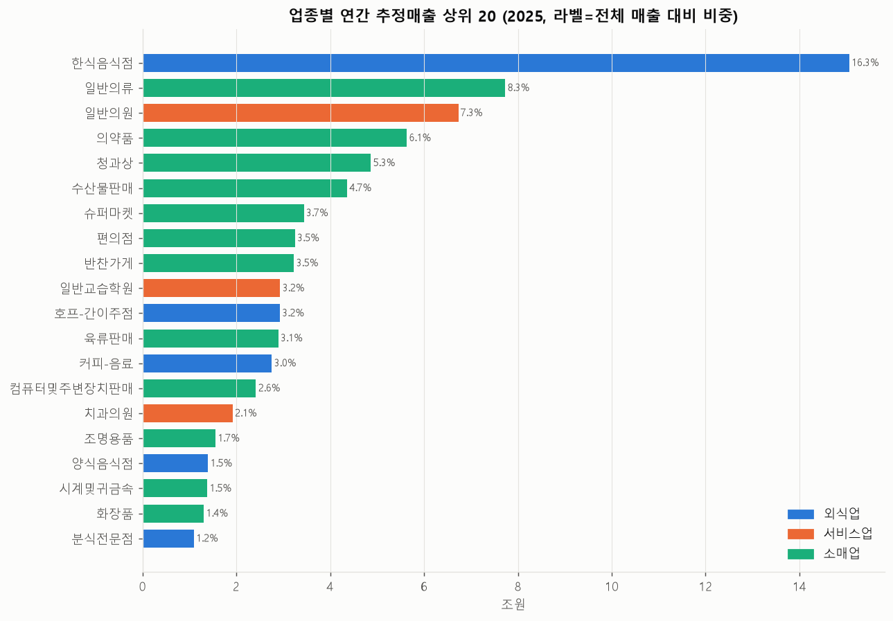

- 대분류별 매출 비중은 **소매업 52.9%, 외식업 29.2%, 서비스업 17.9%** 입니다.
- 매출 1위 업종은 한식음식점(16.3%)이고, 그다음은 일반의류(8.3%), 일반의원(7.3%), 의약품(6.1%), 청과상(5.3%)입니다.
- 객단가(매출 ÷ 건수)는 업종마다 차이가 큽니다. 편의점은 7,146원, 커피·음료는 7,987원인데, 일반교습학원은 31만 원, 치과의원은 15만 원입니다. 업종을 비교할 때는 금액과 건수를 함께 봐야 합니다.

### 6.3 언제·누가 쓰는가

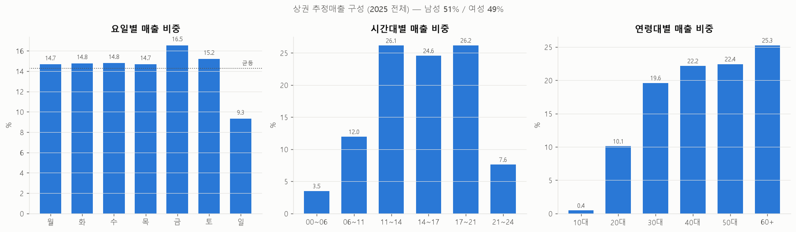

- **요일**: 평일에는 14.7~14.8%로 고르다가, 금요일(16.5%)에 가장 높고 **일요일(9.3%)에 가장 낮습니다.** 주말 매출 비중은 24.5%로, 7일 중 2일이라는 균등 비중(28.6%)보다 낮습니다. 대분류별 주말 비중은 외식업 26.9%, 소매업 25.0%, 서비스업 19.1%입니다.
- **시간대**: 점심(11~14시, 26.1%)과 저녁(17~21시, 26.2%)에 매출이 몰립니다.
- **연령**: 매출 비중은 60대 이상이 25.3%로 가장 크고, 20대는 10.1%, 10대는 0.4%입니다. 성별은 남성 51%, 여성 49%입니다(성별을 알 수 있는 매출 기준).

### 6.4 상권변화지표

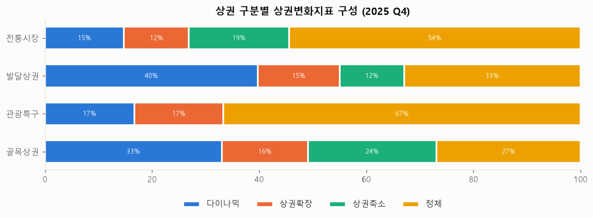

- 지표 코드의 뜻은 다음과 같습니다: HH = 정체, HL = 상권축소, LH = 상권확장, LL = 다이나믹.
- 전통시장은 '정체'가 54%로 가장 많습니다. 발달상권은 '다이나믹'이 40%로 가장 많습니다. 골목상권은 '상권축소'가 24%로 다른 구분보다 높습니다.
- Q1과 Q4의 지표가 같은 상권이 90.2%입니다. 지표가 거의 바뀌지 않으므로 **분기별 예측 대상보다는 상권의 성격(정적 속성)으로 쓰는 것**이 알맞습니다.
- 서울 평균 영업 기간은 운영 중인 점포가 115개월, 폐업한 점포가 53개월입니다.

### 6.5 점포 개업·폐업

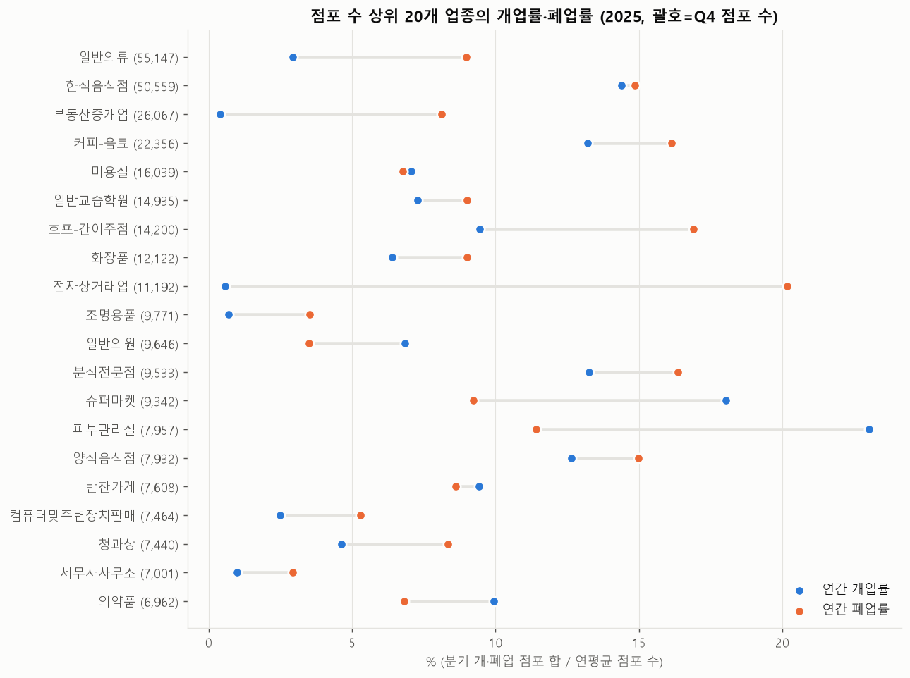

- 2025 Q4 기준 상권 안 점포는 51.4만 개입니다. **연간 개업률은 7.7%, 폐업률은 10.1%로 폐업이 더 많아**, 점포 수가 순감하고 있습니다. 4장에서 본 점포 수 −1.4%와 같은 흐름입니다.
- 회전이 빠른 업종(개업·폐업 모두 13% 이상)은 한식, 커피·음료, 분식, 호프, 양식입니다.
- 순증 업종은 피부관리실(+11.6%p), 슈퍼마켓(+8.8%p), 일반의원(+3.3%p)입니다. 순감 업종은 전자상거래업(−19.6%p), 부동산중개업(−7.7%p), 호프·간이주점(−7.4%p), 일반의류(−6.0%p)입니다.
- 프랜차이즈 비중은 슈퍼마켓 27%, 커피·음료 25%, 분식 22%입니다.

---

## 7. 생활데이터 (서울시 × SKT)

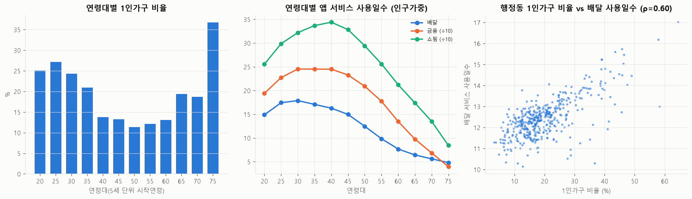

- 구조: 424개 행정동 × 성별 2 × 연령대 12(20~75세 이상, 5세 단위) = 기준월마다 10,176행이고, 20세 이상 인구 약 875만 명을 집계합니다.
- **1인가구 비율**은 연령에 따라 U자 모양입니다. 25~29세에서 27%, 50대에서 11%까지 내려갔다가, 75세 이상에서 37%로 가장 높습니다.
- 앱 사용(배달·쇼핑·금융)은 **30~40대에서 가장 많고**, 60대 이후 급격히 줄어듭니다.
- 행정동 단위로 보면 **1인가구 비율과 배달 앱 사용일수의 상관은 ρ = 0.60** 입니다. 1인가구 비율이 높은 동은 신림동(65%), 을지로동(58%), 화양동(58%), 대학동, 안암동, 신촌동처럼 대학가와 원룸 밀집 지역입니다.
- 관심집단 10종은 각각 20세 이상 인구의 약 2% 규모입니다.

---

## 8. 재현데이터 (빅데이터캠퍼스 sample 1,000명)

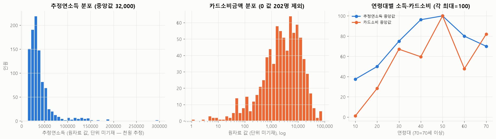

- **표본 편향**: 소비이동패턴 데이터는 남성이 83%이고, 자치구별 표본 수는 7~95명으로 고르지 않습니다. 금융생활 데이터는 여성 54%, 남성 46%입니다.
- 추정연소득 중앙값은 금융생활 3,200만 원, 소비이동 3,900만 원입니다(천원 단위로 추정). 분포는 오른쪽으로 긴 꼬리를 가집니다.
- 카드소비금액이 0인 사람이 202명(20%)입니다.
- 연령대별로 보면 소득과 카드소비 모두 50대에서 가장 높습니다.
- 자치구 정보만 있고 행정동·상권 정보가 없습니다. 게다가 표본이 1,000명뿐이므로, **공간 분석보다는 '소비자 유형'을 정의하는 참고 자료**로 쓰는 것이 알맞습니다.

---

## 9. 네이버 검색 트렌드 (2025 월별)

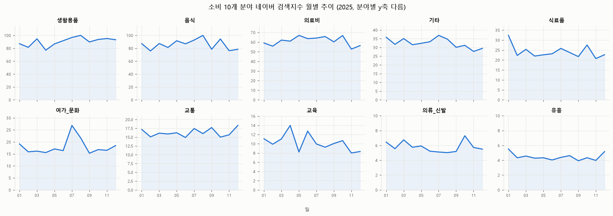

- 10개 분야의 연평균 검색지수는 생활용품(90.6), 음식(85.9), 의료비(61.2) 순으로 높고, 유흥(4.5)과 의류·신발(5.8)이 가장 낮습니다.
- 월별 변동이 가장 큰 분야는 여가·문화(변동계수 0.19)와 교육(0.18)입니다.
- 자치구 TOP5 키워드 125개를 유형별로 나누면 맛집·카페·술집 56개, 쇼핑 27개, 명소·여가 20개, 병원 16개, 학원·교육 6개입니다.
- **주의**: 네이버 검색지수는 각 요청 묶음 안에서 최댓값을 100으로 맞춘 상대값입니다(자치구마다 최댓값이 100으로 확인됨). 따라서 **자치구끼리 검색량 절대 수준을 비교할 수 없습니다.**

---

## 10. 다음 단계 제안

| 우선순위 | 할 일 | 이유 |
|---|---|---|
| 1 | 소비(행정동) 이상치 4개 동의 처리 원칙 정하기 (제외 / 별도 플래그 / 비중 지표 사용) | 서울 전체 합계의 55%를 왜곡합니다. |
| 2 | 전처리 스크립트에서 처리할 것: 컬럼명 수정(시간대 건수), `?` 이름 복원, 집객시설 결측을 0으로 채우기 | 2.4절에서 확인한 이상 사항입니다. |
| 3 | 코드 매핑 테이블 만들기 (행안부 8자리 ↔ 통계청 7자리 ↔ 상권) | 생활데이터와 상권분석 데이터를 합치려면 필요합니다. |
| 4 | 분석 단위 정하기: 상권 × 업종 × 분기 (추정매출·점포) 또는 행정동 × 분기 | 상권 단위가 매출·점포·변화지표를 가장 풍부하게 갖추고 있습니다. |
| 5 | 2023~2024년 데이터 추가 수집 검토 | 1년치로는 계절성과 추세를 구분할 수 없습니다. 또 상주·직장인구는 분기 변화가 없어 연도 간 비교가 필요합니다. |
| 6 | 비율 지표의 분모 맞추기 | 성별·연령 매출은 성별 합계를 분모로, 1인당 지표는 상주인구 + 직장인구를 분모로 검토합니다. |

---

### 부록: 산출물 목록

| 요약표 (`eda_basic_tables/`) | 내용 |
|---|---|
| `01_데이터_인벤토리.csv` | 파일별 행·열·기간·키·결측·중복 |
| `02_결측_컬럼.csv` | 결측이 있는 컬럼과 결측률 |
| `03_행정동_키_커버리지.csv` / `04_상권_키_커버리지.csv` | 단위 누락 현황 |
| `05_행정동_연간소비_2025.csv` | 행정동별 연간 지출 (항목별) |
| `06_행정동_지표패널_2025Q4.csv` | 행정동 소비·인구·시설 패널 (`소비이상치` 플래그 포함) |
| `07_행정동_지표_스피어만상관.csv` | 행정동 지표 간 상관 행렬 |
| `08_분기추이.csv` | 서울 전체 분기별 지표와 지수 |
| `09_자치구_소비_소득_2025.csv` | 자치구 소비·소득·아파트 시가 |
| `10_상권별_연간매출_2025.csv` | 상권별 연간 추정매출 |
| `11_업종별_매출_2025.csv` | 업종별 매출·건수·객단가 |
| `12_업종별_점포_개폐업_2025.csv` | 업종별 점포 수·개폐업률·프랜차이즈 비중 |
| `13_생활데이터_연령대별_2025-12.csv` | 연령대별 1인가구·서비스 이용 지표 |
