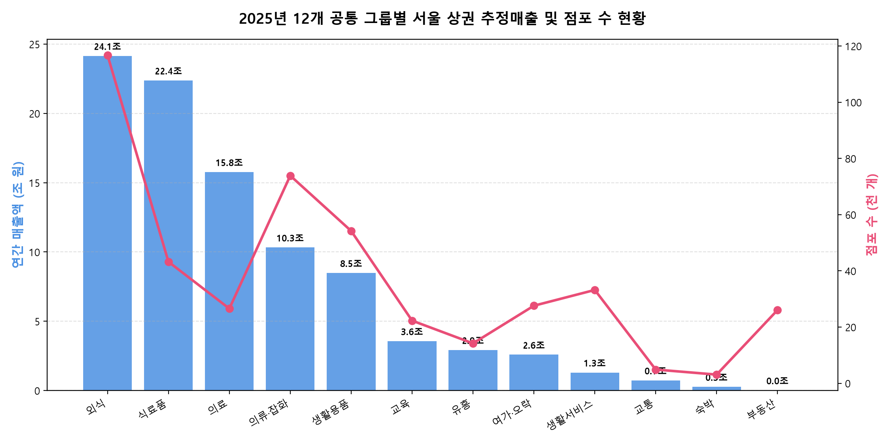
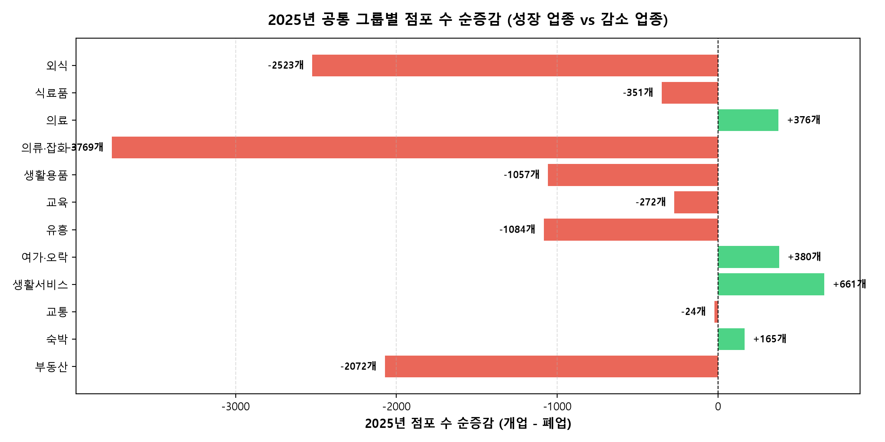
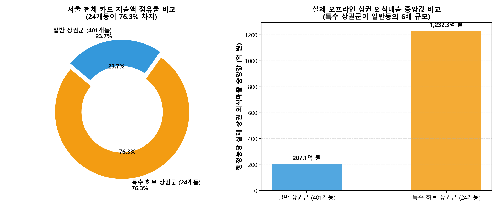
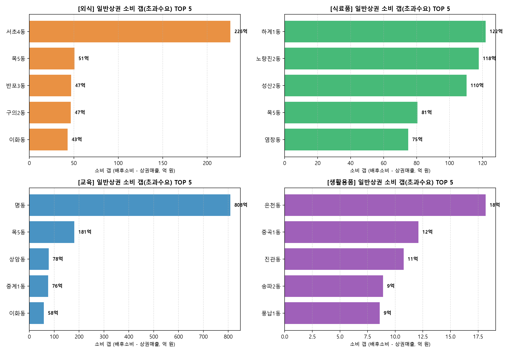

# 📊 기본 EDA 보고서 2차: 공통 그룹 업종 분류 및 이상치 분리(투트랙) 기반 서울 상권 분석

> **작성 일자**: 2026-10-19  
> **분석 목적**: 
> 1. 서울시 상권 추정매출 62개 업종을 **12개 공통 그룹 코드**로 집약 매핑(전자상거래업 제외)하여 수요(행정동 소비)와 공급(상권 매출)의 1:1 비교 체계 구축
> 2. 이상치 24개 행정동을 단순 삭제(Drop)하지 않고 **'특수 허브 상권군(`is_special_hub = True`)'으로 분리(Segregation)**하여 서울 핵심 상권을 온전히 보존하는 투트랙(Two-Track) 데이터 파이프라인 실증 분석  
> **작성자**: 이승희 (팀원 공유용)

---

## 1. 분석 프레임워크 및 데이터셋 재구축

기존 1차 EDA에서 발견된 두 가지 핵심 난제(① 업종 간 층위 불일치 및 외식업 편향, ② 24개 이상치 동 삭제 시 서울 소비 76% 증발 문제)를 해결하기 위해 다음과 같이 데이터셋을 재구축했습니다.

```text
  [추정매출 62개 업종] ──▶ 12개 공통 그룹으로 압축 (전자상거래업 분석 제외)
                                       │
                                       ▼ (1:1 매핑)
  [행정동 소비 10개 비목] ──▶ 외식, 식료품, 의류잡화, 생활용품, 의료, 교육, 유흥, 여가오락
                                       │
  ┌────────────────────────────────────┴────────────────────────────────────┐
  ▼                                                                         ▼
[Track A: 일반 상권군 (401개 동)]                         [Track B: 특수 허브 상권군 (24개 동)]
• PG사 온라인 착시 없는 깨끗한 데이터                     • 대형 플랫폼/PG 본사 밀집 지역
• 정규 머신러닝/회귀 훈련 및 정밀 소비 갭 산출            • 일반 모델 가중치 오염 방지를 위해 분리하되,
• 외식·소매·학원·서비스 전 분야 창업 추천                 오프라인 POS 매출 기반 맞춤형 평가로 보존
```

---

## 2. 12개 공통 그룹별 2025년 상권 시장 현황 분석

서울시 1,650개 상권의 2025년 연간 추정매출 및 4분기 점포 데이터를 12개 공통 그룹별로 집계한 결과입니다.



| 공통 그룹 | 2025 연간 매출 (조 원) | 매출 비중 (%) | 점포 수 (Q4 기준) | 점포 비중 (%) | 점포당 연평균 매출 | 2025년 점포 순증감 | 대표 포함 업종 (매핑) |
| :--- | :---: | :---: | :---: | :---: | :---: | :---: | :--- |
| **외식** | **24.15조 원** | **26.1%** | 116,752개 | 26.2% | 2.07억 원 | **-2,523개** | 한식, 중식, 일식, 양식, 제과, 치킨, 분식, 패스트푸드, 커피·음료 (9) |
| **식료품** | **22.38조 원** | **24.2%** | 43,232개 | 9.7% | **5.18억 원** | -351개 | 슈퍼마켓, 편의점, 미곡, 육류, 수산물, 청과상, 반찬가게 (7) |
| **의료** | **15.77조 원** | **17.0%** | 26,575개 | 6.0% | **5.93억 원** | **+376개** | 일반의원, 치과의원, 한의원, 의약품, 의료기기 (5) |
| **의류·잡화** | 10.33조 원 | 11.2% | 73,885개 | 16.6% | 1.40억 원 | **-3,769개** | 일반의류, 신발, 가방, 안경, 시계·귀금속, 섬유제품 (6) |
| **생활용품** | 8.49조 원 | 9.2% | 54,202개 | 12.2% | 1.57억 원 | -1,057개 | 화장품, 가구, 가전, 철물, 인테리어, 조명, 문구, 애완동물 등 (11) |
| **교육** | 3.57조 원 | 3.9% | 22,296개 | 5.0% | 1.60억 원 | -272개 | 일반교습학원, 외국어학원, 예술학원 (3) |
| **유흥** | 2.93조 원 | 3.2% | 14,200개 | 3.2% | 2.06억 원 | -1,084개 | 호프·간이주점 (1) |
| **여가·오락** | 2.59조 원 | 2.8% | 27,601개 | 6.2% | 0.94억 원 | **+380개** | PC방, 노래방, 당구장, 골프연습장, 헬스클럽, 서적 등 (9) |
| **생활서비스** | 1.30조 원 | 1.4% | 33,207개 | 7.4% | 0.39억 원 | **+661개** | 미용실, 네일숍, 피부관리실, 세탁소, 가전수리 (5) |
| **교통** | 0.74조 원 | 0.8% | 4,886개 | 1.1% | 1.51억 원 | -24개 | 자동차수리, 자동차미용(세차), 자전거 등 (3) |
| **숙박** | 0.27조 원 | 0.3% | 3,093개 | 0.7% | 0.87억 원 | **+165개** | 여관 (1) |
| **부동산** | 0.02조 원 | 0.02% | 26,067개 | 5.8% | 0.01억 원 | **-2,072개** | 부동산중개업 (1) |
| *분석 제외* | *—* | *—* | *—* | *—* | *—* | *—* | *전자상거래업 (오프라인 매장 부재로 제외)* |

### 📌 주요 시장 발견점:
1. **외식과 식료품이 전체 상권 매출의 절반(50.3%)을 차지**:
   * 점포당 평균 연매출은 **의료(5.9억 원) > 식료품(5.2억 원) > 외식(2.1억 원) > 유흥(2.1억 원)** 순으로 높습니다.
2. **성장 업종과 쇠퇴 업종의 명확한 양극화 (점포 순증감)**:
   * 
   * **순증 성장 업종 (개업 > 폐업)**: 생활서비스(+661개), 여가·오락(+380개), 의료(+376개), 숙박(+165개)
   * **순감 쇠퇴 업종 (폐업 > 개업)**: 의류·잡화(-3,769개), 외식(-2,523개), 부동산(-2,072개), 유흥(-1,084개), 생활용품(-1,057개)
   * 특히 **의류·잡화**와 **부동산중개업**의 폐업이 극심하므로 창업 추천 시 고위험 업종으로 별도 관리해야 합니다.

---

## 3. 투트랙 분리(일반 상권군 401개 vs 특수 상권군 24개) 비교 검증

24개 이상치 동을 무작정 버리지 않고 **'특수 허브 상권군'으로 분리해야 하는 이유와 실체**가 데이터로 명확히 입증되었습니다.



| 비교 지표 | 일반 상권군 (Normal, 401개 동) | 특수 허브 상권군 (Special Hub, 24개 동) | 비교 및 시사점 |
| :--- | :---: | :---: | :--- |
| **행정동 수 / 비중** | **401개 동 (94.4%)** | **24개 동 (5.6%)** | 소수 24개 동에 극단적 자본 집중 |
| **연간 소비 총지출** | **12.57조 원 (23.7%)** | **40.38조 원 (76.3%)** | 삭제 시 서울 소비의 76%가 증발하는 이유 |
| **행정동당 평균 총지출** | **313.5억 원** | **16,825.8억 원 (1.68조 원)** | 특수 상권군의 지출액이 무려 54배 거대함 |
| **행정동당 중앙값 총지출** | **180.6억 원** | **5,781.9억 원** | 중앙값 기준도 32배 격차 |
| **음식 지출 비중 중앙값** | **23.2% (정상)** | **3.0% (극심한 왜곡)** | PG/온라인 허수 결제로 외식 비중이 찌그러짐 |
| **식료품 지출 비중 중앙값** | **26.3% (정상)** | **1.6% (극심한 왜곡)** | 정상적인 동네 생활소비 분포가 파괴됨 |
| **상권 실제 외식매출 중앙값** | **207.1억 원** | **1,232.3억 원 (6배 규모!)** | **★ 결정적 발견: 실제 오프라인 매장 매출은 서울 최강의 황금 상권임!** |

> ### 💡 결정적 인사이트:
> 특수 허브 상권군(역삼1·2동, 서초2·3동, 구로3동, 소공동 등)은 소비 데이터상에서는 온라인 PG 결제에 밀려 외식 비중이 겨우 3%로 왜곡되어 있지만, **실제 오프라인 상권 매장들이 올리는 외식 매출 중앙값은 1,232억 원으로 일반 동네의 6배에 달하는 초대형 황금 상권**입니다.  
> 따라서 **"일반 회귀 모델 학습에서는 분리(오염 방지)하되, 최종 창업 추천 서비스에서는 실제 POS 단말기 매출 실적 기반으로 살려두는 투트랙 전략"**이 완벽히 타당함을 증명합니다.

---

## 4. 일반 상권군(401개 동)의 공통 그룹별 소비 갭(수요 vs 공급) 분석

정상화된 일반 상권군(401개 동)을 대상으로 각 공통 그룹별 **`소비 갭 = [배후 소비 잠재력] - [상권 실제 추정매출]`**을 산출하여 초과 수요(블루오션) 상권을 도출했습니다.



### [공통 그룹별 소비 갭 상위 TOP 5 유망 행정동]

1. **외식업 (음식점·카페)**
   * **1위 서초4동** (소비 갭 +226억 원)
   * **2위 목5동** (소비 갭 +51억 원)
   * **3위 반포3동** (소비 갭 +47억 원)
   * **4위 구의2동** (소비 갭 +47억 원)
   * **5위 이화동** (소비 갭 +43억 원)
   * *특징*: 목5동, 반포3동, 서초4동 등 고소득 대단지 주거 배후지가 상권 내부 매장 공급 대비 외식 수요가 매우 풍부함.

2. **식료품 (마트·반찬·식재료)**
   * **1위 하계1동** (+122억 원), **2위 노량진2동** (+118억 원), **3위 성산2동** (+110억 원), **4위 목5동** (+81억 원), **5위 염창동** (+75억 원)
   * *특징*: 아파트 밀집 주거지역 중 대형마트와의 거리가 있는 주거 배후지에서 신선식품/반찬가게 수요 초과.

3. **교육 (학원·교습소)**
   * **1위 명동** (+808억 원, 직장인 어학/자격증 수요), **2위 목5동** (+181억 원), **3위 상암동** (+78억 원), **4위 중계1동** (+76억 원), **5위 이화동** (+58억 원)
   * *특징*: 대한민국 대표 학원가 배후인 **양천구 목5동**과 **노원구 중계1동(은행사거리)**이 정확하게 소비 갭 상위권에 포착됨!

4. **생활용품 (패션잡화·문구·인테리어)**
   * **1위 은천동** (+18억 원), **2위 중곡1동** (+12억 원), **3위 진관동(은평뉴타운)** (+11억 원), **4위 송파2동** (+9억 원), **5위 풍납1동** (+9억 원)
   * *특징*: 신규 대단지 아파트 입주 지역 및 주거 밀집지에서 생활잡화·철물·인테리어 공급 부족 현상 확인.

---

## 5. 최종 데이터 파이프라인 및 모델링 가이드

1. **데이터 컬럼 규격화 (`is_special_hub`)**:
   * 행정동 데이터에 `is_special_hub` 불리언(Boolean) 컬럼을 생성하여 **일반 상권(False, 401개)**과 **특수 상권(True, 24개)**을 엄격히 분리 관리합니다.
2. **소비 갭 모델 훈련 (Track A - 일반 상권)**:
   * 배후 인구(상주·직장·유동인구)와 6대 생활소비를 종속변수로 하는 회귀/머신러닝 모델을 401개 일반 상권만으로 학습시켜 **R² 설명력과 예측 안정성을 극대화**합니다.
3. **특수 상권 맞춤형 추천 (Track B - 특수 상권)**:
   * 24개 특수 상권은 거주민 소비 갭 대신, **`상권 유동인구 × POS 실매출 × 점포당 매출액`** 기반의 오프라인 상권 활성도 지표로 전환하여 창업자에게 추천합니다.

---

### 부록: 생성된 가공 데이터 및 차트 파일 목록

* **이승희 폴더 내 보관 자료**:
  * [01_공통그룹별_상권매출_점포현황.csv](eda_reclassified_tables/01_공통그룹별_상권매출_점포현황.csv)
  * [02_행정동_투트랙_소비갭_패널.csv](eda_reclassified_tables/02_행정동_투트랙_소비갭_패널.csv)
  * [03_투트랙_비교_요약.csv](eda_reclassified_tables/03_투트랙_비교_요약.csv)
  * [04_일반상권_공통그룹별_유망동.json](eda_reclassified_tables/04_일반상권_공통그룹별_유망동.json)
  * 차트: `eda_reclassified_figures/01~04`
  * 분석 스크립트: [`eda_reclassified_2025.py`](eda_reclassified_2025.py), [`plot_reclassified_eda.py`](plot_reclassified_eda.py)
* **프로젝트 공용 경로 (`data/`, `images/`)**:
  * `data/processed/eda_reclassified/`
  * `images/eda_reclassified/`
