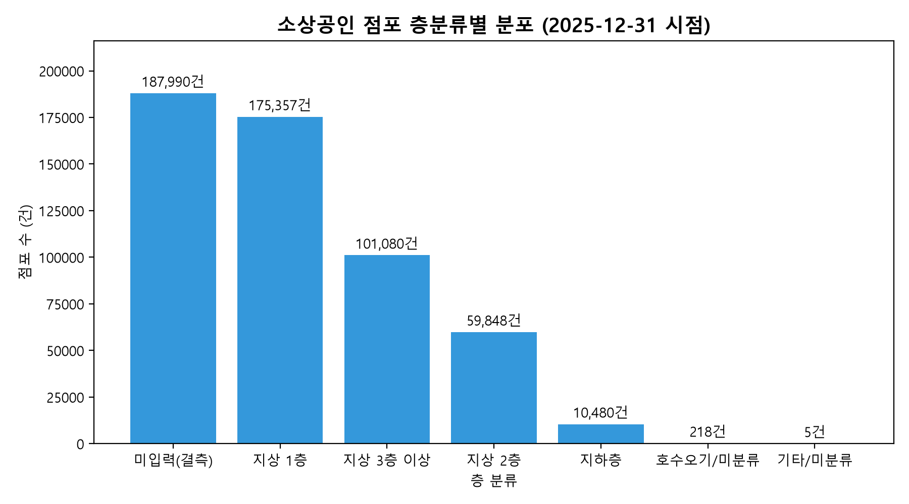
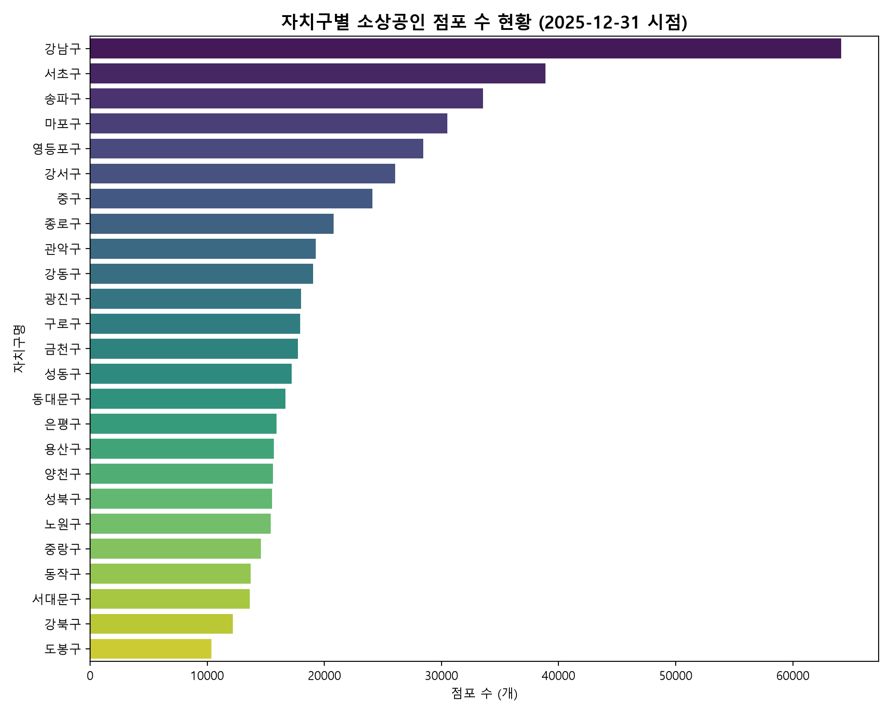
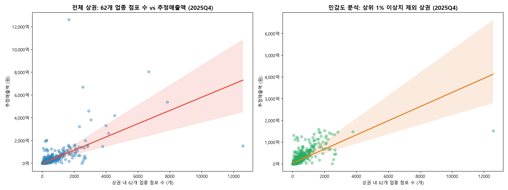
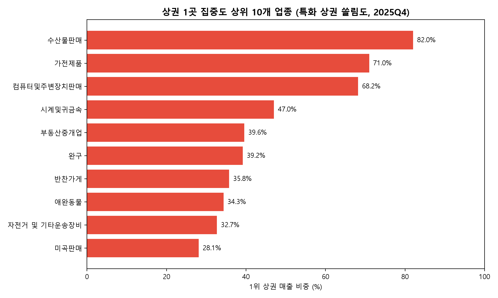

# 01. 서울시 상권 기본 데이터 프로파일링 및 기초 탐색 보고서 (2025Q4)

> **작성 목적**: 예비 창업자 맞춤형 상권 추천 서비스의 기초 분석 단계로서, 서울시 소상공인 점포 및 전체 1,650개 상권 원천 데이터의 품질, 기술통계, 권역·층·업종 교차분석, 추정매출과 점포 수의 상관성, 상권 특성 데이터 준비도를 체계적으로 정리합니다.
> 
> **기준 시점 및 수집 주기**:
> - 소상공인 상가정보 스냅샷: **2025-12-31 시점** (서울시 소재 상가업소 데이터 수록 점포 534,978건)
> - 상권 분석 지표(추정매출, 인구, 점포): **2025년 1분기~4분기 (20251~20254)** 및 **2025Q4 집중 분석** (전체 상권 마스터 1,650개 중 2025Q4 추정매출 보유 상권 1,565개, 매출 보유율 94.85%)

---

## 1. 원천 데이터 파일별 프로파일 (MANIFEST 비교 및 소비 데이터 포함)

서울 열린데이터광장 및 공공데이터포털에서 수집한 10개 핵심 원천 데이터(소상공인 1개, 상권 8개, 소비 행정동 1개)의 행 수, 열 수, 기준 식별 키, 결측치, 주요 변수 값 범위를 점검하였습니다. 모든 데이터 파일의 실제 행 수는 `data/raw/MANIFEST.csv`의 기준치와 정확히 일치함을 확인하였습니다.

| 파일명 | 실제 행수 | MANIFEST 행수 | 일치 여부 | 열 수 | 기준 키 | 키 유일성 | 기준 기간 | 단위 | 결측치 수 | 주요 변수 값 범위 |
|:---|---:|---:|:---:|---:|:---|:---:|:---|:---|---:|:---|
| `소상공인_상가정보_서울.csv` | 534,978 | 534,978 | 일치 | 39 | `상가업소번호` | 유일 | 2025-12-31 시점 | 점포 (건) | 2,586,358 | 위도(37.430~37.693), 경도(126.768~127.183) |
| `OA-15560_영역_상권.csv` | 1,650 | 1,650 | 일치 | 11 | `상권_코드` | 유일 | 시점(고정) | 상권 영역 | 0 | 영역_면적(1,854 ~ 2,462,734 ㎡) |
| `OA-15568_길단위인구_상권.csv` | 6,595 | 6,595 | 일치 | 27 | `기준_년분기_코드+상권_코드` | 유일 | 2025Q1~Q4 | 인구수 (명) | 0 | 총_유동인구_수(8 ~ 8,537,311 명) |
| `OA-15569_직장인구_상권.csv` | 6,564 | 6,564 | 일치 | 26 | `기준_년분기_코드+상권_코드` | 유일 | 2025Q1~Q4 | 인구수 (명) | 0 | 총_직장_인구_수(3 ~ 199,667 명) |
| `OA-15572_추정매출_상권.csv` | 85,732 | 85,732 | 일치 | 55 | `기준_년분기_코드+상권_코드+서비스_업종_코드` | 유일 | 2025Q1~Q4 | 금액 (원) / 건수 | 0 | 당월_매출_금액(31 ~ 1,148,993,825,259 원) |
| `OA-15576_상권변화지표_상권.csv` | 6,600 | 6,600 | 일치 | 11 | `기준_년분기_코드+상권_코드` | 유일 | 2025Q1~Q4 | 지표값 / 구분 | 0 | 서울운영영업개월평균(111 ~ 115 개월) |
| `OA-15577_점포_상권.csv` | 304,775 | 304,775 | 일치 | 14 | `기준_년분기_코드+상권_코드+서비스_업종_코드` | 유일 | 2025Q1~Q4 | 개수 | 0 | 전체_점포_수(0 ~ 11,444 개) |
| `OA-15580_집객시설_상권.csv` | 6,312 | 6,312 | 일치 | 25 | `기준_년분기_코드+상권_코드` | 유일 | 2025Q1~Q4 | 개수 | 102,500 | 집객시설_수(1 ~ 594 개) |
| `OA-15584_상주인구_상권.csv` | 6,532 | 6,532 | 일치 | 29 | `기준_년분기_코드+상권_코드` | 유일 | 2025Q1~Q4 | 인구수 (명) | 0 | 총_상주인구_수(1 ~ 18,076 명) |
| `OA-22166_소비_행정동.csv` | 1,700 | 1,700 | 일치 | 14 | `기준_년분기_코드+행정동_코드` | 유일 | 2025Q1~Q4 | 지출금액 (원) | 0 | 지출_총금액(17,286,000 ~ 2,583,587,907,000 원) |

*근거 파일: `data/processed/eda_stage1/file_profiles.csv`*

## 2. 소상공인 상가정보 데이터 품질 점검

소상공인시장진흥공단 서울 상가정보 원천 데이터(534,978건)에 대해 행정동 코드 정합성, 층 정보, 중복 등록, 공간 지리 좌표를 단계별로 검토하였습니다.

### 2.1 행정동 코드 정합성
- **코드 매핑 전후**: 원천 데이터의 행정동 코드는 **428개**였으나, `PREPROCESSING.md` 2.4절의 2025년 행정동 분동/통합(용신동, 상일동, 일원2동) 대응 규칙을 적용한 결과 상권분석 마스터 기준인 **425개 동**으로 정리되었습니다.
- **마스터 일치 여부**: 변환 후 425개 행정동 코드가 상권분석 공용 행정동 마스터(425개 동)와 모두 일치함을 확인하였습니다.

### 2.2 층 정보 분류 및 결측 현황 (분모 구분 해석)
- **원천 고유값 및 결측**: 원천 데이터 내 층정보의 고유값은 **201개**이며, 결측치는 전체의 **35.14%**(187,990건)입니다.
- **층 1위 해석의 분모 구분**:
  - **전체 점포 기준 (534,978건)**: 미입력 결측이 35.14%(187,990건)로 1위이며, 지상 1층은 32.78%(175,357건)로 2위입니다.
  - **층 정보가 입력된 점포 기준 (346,988건)**: 지상 1층이 **50.54%**(175,357건)로 가장 많은 비중을 차지합니다.

| 층 분류 | 점포 수 (건) | 전체 대비 비중 (%) | 입력 점포 대비 비중 (%) | 비고 |
|:---|---:|---:|---:|:---|
| 미입력(결측) | 187,990 | 35.14% | - | 기본 결측 |
| 지상 1층 | 175,357 | 32.78% | 50.54% | 지상 주요 층 |
| 지상 2층 | 59,848 | 11.19% | 17.25% | 지상 주요 층 |
| 지상 3층 이상 | 101,080 | 18.89% | 29.13% | 지상 주요 층 |
| 지하층 | 10,480 | 1.96% | 3.02% | 세부 검토 필요 |
| 호수오기/미분류 | 218 | 0.04% | 0.06% | 세부 검토 필요 |
| 기타/미분류 | 5 | 0.00% | 0.00% | 세부 검토 필요 |
| **총계** | **534,978** | **100.00%** | **100.00%** | 분모: 전체 점포 / 입력 점포 |

- **미분류 상세 (223건)**: 호수오기/미분류 및 기타는 대부분 층 컬럼에 호수(예: 101호, 201호 등)를 오기입한 경우이며, 상위 5개 빈도는 다음과 같습니다:
`101`(17건), `201`(15건), `102`(12건), `202`(9건), `105`(8건)

### 2.3 중복 점포 및 공간 지리 좌표 검증
- **식별자 중복**: 기본 고유 키인 `상가업소번호` 기준 중복 건수는 **0건**으로 고유 키 유일성이 확인되었습니다.
- **복합 속성 중복**: `[상호명, 도로명주소, 층정보, 호정보, 상권업종소분류명]` 5개 조합 중복은 **0.626%** 나타났습니다. [가설] 동일 매장 내 배달 전문 별도 사업자 등록(숍인숍) 또는 사업자 변경 이력의 누적 반영일 가능성이 있습니다.
- **서울시 경계 폴리곤 판정**: `geo/HangJeongDong_ver20251231.geojson`의 서울시 행정동 경계 피처 427개 폴리곤 합집합과 경도·위도 좌표를 대조한 결과, 서울 경계 내부는 **534,898건 (99.985%)**, 서울 경계 외부는 **80건 (0.015%)**으로 확인되었습니다. [가설] 경계 외 점포는 서울 인접 시·군 행정구역 경계선 오차 등으로 추정되며 임의 삭제하지 않고 원본을 보존합니다.

*근거 파일: `data/processed/eda_stage1/sbiz_quality.json`, `data/processed/eda_stage1/raw_floor_values.csv`*

## 3. 자치구 및 행정동 점포 수 기술통계 분석

소상공인 점포의 공간적 밀집도를 파악하기 위해 25개 자치구와 425개 행정동 단위 점포 수의 분포적 특성을 계산하였습니다.

| 집계 단위 | 지역 수 | 평균 | 중위수 | 표준편차 | Q1 (25%) | Q3 (75%) | IQR | 최소값 (지역명, 코드) | 최대값 (지역명, 코드) | 왜도 | 첨도 |
|:---|---:|---:|---:|---:|---:|---:|---:|:---|:---|---:|---:|
| 자치구 단위 | 25개 구 | 21,399.12 | 17,734.0 | 11,303.83 | 15,535.0 | 24,117.0 | 8,582.0 | 10,339 (도봉구, `11320`) | 64,123 (강남구, `11680`) | 2.405 | 6.292 |
| 행정동 단위 | 425개 동 | 1,258.77 | 912.0 | 1,317.65 | 569.0 | 1,364.0 | 795.0 | 126 (송파구 잠실7동, `11710720`) | 13,380 (강남구 역삼1동, `11680640`) | 4.192 | 25.700 |

### 기술통계 해석
- **자치구 분포**: 서울 25개 자치구 중 가장 점포가 많은 곳은 `강남구`(64,123개)이며, 가장 적은 `도봉구`(10,339개) 대비 약 6.2배 수준의 편차를 보입니다. 왜도(2.405)가 양수로 우측 꼬리가 긴 형태입니다.
- **행정동 분포**: 425개 행정동의 평균 점포 수는 1,258.77개, 중위수는 912.0개입니다. 최대 점포 밀집지는 `강남구 역삼1동`(13,380개)이며, 최소 지역은 [가설] 아파트 주거 중심 배후지로 상업 점포가 적은 `송파구 잠실7동`(126개)입니다. 첨도가 25.7로 매우 높아 특정 핵심 상권 동에 점포가 집중되어 있음을 보여줍니다.

*근거 파일: `data/processed/eda_stage1/descriptive_stats.json`, `data/processed/eda_stage1/descriptive_stats_table.csv`*

## 4. 권역 · 층 · 업종별 교차분석 및 자치구별 전체 LQ

소상공인 점포를 서울 5대 생활권역, 층위, 25개 자치구, 10대 상권업종 대분류 기준으로 교차 집계하고 자치구별 입지계수(LQ)를 도출하였습니다.

### 4.1 권역별 10대 대분류 점포 분포

| 권역 | 과학·기술 | 교육 | 보건의료 | 부동산 | 소매 | 수리·개인 | 숙박 | 시설관리·임대 | 예술·스포츠 | 음식 | 총계 |
|:---|:---:|:---:|:---:|:---:|:---:|:---:|:---:|:---:|:---:|:---:|:---:|
| 도심권 | 9,877 | 2,534 | 1,344 | 1,998 | 17,096 | 3,371 | 1,877 | 3,633 | 1,279 | 17,613 | 60,622 |
| 동남권 | 39,204 | 15,163 | 6,687 | 8,575 | 27,326 | 12,891 | 1,464 | 7,061 | 5,297 | 31,952 | 155,620 |
| 동북권 | 12,605 | 10,161 | 4,295 | 5,462 | 27,923 | 14,548 | 1,656 | 4,407 | 5,568 | 33,320 | 119,945 |
| 서남권 | 23,053 | 11,737 | 4,648 | 6,285 | 28,117 | 14,743 | 2,122 | 6,375 | 6,189 | 35,486 | 138,755 |
| 서북권 | 8,522 | 5,563 | 1,866 | 2,739 | 11,170 | 6,073 | 1,722 | 2,755 | 2,113 | 17,513 | 60,036 |
| 총계 | 93,261 | 45,158 | 18,840 | 25,059 | 111,632 | 51,626 | 8,841 | 24,231 | 20,446 | 135,884 | 534,978 |

- **권역 점포 비중**: 동남권이 **29.09%**(155,620개)로 가장 높은 비중을 차지하며, 서남권(25.94%), 동북권(22.42%), 도심권(11.33%), 서북권(11.22%) 순입니다. (분모: 서울시 전체 점포 534,978개)

### 4.2 층분류별 10대 대분류 점포 분포

| 층 분류 | 과학·기술 | 교육 | 보건의료 | 부동산 | 소매 | 수리·개인 | 숙박 | 시설관리·임대 | 예술·스포츠 | 음식 | 총계 |
|:---| :---: | :---: | :---: | :---: | :---: | :---: | :---: | :---: | :---: | :---: | :---: |
| 미입력(결측) | 35,492 | 14,522 | 5,882 | 8,706 | 45,226 | 17,705 | 5,427 | 9,907 | 5,795 | 39,328 | 187,990 |
| 지상 1층 | 8,894 | 4,806 | 1,003 | 11,920 | 41,502 | 20,410 | 597 | 3,029 | 5,175 | 78,021 | 175,357 |
| 지상 2층 | 10,860 | 9,331 | 4,439 | 1,314 | 8,322 | 6,849 | 784 | 3,075 | 3,063 | 11,811 | 59,848 |
| 지상 3층 이상 | 36,604 | 15,625 | 7,472 | 2,889 | 14,645 | 5,849 | 1,894 | 7,596 | 4,206 | 4,300 | 101,080 |
| 지하층 | 1,323 | 842 | 37 | 225 | 1,902 | 803 | 136 | 612 | 2,203 | 2,397 | 10,480 |
| 호수오기/미분류 | 86 | 31 | 7 | 5 | 34 | 10 | 3 | 12 | 4 | 26 | 218 |
| 기타/미분류 | 2 | 1 | 0 | 0 | 1 | 0 | 0 | 0 | 0 | 1 | 5 |
| 총계 | 93,261 | 45,158 | 18,840 | 25,059 | 111,632 | 51,626 | 8,841 | 24,231 | 20,446 | 135,884 | 534,978 |

*근거 파일: `data/processed/eda_stage1/cross_floor_category.csv`*

### 4.3 자치구별 10대 대분류 점포 수 (25개 구 교차표)

| 자치구 | 과학·기술 | 교육 | 보건의료 | 부동산 | 소매 | 수리·개인 | 숙박 | 시설관리·임대 | 예술·스포츠 | 음식 | 총계 |
|:---| :---: | :---: | :---: | :---: | :---: | :---: | :---: | :---: | :---: | :---: | :---: |
| 강남구 | 18,854 | 6,219 | 3,067 | 3,665 | 9,869 | 4,681 | 511 | 3,132 | 1,779 | 12,346 | 64,123 |
| 강동구 | 1,681 | 2,008 | 882 | 1,121 | 4,232 | 2,310 | 276 | 724 | 875 | 4,937 | 19,046 |
| 강북구 | 980 | 764 | 477 | 532 | 2,860 | 1,683 | 183 | 434 | 649 | 3,612 | 12,174 |
| 강서구 | 3,683 | 2,273 | 958 | 1,280 | 5,117 | 3,203 | 261 | 1,283 | 1,145 | 6,825 | 26,028 |
| 관악구 | 1,878 | 1,567 | 687 | 908 | 3,845 | 2,491 | 630 | 713 | 1,091 | 5,473 | 19,283 |
| 광진구 | 2,088 | 1,389 | 592 | 868 | 4,073 | 2,077 | 302 | 784 | 918 | 4,925 | 18,016 |
| 구로구 | 2,926 | 1,319 | 563 | 704 | 4,104 | 1,849 | 228 | 835 | 822 | 4,571 | 17,921 |
| 금천구 | 5,814 | 835 | 361 | 737 | 3,312 | 1,432 | 122 | 984 | 545 | 3,592 | 17,734 |
| 노원구 | 1,022 | 2,022 | 724 | 581 | 3,529 | 1,804 | 103 | 444 | 860 | 4,327 | 15,416 |
| 도봉구 | 856 | 904 | 369 | 450 | 2,648 | 1,404 | 59 | 337 | 539 | 2,773 | 10,339 |
| 동대문구 | 1,330 | 1,239 | 592 | 820 | 4,585 | 1,860 | 355 | 592 | 694 | 4,606 | 16,673 |
| 동작구 | 1,198 | 1,395 | 579 | 758 | 3,027 | 1,519 | 383 | 465 | 649 | 3,751 | 13,724 |
| 마포구 | 5,704 | 2,634 | 752 | 1,161 | 4,837 | 2,690 | 1,192 | 1,616 | 900 | 9,002 | 30,488 |
| 서대문구 | 1,515 | 1,341 | 435 | 624 | 2,812 | 1,331 | 363 | 592 | 525 | 4,096 | 13,634 |
| 서초구 | 12,633 | 3,820 | 1,527 | 2,094 | 6,491 | 2,472 | 308 | 1,819 | 1,082 | 6,646 | 38,892 |
| 성동구 | 3,829 | 1,193 | 446 | 782 | 3,312 | 1,714 | 224 | 741 | 521 | 4,459 | 17,221 |
| 성북구 | 1,280 | 1,670 | 546 | 754 | 3,471 | 1,915 | 260 | 485 | 646 | 4,508 | 15,535 |
| 송파구 | 6,036 | 3,116 | 1,211 | 1,695 | 6,734 | 3,428 | 369 | 1,386 | 1,561 | 8,023 | 33,559 |
| 양천구 | 1,358 | 2,535 | 685 | 747 | 3,321 | 1,899 | 95 | 481 | 815 | 3,690 | 15,626 |
| 영등포구 | 6,196 | 1,813 | 815 | 1,151 | 5,391 | 2,350 | 403 | 1,614 | 1,122 | 7,584 | 28,439 |
| 용산구 | 2,231 | 880 | 294 | 804 | 3,945 | 1,140 | 449 | 561 | 334 | 5,063 | 15,701 |
| 은평구 | 1,303 | 1,588 | 679 | 954 | 3,521 | 2,052 | 167 | 547 | 688 | 4,415 | 15,914 |
| 종로구 | 2,948 | 1,074 | 481 | 558 | 5,547 | 1,102 | 715 | 1,377 | 502 | 6,500 | 20,804 |
| 중구 | 4,698 | 580 | 569 | 636 | 7,604 | 1,129 | 713 | 1,695 | 443 | 6,050 | 24,117 |
| 중랑구 | 1,220 | 980 | 549 | 675 | 3,445 | 2,091 | 170 | 590 | 741 | 4,110 | 14,571 |
| 총계 | 93,261 | 45,158 | 18,840 | 25,059 | 111,632 | 51,626 | 8,841 | 24,231 | 20,446 | 135,884 | 534,978 |

*근거 파일: `data/processed/eda_stage1/cross_gu_category.csv`*

### 4.4 25개 자치구 × 10대 대분류 전체 입지계수(LQ) 매트릭스
서울 전체 대비 각 자치구의 10대 업종별 입지계수(LQ) 전체 표입니다. LQ 1.0 초과는 서울시 평균 대비 해당 구의 특화 상태를 나타냅니다.

| 자치구 | 과학·기술 | 교육 | 보건의료 | 부동산 | 소매 | 수리·개인 | 숙박 | 시설관리·임대 | 예술·스포츠 | 음식 |
|:---| :---: | :---: | :---: | :---: | :---: | :---: | :---: | :---: | :---: | :---: |
| 강남구 | 1.687 | 1.149 | 1.358 | 1.220 | 0.738 | 0.756 | 0.482 | 1.078 | 0.726 | 0.758 |
| 강동구 | 0.506 | 1.249 | 1.315 | 1.257 | 1.065 | 1.257 | 0.877 | 0.839 | 1.202 | 1.021 |
| 강북구 | 0.462 | 0.743 | 1.113 | 0.933 | 1.126 | 1.433 | 0.910 | 0.787 | 1.395 | 1.168 |
| 강서구 | 0.812 | 1.035 | 1.045 | 1.050 | 0.942 | 1.275 | 0.607 | 1.088 | 1.151 | 1.032 |
| 관악구 | 0.559 | 0.963 | 1.012 | 1.005 | 0.956 | 1.339 | 1.977 | 0.816 | 1.480 | 1.117 |
| 광진구 | 0.665 | 0.913 | 0.933 | 1.029 | 1.083 | 1.195 | 1.014 | 0.961 | 1.333 | 1.076 |
| 구로구 | 0.937 | 0.872 | 0.892 | 0.839 | 1.097 | 1.069 | 0.770 | 1.029 | 1.200 | 1.004 |
| 금천구 | 1.881 | 0.558 | 0.578 | 0.887 | 0.895 | 0.837 | 0.416 | 1.225 | 0.804 | 0.797 |
| 노원구 | 0.380 | 1.554 | 1.334 | 0.805 | 1.097 | 1.213 | 0.404 | 0.636 | 1.460 | 1.105 |
| 도봉구 | 0.475 | 1.036 | 1.013 | 0.929 | 1.227 | 1.407 | 0.345 | 0.720 | 1.364 | 1.056 |
| 동대문구 | 0.458 | 0.880 | 1.008 | 1.050 | 1.318 | 1.156 | 1.288 | 0.784 | 1.089 | 1.088 |
| 동작구 | 0.501 | 1.204 | 1.198 | 1.179 | 1.057 | 1.147 | 1.689 | 0.748 | 1.237 | 1.076 |
| 마포구 | 1.073 | 1.024 | 0.700 | 0.813 | 0.760 | 0.914 | 2.366 | 1.170 | 0.772 | 1.162 |
| 서대문구 | 0.637 | 1.165 | 0.906 | 0.977 | 0.988 | 1.012 | 1.611 | 0.959 | 1.008 | 1.183 |
| 서초구 | 1.863 | 1.164 | 1.115 | 1.149 | 0.800 | 0.659 | 0.479 | 1.033 | 0.728 | 0.673 |
| 성동구 | 1.275 | 0.821 | 0.735 | 0.969 | 0.922 | 1.031 | 0.787 | 0.950 | 0.792 | 1.019 |
| 성북구 | 0.473 | 1.274 | 0.998 | 1.036 | 1.071 | 1.277 | 1.013 | 0.689 | 1.088 | 1.142 |
| 송파구 | 1.032 | 1.100 | 1.025 | 1.078 | 0.962 | 1.059 | 0.665 | 0.912 | 1.217 | 0.941 |
| 양천구 | 0.499 | 1.922 | 1.245 | 1.021 | 1.019 | 1.259 | 0.368 | 0.680 | 1.365 | 0.930 |
| 영등포구 | 1.250 | 0.755 | 0.814 | 0.864 | 0.908 | 0.856 | 0.857 | 1.253 | 1.032 | 1.050 |
| 용산구 | 0.815 | 0.664 | 0.532 | 1.093 | 1.204 | 0.752 | 1.730 | 0.789 | 0.557 | 1.270 |
| 은평구 | 0.470 | 1.182 | 1.212 | 1.280 | 1.060 | 1.336 | 0.635 | 0.759 | 1.131 | 1.092 |
| 종로구 | 0.813 | 0.612 | 0.657 | 0.573 | 1.278 | 0.549 | 2.080 | 1.461 | 0.631 | 1.230 |
| 중구 | 1.117 | 0.285 | 0.670 | 0.563 | 1.511 | 0.485 | 1.789 | 1.552 | 0.481 | 0.988 |
| 중랑구 | 0.480 | 0.797 | 1.070 | 0.989 | 1.133 | 1.487 | 0.706 | 0.894 | 1.331 | 1.111 |

*근거 파일: `data/processed/eda_stage1/lq_gu_category.csv`*

### 4.5 구별 최고 특화 업종 (25개 자치구)
각 자치구별로 입지계수(LQ)가 가장 높은 대분류 업종을 추출하여 해당 구의 업종 점포 수 및 구 내 비중을 함께 정리하였습니다. (입지계수 1.5 이상 '서울 대비 고특화', 1.2 이상 1.5 미만 '서울 대비 특화', 1.2 미만 '평균 수준')

| 자치구명 | 최고 특화 대분류 | 해당 구 업종 점포수 | 구 내 전체 점포수 | 구 내 비중 (%) | 서울 업종 점포수 | 서울 전체 비중 (%) | 입지계수 (LQ) | 특화 해석 |
|:---|:---|---:|---:|---:|---:|---:|---:|:---|
| 강남구 | **과학·기술** | 18,854개 | 64,123개 | 29.40% | 93,261개 | 17.43% | **1.687** | 서울 대비 고특화 |
| 강동구 | **보건의료** | 882개 | 19,046개 | 4.63% | 18,840개 | 3.52% | **1.315** | 서울 대비 특화 |
| 강북구 | **수리·개인** | 1,683개 | 12,174개 | 13.82% | 51,626개 | 9.65% | **1.433** | 서울 대비 특화 |
| 강서구 | **수리·개인** | 3,203개 | 26,028개 | 12.31% | 51,626개 | 9.65% | **1.275** | 서울 대비 특화 |
| 관악구 | **숙박** | 630개 | 19,283개 | 3.27% | 8,841개 | 1.65% | **1.977** | 서울 대비 고특화 |
| 광진구 | **예술·스포츠** | 918개 | 18,016개 | 5.10% | 20,446개 | 3.82% | **1.333** | 서울 대비 특화 |
| 구로구 | **예술·스포츠** | 822개 | 17,921개 | 4.59% | 20,446개 | 3.82% | **1.200** | 서울 대비 특화 |
| 금천구 | **과학·기술** | 5,814개 | 17,734개 | 32.78% | 93,261개 | 17.43% | **1.881** | 서울 대비 고특화 |
| 노원구 | **교육** | 2,022개 | 15,416개 | 13.12% | 45,158개 | 8.44% | **1.554** | 서울 대비 고특화 |
| 도봉구 | **수리·개인** | 1,404개 | 10,339개 | 13.58% | 51,626개 | 9.65% | **1.407** | 서울 대비 특화 |
| 동대문구 | **소매** | 4,585개 | 16,673개 | 27.50% | 111,632개 | 20.87% | **1.318** | 서울 대비 특화 |
| 동작구 | **숙박** | 383개 | 13,724개 | 2.79% | 8,841개 | 1.65% | **1.689** | 서울 대비 고특화 |
| 마포구 | **숙박** | 1,192개 | 30,488개 | 3.91% | 8,841개 | 1.65% | **2.366** | 서울 대비 고특화 |
| 서대문구 | **숙박** | 363개 | 13,634개 | 2.66% | 8,841개 | 1.65% | **1.611** | 서울 대비 고특화 |
| 서초구 | **과학·기술** | 12,633개 | 38,892개 | 32.48% | 93,261개 | 17.43% | **1.863** | 서울 대비 고특화 |
| 성동구 | **과학·기술** | 3,829개 | 17,221개 | 22.23% | 93,261개 | 17.43% | **1.275** | 서울 대비 특화 |
| 성북구 | **수리·개인** | 1,915개 | 15,535개 | 12.33% | 51,626개 | 9.65% | **1.277** | 서울 대비 특화 |
| 송파구 | **예술·스포츠** | 1,561개 | 33,559개 | 4.65% | 20,446개 | 3.82% | **1.217** | 서울 대비 특화 |
| 양천구 | **교육** | 2,535개 | 15,626개 | 16.22% | 45,158개 | 8.44% | **1.922** | 서울 대비 고특화 |
| 영등포구 | **시설관리·임대** | 1,614개 | 28,439개 | 5.68% | 24,231개 | 4.53% | **1.253** | 서울 대비 특화 |
| 용산구 | **숙박** | 449개 | 15,701개 | 2.86% | 8,841개 | 1.65% | **1.730** | 서울 대비 고특화 |
| 은평구 | **수리·개인** | 2,052개 | 15,914개 | 12.89% | 51,626개 | 9.65% | **1.336** | 서울 대비 특화 |
| 종로구 | **숙박** | 715개 | 20,804개 | 3.44% | 8,841개 | 1.65% | **2.080** | 서울 대비 고특화 |
| 중구 | **숙박** | 713개 | 24,117개 | 2.96% | 8,841개 | 1.65% | **1.789** | 서울 대비 고특화 |
| 중랑구 | **수리·개인** | 2,091개 | 14,571개 | 14.35% | 51,626개 | 9.65% | **1.487** | 서울 대비 특화 |

*근거 파일: `data/processed/eda_stage1/lq_gu_top_specialization.csv`, `data/processed/eda_stage1/lq_gu_category_full.csv`*

## 5. 상권 점포 수와 추정매출액 분석 (62개 업종 주분석 및 100개 업종 민감도)

서울시 전체 1,650개 상권 마스터 대비 2025Q4 시점의 62개 업종 점포 수와 추정매출액 간 상관관계를 분석하고, 100개 업종과의 차이 및 상위 1% 이상치 상권에 대한 민감도 분석을 수행하였습니다.

### 5.1 상권 표본 보유 현황
- **전체 마스터 상권 수**: 1,650개 상권 (골목상권 1,090개, 전통시장 305개, 발달상권 249개, 관광특구 6개)
- **2025Q4 추정매출 보유 상권 수**: **1,565개 상권** (전체 마스터 상권 1,650개 대비 매출 보유율 **94.85%**)
- **분기별 매출 보유 추이**: Q1(1572개, 95.27%) → Q2(1570개, 95.15%) → Q3(1569개, 95.09%) → Q4(1565개, 94.85%)

### 5.2 점포 수 vs 추정매출액 상관분석 및 민감도 분석 (62개 업종 vs 100개 업종)

| 분석 구분 | 업종 기준 | 분석 대상 상권 수 | 피어슨 상관계수 (r) | 스피어만 순위상관 (rho) | 이상치 제외 기준 | 비고 |
|:---|:---:|---:|---:|---:|:---|:---|
| **주 분석 (전체 상권)** | **62개 업종** | 1,565개 | **0.6340** | **0.8632** | 없음 (전체 유효 상권) | 추정매출 업종과 1:1 일치 기준 |
| 민감도 1 (상위 1% 제외) | 62개 업종 | 1,549개 | 0.7063 | 0.8604 | 매출 상위 1% (16개 상권 제외) | 선형 상관성 변화 (0.6340 → 0.7063) |
| 민감도 2 (100개 업종 전체) | 100개 업종 | 1,565개 | 0.6382 | 0.8556 | 없음 (전체 유효 상권) | 점포 파일 전체 업종 합계 |
| 민감도 3 (100개 + 상위 1% 제외) | 100개 업종 | 1,549개 | 0.7293 | 0.8528 | 매출 상위 1% (16개 상권 제외) | 업종 범위 및 이상치 복합 비교 |

- **민감도 분석 수치 비교**:
  - 62개 업종 기준 점포 수 총계(453,076개)는 매출 보유 1,565개 상권 기준 100개 업종 총계(509,325개) 대비 56,249개(11.04%) 적습니다. (참고: 점포 파일의 전체 1,650개 상권 100개 업종 점포 수 총계는 513,778개입니다.)
  - 62개 업종 기준 선형 상관계수는 전체 0.6340이며, 상위 1% 이상치 상권을 제외할 경우 0.7063로 나타납니다.
  - 순위 상관계수(스피어만 rho)는 62개 업종 기준 0.8632, 100개 업종 기준 0.8556입니다.
  - [주의] 상위 1% 이상치 제외 민감도 분석은 매출액을 기준으로 상위 16개 상권을 인위적으로 제외한 결과이므로, 표본 절단 효과에 의한 수치 변동이 있을 수 있어 일반 상권 추천 모델 적용 시 해석에 주의가 필요합니다.

### 5.3 회귀 잔차 기반 이상치 상권 원인 분석 (62개 업종 기준)
- **선형 추세식**: `예측매출(원) = 58,181,687.58 × 점포수_62업종 + (-1,233,812,372.00)`
- 잔차 상·하위 5개 상권의 매출 1위 업종과 점포 1위 업종을 코드로 자동 계산하여 표기하고, 외부 지식은 `[가설]`로 명시하였습니다.

#### (1) 점포 수 대비 매출 과대표 상권 Top 5 (회귀선 상단)

| 순위 | 상권명 | 상권코드 | 점포수 (62업종) | 2025Q4 추정매출 (원) | 잔차 (원) | 매출 1위 업종 (매출액, 비중) | 점포 1위 업종 (점포수, 비중) | 추정 가설 |
|:---:|:---|---:|---:|---:|---:|:---|:---|:---|
| 1 | 노량진역(노량진) | `3120153` | 1,666개 | 1,261,630,232,011 | +1,165,933,352,875 | 수산물판매 (1,148,993,825,259원, 91.1%) | 수산물판매 (835개, 50.1%) | [가설] 수산물 대량 유통 및 도매 결제 집중 |
| 2 | 용산전자상가(용산역) | `3120040` | 2,543개 | 668,985,024,792 | +522,262,805,649 | 컴퓨터및주변장치판매 (462,190,556,477원, 69.1%) | 컴퓨터및주변장치판매 (1,774개, 69.8%) | [가설] 고가 전자기기 및 컴퓨터 하드웨어 B2B 결제 집중 |
| 3 | 가산디지털단지 | `3120131` | 6,671개 | 804,376,684,466 | +417,480,458,996 | 일반의류 (529,180,460,200원, 65.8%) | 일반의류 (997개, 14.9%) | [가설] 대형 아웃렛 및 패션 도소매 유통 결제 집중 |
| 4 | 가락시장 | `3120231` | 2,914개 | 459,214,405,791 | +290,906,780,556 | 반찬가게 (306,222,803,666원, 66.7%) | 청과상 (1,790개, 61.4%) | [가설] 도매시장 내 식자재 및 청과·반찬 도소매 유통 결제 집중 |
| 5 | 잠실 관광특구 | `3001495` | 3,051개 | 380,932,087,468 | +204,653,571,035 | 일반의류 (184,769,705,130원, 48.5%) | 일반의류 (568개, 18.6%) | [가설] 복합쇼핑몰 및 패션 소비 결제 집중 |

#### (2) 점포 수 대비 매출 과소표 상권 Top 5 (회귀선 하단)

| 순위 | 상권명 | 상권코드 | 점포수 (62업종) | 2025Q4 추정매출 (원) | 잔차 (원) | 매출 1위 업종 (매출액, 비중) | 점포 1위 업종 (점포수, 비중) | 추정 가설 |
|:---:|:---|---:|---:|---:|---:|:---|:---|:---|
| 1 | 동대문패션타운 관광특구 | `3001493` | 12,574개 | 151,636,997,858 | -578,705,729,392 | 일반의류 (84,453,856,133원, 55.7%) | 일반의류 (10,758개, 85.6%) | [가설] 의류 도매 B2B 특성상 계좌이체/현금 결제 비중이 높아 추정매출 포착률이 낮음 |
| 2 | 청평화시장 | `3130050` | 2,485개 | 931,972,995 | -142,415,708,267 | 일반의류 (796,856,961원, 85.5%) | 일반의류 (2,444개, 98.4%) | [가설] 심야 의류 도매 전문 시장으로 개인/카드 결제 비중이 매우 낮음 |
| 3 | 평화시장(남평화시장, 제일평화시장, 신평화패션타운) | `3130327` | 2,567개 | 20,285,980,909 | -127,832,598,735 | 일반의류 (19,632,164,129원, 96.8%) | 일반의류 (2,451개, 95.5%) | [가설] 전통 의류 도매 위주 결제 구조로 추정매출 포착 한계 |
| 4 | 신당역 | `3120039` | 2,700개 | 45,337,378,868 | -110,519,365,224 | 일반의류 (19,471,048,796원, 42.9%) | 일반의류 (1,969개, 72.9%) | [가설] 동대문 배후 의류 봉제·도매 연계로 카드 결제 비중 낮음 |
| 5 | 문정역 | `3120235` | 2,616개 | 44,725,065,576 | -106,244,416,759 | 한식음식점 (11,578,801,194원, 25.9%) | 한식음식점 (308개, 11.8%) | [가설] 법조타운·오피스 중심 상권으로 주말/야간 소비 제한적 |

### 5.4 업종별 매출 순위 및 1위 상권 집중도 (62개 업종 전체)
- 특정 업종의 매출이 서울시 전체 대비 단 1곳 상권에 30% 이상 편중된 경우 `특화집중_상권` 이름표를 부여하였습니다.
- **상권 수 주의 이름표 기준 (2단계)**:
  - **50개 미만 (`주의(50개미만)`):** 2025Q4 매출 보유 상권 수 1,565개 중 매출 데이터가 존재하는 상권 수가 50개 미만인 소표본 업종으로, 극소수 점포의 매출 이상치에 따라 업종 전체 평균이 크게 왜곡될 수 있어 고위험군으로 분류합니다.
  - **100개 미만 (`주의(100개미만)`):** 서울시 25개 자치구에 평균 4개 이하 수준으로 분포하는 업종으로, 추천 모델 적용 시 주의를 위해 팀이 정한 판단 기준입니다.

| 순위 | 업종명 | 업종코드 | 서울 총매출 (원) | 매출보유 상권수 | 상권수 주의 | 1위 상권명 | 1위 상권코드 | 1위 상권 매출 (원) | 1위 상권 집중도 (%) | 특화집중 여부 |
|:---:|:---|:---:|---:|---:|:---:|:---|:---:|---:|---:|:---:|
| 1 | 한식음식점 | `CS100001` | 3,985,898,301,921 | 1406개 | 정상 | 명동 남대문 북창동 다동 무교동 관광특구 | `3001492` | 123,135,896,699 | 3.09% | 일반 |
| 2 | 일반의류 | `CS300011` | 2,132,212,624,743 | 850개 | 정상 | 가산디지털단지 | `3120131` | 529,180,460,200 | 24.82% | 일반 |
| 3 | 일반의원 | `CS200006` | 1,787,685,318,222 | 518개 | 정상 | 강남역 | `3120189` | 135,767,729,504 | 7.59% | 일반 |
| 4 | 의약품 | `CS300018` | 1,426,634,468,592 | 583개 | 정상 | 휘문고교사거리 | `3120223` | 49,668,000,000 | 3.48% | 일반 |
| 5 | 수산물판매 | `CS300008` | 1,400,689,731,246 | 130개 | 정상 | 노량진역(노량진) | `3120153` | 1,148,993,825,259 | 82.03% | **특화집중** |
| 6 | 청과상 | `CS300009` | 1,281,305,234,493 | 274개 | 정상 | 청량리청과물시장 | `3130094` | 183,825,968,781 | 14.35% | 일반 |
| 7 | 반찬가게 | `CS300010` | 856,226,080,781 | 400개 | 정상 | 가락시장 | `3120231` | 306,222,803,666 | 35.76% | **특화집중** |
| 8 | 슈퍼마켓 | `CS300001` | 849,778,983,467 | 888개 | 정상 | 가락시장 | `3120231` | 21,777,728,275 | 2.56% | 일반 |
| 9 | 육류판매 | `CS300007` | 807,736,979,652 | 405개 | 정상 | 독산동 우시장 | `3130231` | 198,687,712,787 | 24.60% | 일반 |
| 10 | 편의점 | `CS300002` | 806,130,121,145 | 671개 | 정상 | 강남역 | `3120189` | 18,418,817,345 | 2.28% | 일반 |
| 11 | 호프-간이주점 | `CS100009` | 727,658,898,205 | 882개 | 정상 | 홍대입구역(홍대) | `3120103` | 22,310,355,063 | 3.07% | 일반 |
| 12 | 일반교습학원 | `CS200001` | 701,123,088,884 | 645개 | 정상 | 은마아파트 | `3120219` | 72,977,777,148 | 10.41% | 일반 |
| 13 | 커피-음료 | `CS100010` | 686,429,650,341 | 1069개 | 정상 | 명동 남대문 북창동 다동 무교동 관광특구 | `3001492` | 23,547,174,262 | 3.43% | 일반 |
| 14 | 컴퓨터및주변장치판매 | `CS300003` | 678,032,239,217 | 89개 | `주의(100개미만)` | 용산전자상가(용산역) | `3120040` | 462,190,556,477 | 68.17% | **특화집중** |
| 15 | 치과의원 | `CS200007` | 451,956,868,408 | 376개 | 정상 | 강남역 | `3120189` | 17,387,851,070 | 3.85% | 일반 |
| 16 | 조명용품 | `CS300036` | 396,448,154,343 | 155개 | 정상 | 구로역 | `3120125` | 97,257,595,876 | 24.53% | 일반 |
| 17 | 시계및귀금속 | `CS300017` | 395,765,977,273 | 180개 | 정상 | 종로3가역 | `3120009` | 186,159,760,096 | 47.04% | **특화집중** |
| 18 | 양식음식점 | `CS100004` | 373,127,782,711 | 331개 | 정상 | 이태원 관광특구 | `3001491` | 18,616,130,631 | 4.99% | 일반 |
| 19 | 화장품 | `CS300022` | 338,727,988,507 | 485개 | 정상 | 명동 남대문 북창동 다동 무교동 관광특구 | `3001492` | 34,025,334,379 | 10.05% | 일반 |
| 20 | 일식음식점 | `CS100003` | 287,641,673,877 | 337개 | 정상 | 여의도역(여의도) | `3120149` | 16,430,958,207 | 5.71% | 일반 |
| 21 | 분식전문점 | `CS100008` | 281,397,512,910 | 785개 | 정상 | 고덕역 | `3120249` | 6,910,491,537 | 2.46% | 일반 |
| 22 | 중식음식점 | `CS100002` | 264,156,022,454 | 438개 | 정상 | 강남 마이스 관광특구 | `3001496` | 11,307,589,200 | 4.28% | 일반 |
| 23 | 가전제품 | `CS300032` | 253,031,507,746 | 56개 | `주의(100개미만)` | 용산전자상가(용산역) | `3120040` | 179,602,345,883 | 70.98% | **특화집중** |
| 24 | 문구 | `CS300021` | 252,603,433,890 | 243개 | 정상 | 종로?청계 관광특구 | `3001494` | 30,274,206,862 | 11.98% | 일반 |
| 25 | 미용실 | `CS200028` | 230,322,706,119 | 1118개 | 정상 | 압구정로데오역(압구정로데오) | `3120202` | 8,927,090,936 | 3.88% | 일반 |
| 26 | 운동/경기용품 | `CS300024` | 214,735,198,073 | 131개 | 정상 | 언주역(차병원) | `3120194` | 33,902,478,793 | 15.79% | 일반 |
| 27 | 제과점 | `CS100005` | 209,457,645,279 | 430개 | 정상 | 잠실역 | `3120227` | 7,530,520,276 | 3.60% | 일반 |
| 28 | 의료기기 | `CS300019` | 201,721,201,093 | 156개 | 정상 | 63빌딩 | `3120150` | 20,502,000,000 | 10.16% | 일반 |
| 29 | 자동차수리 | `CS200025` | 177,739,209,563 | 374개 | 정상 | 양천향교역 5번 | `3110657` | 6,492,932,346 | 3.65% | 일반 |
| 30 | 패스트푸드점 | `CS100006` | 161,943,433,566 | 402개 | 정상 | 잠실 관광특구 | `3001495` | 7,962,169,696 | 4.92% | 일반 |
| 31 | 한의원 | `CS200008` | 149,120,875,302 | 308개 | 정상 | 압구정역 | `3120188` | 4,196,208,936 | 2.81% | 일반 |
| 32 | 신발 | `CS300014` | 124,562,883,994 | 129개 | 정상 | 성수동카페거리 | `3110131` | 12,677,014,635 | 10.18% | 일반 |
| 33 | 가구 | `CS300031` | 122,124,148,036 | 95개 | `주의(100개미만)` | 논현역 | `3120185` | 18,897,950,937 | 15.47% | 일반 |
| 34 | 예술학원 | `CS200003` | 113,155,646,706 | 503개 | 정상 | 선릉역 | `3120210` | 7,181,137,701 | 6.35% | 일반 |
| 35 | 노래방 | `CS200037` | 100,493,323,252 | 503개 | 정상 | 잠실새내역(신천) | `3120225` | 1,826,094,924 | 1.82% | 일반 |
| 36 | 안경 | `CS300016` | 100,177,124,888 | 208개 | 정상 | 명동 남대문 북창동 다동 무교동 관광특구 | `3001492` | 11,057,699,566 | 11.04% | 일반 |
| 37 | 치킨전문점 | `CS100007` | 87,362,897,734 | 503개 | 정상 | 명동 남대문 북창동 다동 무교동 관광특구 | `3001492` | 2,690,435,430 | 3.08% | 일반 |
| 38 | 미곡판매 | `CS300006` | 86,468,371,139 | 57개 | `주의(100개미만)` | 가락시장 | `3120231` | 24,283,973,049 | 28.08% | 일반 |
| 39 | 핸드폰 | `CS300004` | 79,477,025,439 | 175개 | 정상 | 강변역(테크노마트) | `3120060` | 11,624,981,763 | 14.63% | 일반 |
| 40 | 스포츠 강습 | `CS200005` | 77,238,744,835 | 480개 | 정상 | 선릉역 | `3120210` | 2,537,189,496 | 3.28% | 일반 |
| 41 | 가방 | `CS300015` | 72,656,058,330 | 62개 | `주의(100개미만)` | 영등포역지하도상점가 | `3130248` | 17,834,239,754 | 24.55% | 일반 |
| 42 | 스포츠클럽 | `CS200024` | 72,336,083,725 | 277개 | 정상 | 서래마을카페거리(서래마을) | `3120165` | 3,698,201,889 | 5.11% | 일반 |
| 43 | 여관 | `CS200034` | 66,787,752,855 | 205개 | 정상 | 명동 남대문 북창동 다동 무교동 관광특구 | `3001492` | 11,458,254,420 | 17.16% | 일반 |
| 44 | 서적 | `CS300020` | 66,613,105,452 | 150개 | 정상 | 강남역 | `3120189` | 10,997,421,861 | 16.51% | 일반 |
| 45 | 화초 | `CS300028` | 55,514,682,245 | 299개 | 정상 | 양재시민의숲역(양재동꽃시장, aT센터) | `3120182` | 14,065,130,489 | 25.34% | 일반 |
| 46 | 피부관리실 | `CS200030` | 54,215,886,875 | 404개 | 정상 | 강남역 | `3120189` | 4,085,324,462 | 7.54% | 일반 |
| 47 | 인테리어 | `CS300035` | 46,465,316,353 | 185개 | 정상 | 방산종합시장(방산시장) | `3130035` | 6,385,870,706 | 13.74% | 일반 |
| 48 | 완구 | `CS300026` | 45,391,851,043 | 16개 | `주의(50개미만)` | 잠실 관광특구 | `3001495` | 17,790,000,000 | 39.19% | **특화집중** |
| 49 | 외국어학원 | `CS200002` | 43,952,372,096 | 74개 | `주의(100개미만)` | 은마아파트 | `3120219` | 5,363,054,322 | 12.20% | 일반 |
| 50 | PC방 | `CS200019` | 41,848,288,717 | 105개 | 정상 | 한양대앞상점가(한양시장, 왕십리맛골목) | `3130069` | 2,782,275,621 | 6.65% | 일반 |
| 51 | 전자상거래업 | `CS300043` | 33,200,512,603 | 127개 | 정상 | 역삼역 | `3120197` | 3,284,966,332 | 9.89% | 일반 |
| 52 | 골프연습장 | `CS200017` | 28,406,566,635 | 140개 | 정상 | 신아타운 | `3130113` | 3,139,433,417 | 11.05% | 일반 |
| 53 | 섬유제품 | `CS300027` | 28,064,643,255 | 104개 | 정상 | 종로?청계 관광특구 | `3001494` | 5,436,235,321 | 19.37% | 일반 |
| 54 | 세탁소 | `CS200031` | 27,273,139,971 | 430개 | 정상 | 방배역 | `3120166` | 1,157,868,487 | 4.25% | 일반 |
| 55 | 당구장 | `CS200016` | 27,061,280,878 | 340개 | 정상 | 잠실새내역(신천) | `3120225` | 1,345,773,925 | 4.97% | 일반 |
| 56 | 철물점 | `CS300033` | 21,999,437,919 | 173개 | 정상 | 천호역 6번 | `3111051` | 3,249,785,601 | 14.77% | 일반 |
| 57 | 네일숍 | `CS200029` | 11,483,453,135 | 246개 | 정상 | 강남역 | `3120189` | 812,762,392 | 7.08% | 일반 |
| 58 | 애완동물 | `CS300029` | 7,915,045,753 | 72개 | `주의(100개미만)` | 언북중학교 | `3110957` | 2,717,413,309 | 34.33% | **특화집중** |
| 59 | 자전거 및 기타운송장비 | `CS300025` | 5,462,381,175 | 24개 | `주의(50개미만)` | 오목교역 | `3120113` | 1,784,772,055 | 32.67% | **특화집중** |
| 60 | 자동차미용 | `CS200026` | 5,178,110,020 | 53개 | `주의(100개미만)` | 한국교통안전공단 강남자동차검사소 | `3111002` | 685,768,750 | 13.24% | 일반 |
| 61 | 가전제품수리 | `CS200032` | 4,998,110,508 | 56개 | `주의(100개미만)` | 대림3동사거리 | `3120139` | 1,001,866,900 | 20.04% | 일반 |
| 62 | 부동산중개업 | `CS200033` | 4,486,761,940 | 23개 | `주의(50개미만)` | 선릉역 | `3120210` | 1,774,847,384 | 39.56% | **특화집중** |

*근거 파일: `data/processed/eda_stage1/industry_sales_concentration_2025Q4.csv`, `data/processed/eda_stage1/sales_store_analysis.json`*

### 5.5 행정동 소비 이상치 8곳 실제 집계 (행정동_마스터 기준)
`PREPROCESSING.md` 6장 및 `행정동_마스터.csv`의 `소비_이상치` 레이블을 기준으로 2025년 행정동 소비 데이터(52.95조원)를 집계한 결과, 8개 이상치 동이 서울 전체 지출의 **49.18%**(26.04조원)를 차지함을 확인하였습니다. 값을 임의 삭제하지 않고 이름표로 구분 관리합니다.

| 행정동 코드 | 행정동명 | 2025년 총 지출액 (원) | 지출 규모 (조원) | 서울 전체 대비 비중 (%) | 지출 쏠림 최대 항목 | 최대 항목 비중 (%) |
|:---:|:---|---:|---:|---:|:---|---:|
| `11140520` | **소공동** | 9,690,910,534,000 | 9.69조원 | 18.30% | 여가·문화 | 97.8% |
| `11530540` | **구로3동** | 7,716,566,651,000 | 7.72조원 | 14.57% | 여가·문화 | 99.2% |
| `11560605` | **문래동** | 6,172,497,607,000 | 6.17조원 | 11.66% | 여가·문화 | 99.3% |
| `11650520` | **서초2동** | 695,943,310,000 | 0.70조원 | 1.31% | 기타 | 90.5% |
| `11140605` | **을지로동** | 608,651,585,000 | 0.61조원 | 1.15% | 여가·문화 | 93.4% |
| `11170520` | **용산2가동** | 583,265,129,000 | 0.58조원 | 1.10% | 식료품 | 98.7% |
| `11680656` | **도곡2동** | 292,700,722,000 | 0.29조원 | 0.55% | 여가·문화 | 91.0% |
| `11440610` | **염리동** | 279,782,687,000 | 0.28조원 | 0.53% | 여가·문화 | 95.9% |
| - | **8개 이상치 동 합계** | **26,040,318,225,000** | **26.04조원** | **49.18%** | - | - |
| - | **정상 417개 동 합계** | **26,912,996,515,000** | **26.91조원** | **50.82%** | - | - |
| - | **서울시 전체 총계** | **52,953,314,740,000** | **52.95조원** | **100.00%** | - | - |

*근거 파일: `data/processed/eda_stage1/spending_outlier_dong_summary.csv`*

## 6. 상권 특성 데이터 준비도 점검 (코드 자동 집계)

7대 핵심 상권 특성(고객 구성, 객단가, 프랜차이즈 비율, 매출 변화, 경쟁, 개폐업, 소비 수준)과 비용 항목(임대료·보증금)의 파일별 행 수, 빠진 상권 수, 빠진 상권×분기 칸 수, 주요 컬럼 0값, 결측치 수를 코드로 직접 집계하였습니다.

- **지표 정의**:
  - **파일 행 수**: 2025년 기준 해당 파일의 전체 레코드(행) 개수
  - **빠진 상권 수**: 서울시 마스터 상권 1,650개 중 해당 파일에 연간 단 1건도 포함되지 않은 상권 수 (상권 미집계 파일은 '해당 없음')
  - **빠진 상권×분기 칸 수**: 마스터 상권 1,650개 × 4분기 = 6,600개 슬롯 중 데이터가 없는 빈 칸 수 (단일 스냅샷 파일은 0, 상권 미집계 파일은 '해당 없음')
  - **주요컬럼 0값 건수**: 핵심 분석 지표 컬럼에서 0으로 기록된 건수를 컬럼별로 분리 기재
  - **결측치 수**: 결측(NA)으로 비어 있는 값의 수

| 상권 특성 항목 | 계산 가능 여부 | 대응 원천 파일 | 파일 행 수 | 빠진 상권 수 | 빠진 상권×분기 칸 수 | 주요컬럼 0값 건수 | 결측치 수 | 활용 가능 컬럼 | 한계점 및 주의사항 |
|:---|:---:|:---|---:|---:|---:|:---|---:|:---|:---|
| 고객 구성 (상주인구) | **필요한 컬럼이 있어 계산할 수 있음** | `OA-15584_상주인구_상권.csv` | 6,532 | 17 | 68 | `총_상주인구_수=0건` | 0 | `총_상주인구_수, 남성/여성_상주인구_수, 연령대별_상주인구_수` | 4개 분기 수치가 동일하여 계절별 인구 변동 반영 제한 |
| 고객 구성 (직장인구) | **필요한 컬럼이 있어 계산할 수 있음** | `OA-15569_직장인구_상권.csv` | 6,564 | 9 | 36 | `총_직장_인구_수=0건` | 0 | `총_직장_인구_수, 남성/여성_직장_인구_수, 연령대별_직장_인구_수` | 4개 분기 수치가 동일하여 계절별 직장인 변화 파악 불가 |
| 고객 구성 (유동인구) | **필요한 컬럼이 있어 계산할 수 있음** | `OA-15568_길단위인구_상권.csv` | 6,595 | 0 | 5 | `총_유동인구_수=0건` | 0 | `총_유동인구_수, 시간대별_유동인구_수, 요일별_유동인구_수` | 2025년 2~4분기 중 일부 상권 미집계 칸(5칸) 존재 |
| 객단가 | **필요한 컬럼이 있어 계산할 수 있음** | `OA-15572_추정매출_상권.csv` | 85,732 | 73 | 324 | `당월_매출_금액=0건, 당월_매출_건수=0건` | 0 | `당월_매출_금액, 당월_매출_건수 (매출금액 ÷ 매출건수)` | 업종별 단가 편차가 커 상권 전체 단순평균보다 업종별 표준화 선행 필요 |
| 프랜차이즈 비율 | **필요한 컬럼이 있어 계산할 수 있음** | `OA-15577_점포_상권.csv` | 304,775 | 0 | 0 | `프랜차이즈_점포_수=250,286건, 전체_점포_수=2,197건` | 0 | `프랜차이즈_점포_수, 전체_점포_수 (프랜차이즈 합 ÷ 전체 점포 합)` | 행별 비율의 단순평균 왜곡 방지를 위해 점포 수 합계로 재계산 필수 |
| 매출 변화 | **필요한 컬럼이 있어 계산할 수 있음** | `OA-15572_추정매출_상권.csv` | 85,732 | 73 | 324 | `당월_매출_금액=0건` | 0 | `기준_년분기_코드 (20251~20254), 당월_매출_금액` | 2025년 4개 분기 자료로 계절 요인과 추세 성장의 분리가 제한적임 |
| 경쟁 (점포 밀집도) | **필요한 컬럼이 있어 계산할 수 있음** | `OA-15577_점포_상권.csv` | 304,775 | 0 | 0 | `전체_점포_수=2,197건` | 0 | `전체_점포_수 (상권 내 업종별 점포 집적도 산출)` | 상권 내 점포 밀집도 지표이며 상권 경계 외부 인접 점포는 미포함 |
| 경쟁 (상권 영역) | **필요한 컬럼이 있어 계산할 수 있음** | `OA-15560_영역_상권.csv` | 1,650 | 0 | 0 | `영역_면적=0건` | 0 | `영역_면적 (점포 수 ÷ 영역면적으로 점포밀도 산출)` | 단일 연도 스냅샷이며 상권 경계 외부 인접 시설 미포함 |
| 개폐업 수준 | **필요한 컬럼이 있어 계산할 수 있음** | `OA-15577_점포_상권.csv` | 304,775 | 0 | 0 | `개업_점포_수=278,059건, 폐업_점포_수=272,396건, 개업_율=278,194건, 폐업_률=274,529건` | 0 | `개업_점포_수, 폐업_점포_수, 개업_율, 폐업_률` | 상권×업종 집계 데이터로 개별 점포의 개폐업 이력은 포함되지 않음 |
| 상권 변화 지표 | **필요한 컬럼이 있어 계산할 수 있음** | `OA-15576_상권변화지표_상권.csv` | 6,600 | 0 | 0 | `운영_영업_개월_평균=0건, 폐업_영업_개월_평균=0건` | 0 | `상권_변화_지표_명, 운영_영업_개월_평균, 폐업_영업_개월_평균` | 상권 단위 집계 지표로 평균 개월 수만 제공 |
| 소비 수준 | **필요한 컬럼이 있어 계산할 수 있음** | `OA-22166_소비_행정동.csv` | 1,700 | 해당 없음 | 해당 없음 | `지출_총금액=0건` | 0 | `행정동 지출_총금액, 항목별_지출금액` | 행정동 425개 전 분기 집계 완료(빈칸 0칸). 소비 데이터 미수집 행정동에 속한 상권 수는 0개임 (상권 공간 매핑 연계 필요) |
| 임대료 · 보증금 | 데이터 없음 | `데이터 없음` | 0 | 1650 | 6600 | `데이터 없음` | 0 | `데이터 없음` | 원천 데이터 미제공으로 외부 공공 임대 시세 연계 없이는 산출 불가 |

*근거 파일: `data/processed/eda_stage1/trade_area_readiness_table.csv`*

## 7. 종합 요약 및 다음 단계 제언

1. **데이터 품질 확보**: 10개 핵심 원천 파일의 실제 행 수가 MANIFEST와 일치하며, 2025년 행정동 분동/통합 대응을 통해 425개 마스터 동 코드와 일치하도록 정비되었습니다.
2. **이상치 이름표 관리**: 행정동 소비 이상치 8곳(지출 합계 26.04조 원, 비중 49.18%) 및 상권 매출 이상치(매출 상위 1% 16곳 등)는 값을 임의 삭제하지 않고 이름표를 부여해 보존하였으며, 민감도 분석을 통해 선형 상관계수 r이 전체 0.6340에서 상위 1% 제외 시 0.7063로 산출됨을 확인하였습니다.
3. **상권 추천 데이터 준비성**: 고객 구성, 객단가, 프랜차이즈 비율, 개폐업률 등 7대 상권 특성은 모두 보유 데이터에 필요한 컬럼이 있어 계산할 수 있습니다. 단, 임대료 및 보증금은 원천 데이터에 없으므로 향후 공공 임대 시세 연계가 필요합니다.

## 8. 수정 이력 (2026-10-31)

이 보고서는 원천 데이터를 다시 계산하는 독립 검수를 거치며 여러 번 수정되었습니다. 회차별로 무엇을 왜 고쳤는지 기록합니다. 시각은 검수 결과가 나온 때입니다.

> **읽는 법**: 이 장의 숫자에는 과거의 틀린 값이 포함되어 있습니다. 분석 값을 인용할 때는 1~7장을 사용하세요.

### 8.1 이전 보고서 검수 (13:08, 13:40)
- **대상**: `이승희/01_소상공인시장진흥공단_상가데이터_기본EDA_보고서.md`
- **발견**: 자치구·권역 표는 합계만 맞고 칸 값이 틀렸습니다. 음식과 소매의 1층 비율이 뒤바뀌어 있었고, 슈퍼마켓 14,007억은 실제로 수산물판매 금액이었습니다. 신사동 2곳이 하나로 합쳐졌고, 도곡1동은 두 번 집계되었습니다. 2025Q4 매출이 있는 상권은 1,650개가 아니라 1,565개였습니다.
- **왜 새로 만들었나**: 고친 뒤 다시 계산하자 지적한 값은 맞았지만, 지적하지 않은 칸에서 새 오류가 나왔습니다. 값을 손으로 고치는 방식으로는 끝나지 않는다고 판단해, 코드로 집계하고 보고서를 자동 생성하는 현재 방식으로 다시 작성했습니다.
- **후속 처리**: 이전 산출물 15개는 커밋 `346686b`로 현재 파일 목록에서 삭제했습니다. 내용은 커밋 `fcbfebb`의 기록에서 볼 수 있습니다.

### 8.2 1차 검수 (14:51)
- **점포 기준 100개 → 62개 업종**: `PREPROCESSING.md` 5장 규칙에 맞추기 위해서입니다. 매출 집계 대상이 아닌 업종이 점포 수에 섞이면 상관계수와 잔차 순위가 달라집니다.
- **실제로 하지 않은 처리 삭제**: 이상치 이름표를 붙였다고 적혀 있었지만 코드에 없었습니다. 이름표를 실제로 만들고, 소비 이상치 8곳도 코드로 집계했습니다.
- **"데이터 확인 특성" 제거**: 코드에 직접 쓴 설명이 데이터와 맞지 않았습니다. 예를 들어 노량진역을 입시 학원가로 설명했지만 매출의 91.1%는 수산물판매였습니다. 매출·점포 1위 업종을 코드로 계산하고, 외부 지식은 [가설]로 표시했습니다.
- **빠진 표 추가**: 교차표, LQ, 업종별 매출 순위가 결과 파일에만 있었습니다.
- **분모와 표현 정리**: 1층 비율은 전체 점포(32.78%)와 층 입력 점포(50.54%)를 구분했습니다. 전체 상권과 골목상권을 구분하고, 문서로 확인되지 않는 카드 기반 표현을 뺐습니다.
- **자동 검사 재작성**: 표에 틀린 값 3곳을 일부러 넣어도 통과했기 때문입니다. 숫자가 문서 어딘가에 있는지만 보고 있었습니다.
- **데이터 정리**: 현재 코드가 만들지 않는 옛 결과 파일을 삭제하고, `data/raw/MANIFEST.csv`를 원래 상태로 되돌렸습니다.

### 8.3 2차 검수 (15:43)
- **상권 유형 수 정정**: 발달 261·전통시장 284·관광특구 15개를 발달 249·전통시장 305·관광특구 6개로 고쳤습니다. 합계가 1,650으로 맞아 눈에 띄지 않던 오류로, 코드에 숫자를 직접 쓴 것이 원인이었습니다.
- **직접 쓴 숫자 제거**: 값이 바뀌어도 문장이 따라오지 못하므로 결과 파일 값을 쓰도록 바꿨습니다.
- **대시보드 표와 LQ 표 추가**: 자치구·층 교차표와 62개 업종 순위가 대시보드에 없었고, "전체 LQ"라는 제목 아래 구별 1위만 있었습니다.
- **주의 이름표 기준 정리**: 문장에는 50개 미만만 있었지만 표에는 100개 미만도 있었습니다.
- **점포 총계 기준 변경**: 상관분석과 같은 대상인 매출 보유 1,565개 상권 기준으로 맞춰 457,188개에서 453,076개가 되었습니다. 파일 전체 값이 틀렸던 것은 아닙니다.
- **자동 검사 보강**: 문장·일부 표 칸 등 11곳을 바꿔도 모두 통과했기 때문입니다.
- **대시보드 사본 통합**: 내용이 같은 HTML 2개가 혼란을 주어 대시보드 파일 하나로 합쳤습니다.

### 8.4 3차 검수 (19:52)
- **개폐업 연결 파일 정정**: `OA-15576`에 연결되어 있었지만, 개업·폐업 수와 비율은 `OA-15577`에만 있습니다. 0값 건수를 나누라는 지적을 받은 뒤 다른 파일로 바뀌면서 0값이 `0건`으로 보이게 된 것을 되돌렸습니다.
- **경쟁 항목 분리**: 밀집도에는 점포 수(`OA-15577`)와 면적(`OA-15560`)이 모두 필요하므로 두 행으로 나눴습니다.
- **소비 수준 기준 정정**: 행정동 파일이므로 상권 기준 지표는 "해당 없음"으로 쓰고, 행정동 425개 기준으로 다시 계산했습니다.
- **과장·미확인 표현 정리**: 사업자 등록 여부를 단정한 표현과 "고르게 분산" 같은 표현은 데이터로 확인할 수 없거나 근거가 부족했습니다. 매출 기준으로 뺀 민감도에는 해석 주의 문구를 넣었습니다.
- **그림 재현성 확보**: 신뢰구간 띠가 실행마다 달라져 시드를 고정했습니다. 점과 회귀선은 원래 같았습니다.
- **자동 검사 보강**: 추가 변조 17곳 중 14곳이 통과했기 때문입니다.

### 8.5 4차 검수 (20:15)
- **대시보드 고특화 표시 정정**: LQ 1.5 이상 12개 구가 "특화"로 표시되어 보고서와 달랐습니다. 대시보드 코드에 1.5 기준이 빠져 있었습니다.
- **LQ 기준 한 곳에서 관리**: 같은 기준값이 네 곳에 있어 어긋날 수 있었기 때문입니다.
- **문구 정리**: `OA-15576`은 평균 개월 수만 제공하므로 "분포 분석" 표현을 뺐습니다. "지역적 특색이 뚜렷"은 수치 표현으로 바꿨습니다.
- **자동 검사 보강**: 변조 39곳 중 16곳이 통과했고, 이 중 글자 칸 비교 누락이 이번 오류를 놓친 원인이었습니다.

### 8.6 5차 검수 (20:50)
- 치명·중요 항목은 없었습니다. 격리 재실행 결과 보고서, 대시보드, 결과 파일, 그림이 모두 같았습니다.
- 변조 41곳 중 34곳을 잡았습니다. 못 잡은 7곳은 문장 숫자를 다른 실제 값으로 바꾼 경우로, 자동 검사의 한계로 명시했습니다.

### 8.7 남은 과제
- **점포 위치 불일치 7,722건**: 좌표 위치와 행정동 코드가 다른 원인을 아직 조사하지 않았습니다. 2단계에서 점포를 행정동에 연결하기 전에 확인이 필요합니다.
- **추정매출 산출 방식**: 문서로 확인하지 못했습니다.
- **[가설] 문장**: 저장소 데이터로는 사실 여부를 판단할 수 없습니다.
- **대시보드 화면**: 표 스크롤 안내와 휴대폰 화면 대응이 남아 있습니다. 값과는 무관합니다.

### 8.8 함께 기억할 점
- 합계가 맞아도 칸 값은 틀릴 수 있습니다.
- 보고서를 직접 고치지 말고, 코드를 고쳐 다시 생성합니다.
- 자동 검사가 통과해도 틀린 값을 실제로 잡는지 일부러 바꿔 시험합니다.
- "이 항목에 이 파일이 맞는가" 같은 의미 판단은 사람이 확인합니다.

---
*본 보고서는 `src/build_stage1_report.py`에 의해 `data/processed/eda_stage1/` 집계 파일로부터 자동 생성되었습니다.*